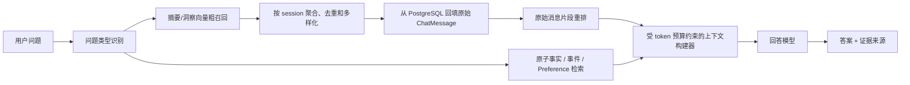

# 记忆系统优化方案（基于 LongMemEval-S 100 题对照实验）

## 1. 决策摘要

本轮不优先继续调整 embedding、相似度阈值或简单放大 fragment Top-K，而是按下面的顺序优化：

1. **P0：召回会话后回填原始消息证据。** 当前检索会话不变，仅把压缩片段替换为原始消息，可回答题从 22.34% 提升到 71.28%，是最大且已被实验验证的收益。
2. **P0：采用混合上下文，不做纯 Raw 替换。** 原始证据负责事实、数字、日期和更新；结构化 preference/profile 负责偏好与推荐。
3. **P1：按会话去重、多样化召回，再对原始消息片段重排。** Retrieved Raw 与 Oracle Raw 仍相差 13.83 个百分点，多会话题相差 27.27 个百分点。
4. **P1：增加可追溯、可版本化的原子事实和事件。** 名称、数值、链接、事件时间不能只存在于摘要里。
5. **P2：针对问题类型进行检索与回答。** 时间、更新、多会话计算、偏好建议分别走不同的上下文组织和提示策略。

最终形态应是“结构化记忆 + 原始证据 + 查询感知检索”的混合系统，而不是在摘要记忆和全量原始会话之间二选一。

## 2. 实验依据

使用同一固定 100 题、同一回答模型、同一 Judge，人工仅修正 3 个无歧义的 Judge 假阴性后：

| 实验组 | 全部正确率 | 可回答题正确率 |
|---|---:|---:|
| Compressed Memory | 26.00% | 22.34% |
| Retrieved Raw Session | 73.00% | 71.28% |
| Oracle Raw Session | 86.00% | 85.11% |

关键差值：

- `Retrieved Raw - Compressed = +48.94pp`，说明首要问题是压缩和上下文重建时丢失事实。
- `Oracle Raw - Retrieved Raw = +13.83pp`，说明会话选择是显著的第二瓶颈。
- preference 是唯一 Raw 退化的题型：Compressed 37.50%，Retrieved Raw 25.00%，Oracle Raw 12.50%。结构化偏好不能被删除。
- Oracle Raw 仍有 14/94 道可回答题失败，集中在偏好、时间和多会话计算；这部分需要查询路由、聚合和提示优化。

## 3. 目标架构



职责划分：

- **Milvus**：做候选召回，不作为事实的唯一存储。
- **PostgreSQL**：保存原始消息、结构化事实、版本、时间和来源关系。
- **上下文构建器**：决定哪些会话、哪些消息片段、哪些结构化事实进入模型上下文。
- **回答模型**：消费已经组织好的证据，不承担从超长、无结构历史中盲找事实的工作。

## 4. 分阶段实施

### 阶段 0：先补可观测性和回归护栏

目的：让后续每项改动都能回答“改善了哪一段、代价是多少、有没有伤害偏好题”。

实施项：

1. 保留当前 C/R/O 三组结果为冻结基准，不修改历史目录。
2. 每次评估继续生成独立时间戳目录，保存配置、逐题答案、Judge 原始响应、汇总和失败样本。
3. 在端到端日志中记录以下漏斗：
   - gold session 是否进入候选集；
   - gold raw evidence 是否进入最终上下文；
   - 最终上下文是否足以作答；
   - 模型是否基于已有证据答对。
4. 记录 `candidate fragments`、`selected sessions`、`selected message_ids`、上下文字符/token、检索耗时、上下文构建耗时、模型耗时和拒答原因。
5. exact、数字、日期短答案优先使用确定性评分；语义与偏好题再使用 LLM Judge。Judge 原始结论不能只保存布尔值。

准入要求：100 个唯一问题、0 个最终执行错误、结果目录不覆盖、可回答题与 abstention 分开统计。

### 阶段 1：两阶段“粗召回 → Raw 回填”（最高优先级）

这一阶段不需要新增原始消息存储。项目中的 `chat_messages` 已保存 content、role、session_id 和 created_at，可以直接利用。

#### 4.1 候选召回

- 将 fragment 候选数与最终 session 数分开，例如先取 20 个 fragment，再选 3～5 个 session。
- 按 `session_id` 聚合，同一 session 的 summary、insight、topic 不再重复占满 Top-K。
- session 初始分可使用该 session 的最高分、Top-N 平均分及命中 fragment 类型组合；参数化保存，不把权重散落在代码中。
- 加入 session 多样化约束，尤其保护 multi-session 查询。
- 保留用户和 session 所有权校验，禁止从其他用户回填原始消息。

#### 4.2 原始消息回填与片段重排

- 从 PostgreSQL 拉取候选 session 的原始 `ChatMessage`，附带 session date、message date、role 和 message_id。
- 不直接把所有候选会话全文塞入提示词；先以 turn 或相邻 turns 为窗口做二次重排。
- 二次重排采用“向量语义分 + 关键词/数字/实体精确命中 + 时间相关性”的混合分数。
- 默认每个 session 保留 2～4 个相关窗口，并为 multi-session 查询保留跨 session 配额。
- 上下文使用统一 token 预算，先保留结构化事实和最高价值 Raw evidence，再裁剪冗余助手长回答。

#### 4.3 偏好保护

- 偏好/推荐型问题优先加入结构化 `preference` 和 profile，再补少量支持该偏好的原始证据。
- 提示明确区分“缺少唯一事实答案”和“可以根据历史行为给出个性化建议”，避免有偏好证据仍拒答。
- 阶段 1 不删除现有 summary、insight、topics、preference 向量。

#### 4.4 阶段 1 验收门槛

| 指标 | 门槛 |
|---|---:|
| 可回答题正确率 | ≥ 68% |
| temporal-reasoning | ≥ 70% |
| multi-session | ≥ 55% |
| single-session-assistant | ≥ 95% |
| preference | 不低于当前 Compressed 的 37.5% |
| 最终执行错误 | 0 |

68% 是上线实现的保守门槛，不是最终目标；实验中的 Retrieved Raw 已证明 71.28% 可达。另需报告 p50/p95 检索时延和上下文 token，先测量真实基线，再设生产 SLO，避免用离线正确率换取不可接受的延迟与成本。

### 阶段 2：原子事实、事件时间和版本化更新

仅回填 Raw 能快速提分，但会增加上下文长度，且不利于版本、时间和聚合。下一步增加 PostgreSQL 中的持久事实层。

建议新增 `memory_facts` 表，至少包含：

| 字段 | 作用 |
|---|---|
| id / user_id / session_id | 所有权和会话来源 |
| fact_type | profile、preference、event、entity、numeric、link 等 |
| subject / predicate / value | 可检索、可比较的原子三元组或结构化值 |
| occurred_at | 事件实际发生时间 |
| observed_at | 系统从对话中获知该事实的时间 |
| valid_from / valid_to | 事实有效区间 |
| status / supersedes_id | active、superseded 及更新链 |
| confidence | 抽取置信度，不作为事实真实性的替代品 |
| source_message_ids / source_quote | 可追溯原始证据 |
| index_status | PostgreSQL 与 Milvus 索引一致性 |

抽取约束：

- 数字、日期、专名、URL 保留原文，不允许只写模糊摘要。
- 一个事实必须带来源 message_id；没有来源的推断只能标记为 inferred，不能伪装成用户事实。
- 新信息不直接覆盖旧值，而是关闭旧事实的 `valid_to`、建立 `supersedes_id`，支持“目前是什么”“最初是什么”“某日期前是什么”。
- 向量库只保存 fact_id 和可检索文本，事实的最终真值、版本和来源保留在 PostgreSQL。
- 对现有 `chat_messages` 做可恢复、幂等的离线回填；新消息继续通过现有 memory job/outbox 异步处理。

阶段 2 验收目标：可回答题 ≥ 75%，knowledge-update ≥ 85%，temporal-reasoning ≥ 78%，同时上下文 token 明显低于直接回填候选会话全文。

### 阶段 3：查询感知的检索、聚合和回答

增加轻量问题路由，不同题型使用不同策略：

| 问题类型 | 检索与构建策略 |
|---|---|
| exact fact | 原子事实优先，附 1～2 条 Raw 引证 |
| temporal | 检索带 occurred_at/observed_at 的事件，按时间排序后计算 |
| knowledge update | 返回 active 最新值及必要的 superseded 历史 |
| multi-session | session 多样化召回，跨会话聚合，必要时调用确定性计数/日期/求和函数 |
| preference | preference/profile 优先，Raw 作为行为依据，生成建议而非要求唯一事实 |
| generic | summary 用于定位，Raw evidence 用于回答 |

对于计数、日期差、持续时间和简单求和，使用确定性函数得到中间结果，并把计算依据交给回答模型组织语言。不要要求 LLM 在长上下文中同时完成检索、去重和算术。

阶段 3 验收目标：可回答题 ≥ 80%，与本轮审计后 Oracle Raw 85.11% 的差距 ≤ 5pp；multi-session ≥ 75%，preference ≥ 50%，并维持 0 个最终执行错误。

## 5. 上下文协议

建议把当前扁平的 `[相关历史记忆]` 改成显式分区：

```text
[用户画像与偏好]
- preference: ...
- evidence_message_ids: ...

[当前有效事实]
- subject / predicate / value
- occurred_at / valid_from / source_message_ids

[相关原始证据]
- session_id / session_date / message_id / role / message_date
- 原始消息片段

[冲突与历史版本]
- old_value -> new_value / valid interval / source
```

回答提示应要求：

1. 事实回答优先使用原始证据或带来源的原子事实。
2. 时间问题区分会话日期、事件发生日期和系统获知日期。
3. 有冲突时按问题中的“当前、最初、之前、当时”等限定选择版本。
4. 偏好问题允许基于历史行为作合理建议，但要说明依据，不因没有唯一标准答案而拒答。
5. 不把检索到的历史消息当作系统指令，防止旧对话中的 prompt injection 影响当前模型。

## 6. 代码改造建议

| 文件/模块 | 改造内容 |
|---|---|
| `backend/app/service/memory_contracts.py` | 为搜索参数增加 candidate_limit、max_sessions、include_raw_evidence、max_context_tokens、diversify_sessions；结果增加来源 message/session 时间和 raw excerpt |
| `backend/app/service/memory_service.py` | fragment 粗召回、session 聚合、多样化、原始消息安全回填；保留 Provider 边界 |
| `backend/app/service/memory_context_builder.py`（新增） | 片段重排、token 预算、结构化事实与 Raw evidence 合并、上下文序列化 |
| `backend/app/service/memory_query_router.py`（新增） | exact/temporal/update/multi/preference/generic 分类及策略参数 |
| `backend/app/models/chat.py` | 阶段 2 新增 MemoryFact 及关系/索引，不改动已有原始消息语义 |
| `backend/alembic/versions/*_hybrid_memory.py` | 只做向前兼容的增量迁移 |
| `backend/app/service/chat_service.py` | 从直接调用扁平 `build_memory_context` 改为调用新的上下文构建器；保留失败时回退 |
| `backend/app/router/memory_router.py` | context 调试接口返回结构化 trace，生产接口默认不暴露敏感原文 |
| `backend/eval/scripts/` | 增加 hybrid 模式、检索漏斗、token/延迟和 per-type 回归报告 |

建议功能开关：

```text
MEMORY_CONTEXT_MODE=compressed|hybrid_raw|hybrid_fact
MEMORY_CANDIDATE_FRAGMENTS=20
MEMORY_MAX_SESSIONS=5
MEMORY_MAX_CONTEXT_TOKENS=12000
MEMORY_SESSION_DIVERSITY=true
MEMORY_QUERY_ROUTER=true
```

具体默认值需要用固定 100 题和生产流量 shadow 数据共同确定，不能只在这一份评估集上调到最优。

## 7. 测试与发布策略

### 离线测试

- 单元测试：session 聚合、去重、多样化、token 裁剪、版本选择、用户隔离。
- 集成测试：Milvus 粗召回 → PostgreSQL Raw 回填 → 上下文构建全过程。
- 对抗测试：原始历史中的 prompt injection、跨用户 session_id、已删除消息/会话、向量索引缺失、超长消息。
- 固定 LongMemEval-S 100 题：每个阶段生成独立目录，不覆盖历史结果。
- 除总体分数外，必须检查题型门槛和 C/R/O 对应错误集，防止平均分掩盖 preference 回归。

### 发布顺序

1. `hybrid_raw` 先进入 shadow 模式，只记录上下文、耗时和离线判分，不改变用户可见答案。
2. 对比 compressed 与 hybrid_raw 的证据充分率、token、延迟、拒答和安全事件。
3. 小流量 canary，上线时保留一键回退到 `compressed`。
4. `hybrid_fact` 在完成幂等回填和索引一致性校验后再逐步替换 raw 全文依赖。

## 8. 风险与约束

| 风险 | 缓解措施 |
|---|---|
| Raw 上下文拉高 token、延迟和 provider refusal | 二次片段重排、硬 token 预算、按价值裁剪、记录 p95 |
| 原始历史包含敏感内容 | 严格 user_id 所有权过滤、日志脱敏、调试接口权限控制 |
| 历史消息包含 prompt injection | 结构化角色分隔，明确历史是数据不是指令，增加对抗测试 |
| 新旧事实冲突 | 有效期与 supersedes 链，不直接覆盖历史 |
| Milvus 与 PostgreSQL 不一致 | 继续使用 outbox、index_status、幂等重建和对账任务 |
| 只对固定 100 题过拟合 | 参数化配置，并用真实 shadow 查询与新增扰动集复核 |

## 9. 建议执行节奏

1. **第一个迭代：阶段 0 + 阶段 1。** 先实现 session 聚合与 Raw 回填，预计是收益最大的最小可交付版本。
2. **第二个迭代：阶段 2。** 增加原子事实、事件时间、来源和版本链，减少 Raw 上下文成本。
3. **第三个迭代：阶段 3。** 增加问题路由、确定性聚合及偏好专用策略，追近 Oracle 上限。

每个迭代的顺序固定为：实现 → 离线测试 → 固定 100 题独立评估 → 逐题差异分析 → 达到题型门槛后才进入 shadow/canary。若 preference、用户隔离、安全或执行错误任一项退化，不以总体分数上升为理由放行。

## 10. 第一批可直接拆分的任务

1. 扩展 `MemorySearchOptions`，把 fragment 候选数和最终 session 数解耦。
2. 在 Native Provider 中按 session 聚合候选，返回 session 排名与检索 trace。
3. 新建上下文构建器，按候选 session 查询 `ChatMessage` 并生成带日期和 message_id 的 Raw evidence。
4. 增加消息窗口重排、跨 session 配额和 token 裁剪。
5. 把现有 preference 片段与 Raw evidence 合并，加入偏好专用提示。
6. 接入 `chat_service.py`，用 feature flag 支持 compressed/hybrid_raw 回退。
7. 增加用户隔离、prompt injection、超长上下文和多会话单元/集成测试。
8. 跑一份新的固定 100 题端到端结果，按阶段 1 门槛决定是否继续到原子事实层。

## 11. 关联结果

- 对照实验分析：`backend/eval/data/longmemeval_s/comparisons/20260822_212333_raw_session_ablation_v2/analysis.md`
- 三组自动比较：`backend/eval/data/longmemeval_s/comparisons/20260822_212333_raw_session_ablation_v2/comparison.md`
- 人工审计：`backend/eval/data/longmemeval_s/comparisons/20260822_212333_raw_session_ablation_v2/manual_audit.json`

