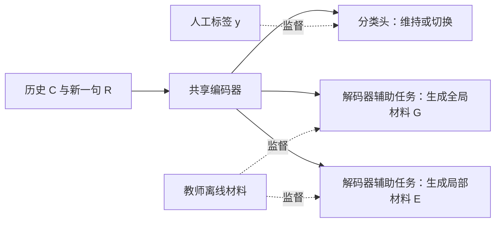

# DMF 双过程话题切换检测：通俗解读、实现方案与论文实验分析

## 1. 日期、对象与证据边界

- 评估与分析日期：2026-10-18，Asia/Singapore。
- 对象：Wang 等人的 *Simulating Dual-Process Thinking in Dialogue Topic Shift Detection*，COLING 2025，2592–2602 页。
- 本次工作：阅读原文，核对图 2、公式 1–5、表 2–5、附录 A/B，并整理实现方案。没有训练模型、调用教师生成训练集，也没有在本项目运行话题检测评测。
- **已测量**：下文数字均为论文作者报告的实验测量；本次仅转录、核对与分析，不能当作本项目实测。
- **间接推断**：辅助监督可能改善共享编码器表示；二分类结果不足以覆盖本项目四种话题关系。
- **尚未评估**：本项目真实对话效果、延迟、显存、成本、超长会话和四分类改造效果。

来源与原始结果：

- [ACL 论文主页](https://aclanthology.org/2025.coling-main.177/)。
- [论文原文 PDF](../backend/eval/data/DMF论文解读-20261018/DMF话题切换检测论文原文.pdf)。
- [公开实验结果转录 JSON](../backend/eval/data/DMF论文解读-20261018/论文公开实验结果转录.json)：保留表 2–5 的数据、配置、出处和原文 SHA-256。它是公开结果转录，不是本地推理日志。

## 2. 用一个例子理解任务

假设对话先聊“新能源汽车销量”，再聊“动力电池”，现在用户说：

> 回到刚才的销量，去年增长主要来自哪里？

这句话回到了旧话题，但相对于最近的“动力电池”，仍然发生了话题切换。因此：

- 是否切换：比较新一句与最近正在讨论的话题。
- 是否首次出现：比较新一句与所有历史话题。

这两个问题不同。论文图 1 中也把“从摄影回到此前的户外活动”标为切换。

DMF 的想法可以理解为：给模型同时上两门课，一门学习整段对话的话题脉络，一门学习当前这一句为什么接得上或接不上。这里的“双过程”是认知理论启发的建模方式，不是对人脑机制的验证。

## 3. 两个模块各自学习什么

| 模块 | 通俗作用 | 教师生成的训练材料 |
| --- | --- | --- |
| 直觉模块 | 记住一路聊过什么，形成话题地图 | 按时间排列的历史话题结构，以及当前话题和切换结论 |
| 推理模块 | 看清新一句与最近话题之间的具体关系 | 最近话题、当前话题、延续或切换的简短原因 |

例如历史话题结构可以是“新能源汽车销量 → 动力电池”。局部说明则可以是“最近在讨论动力电池；新一句询问此前的汽车销量增长原因，因此切回销量话题”。

论文的“全局结构”主要是话题序列，不能直接理解为已经实现了向量数据库、知识图谱或可持久化的生产记忆系统。

## 4. 按论文思路实现

### 4.1 准备逐轮标注数据

每个训练样本包含历史 C、新一句 R 和人工标签 y：

```json
{
  "dialogue_id": "示例会话一",
  "context": [
    {"role": "user", "text": "分析新能源汽车销量。"},
    {"role": "assistant", "text": "销量分析……"},
    {"role": "user", "text": "接着说说动力电池。"},
    {"role": "assistant", "text": "动力电池分析……"}
  ],
  "response": "回到刚才的销量，去年增长主要来自哪里？",
  "label": 1
}
```

这是自拟格式示例，不是论文公布的实际数据格式。0 表示维持最近话题，1 表示切换。标注边界应先定义清楚：细节追问、换表达方式和真正换主题应如何区分。

按完整会话划分训练、验证和测试集，再展开逐轮样本，避免同一会话进入不同集合。若多个会话引用同一研究报告，项目评测还应检查报告是否跨集合泄漏。当前样本只能看到该轮之前的历史，不能看到未来消息。

### 4.2 离线制作两类教师材料

**全局材料 G：** 仅在训练材料构造阶段，使用历史真实标签把 C 切成话题块，让 GPT-4 为各块提炼主题，得到有先后顺序的历史结构。按照第 3.3 节的目标格式，再组织当前话题和真实切换结论。

中文提示词示意，可由实现者调整：

```text
下面是已经按人工边界分段的历史对话。
按原顺序为每段提炼简短主题，只返回主题列表。
不要合并相隔的同名主题；不要加入当前新一句或未来消息。
```

**局部材料 E：** 给 GPT-4 输入 C、R 和已知的训练标签 y，请它提炼最近话题、R 的话题，并给出与标注相符的简短说明。这是附录 B 的核心做法：教师是在解释已知标签。

```text
给定历史对话、新一句和人工标签：
提炼最近话题、新一句的主题，并简短说明它们为何延续或切换。
只使用输入中的内容，不要编造事实。
```

教师材料可存为训练记录中的 `global_target` 与 `local_target`。材料应抽查：是否把细节当新主题、是否忽略“回到刚才”、理由是否只是换一种方式重复标签。

测试输入不得出现真实 y、根据真实边界生成的主题列表，或包含正确答案的教师解释。真实标签只用于离线评分。训练材料含标签是监督学习；把这些答案材料当作测试输入则会泄漏。

### 4.3 用一个小模型同时完成三项训练任务

论文采用编码器—解码器结构，英文实验使用 T5，中文实验使用 mT5。历史和新一句共同输入编码器；一个分类头输出 0/1；解码器分别学习生成 G 和 E。



训练目标为：

```text
总损失 = 分类损失 + λ1 × 全局生成损失 + λ2 × 局部生成损失
```

论文设置 λ1 = λ2 = 1。分类使用交叉熵，两项生成使用目标序列的自回归负对数似然。

下面是结构伪代码，不是已在仓库实现或验证的训练程序：

```python
# C 和 R 中保留说话人及轮次边界。
H = encoder(serialize(C, R), attention_mask=mask)
pooled = pool(H, mask)
logits = classifier(pooled)                   # [batch, 2]

loss_cls = cross_entropy(logits, y)
loss_global = decoder_nll(H, G, task="global")
loss_local = decoder_nll(H, E, task="local")
loss = loss_cls + lambda_1 * loss_global + lambda_2 * loss_local
loss.backward()
optimizer.step()
optimizer.zero_grad()
```

实现时需要显式确定的细节：

1. `pool` 如何将编码器状态变成分类向量。论文写有 `[CLS]`，但 T5 没有 BERT 式的原生分类接口；若新增分类 token，要同步扩展词表和嵌入。采用带掩码平均池化则是另一种工程选择。
2. 两项生成任务共用解码器时，可以用不同解码起始标记区分目标；这是可选实现设计，论文没有充分交代任务区分的代码细节。不能把两种目标简单拼接后声称与两项独立损失完全等价。
3. Padding 不参与损失。论文公式按目标 token 求和，常见库默认可能按 token 求平均；必须记录归约方式，否则相同 λ 未必有相同权重。
4. 固定输入长度、截断规则、教师输出版本和随机种子，才能让比较可追溯。

### 4.4 推理时直接输出分类

按图 2 和第 3.4 节的分类路径，分类器直接读取编码器表示，没有要求把生成的 G/E 再输入分类器。因此可以实现：

```python
H = encoder(serialize(history, current_utterance), attention_mask=mask)
probabilities = classifier(pool(H, mask)).softmax(dim=-1)
shift = probabilities.argmax(dim=-1)
```

若只需要切换信号，这条路径无需调用教师，也无需执行解码器逐 token 生成。若另行生成解释，应单独检查解释质量；解释看起来合理，不等于它忠实反映了分类依据。

“容易的先快速判断，困难的才调用大模型”可以成为后续产品方案，但不是本文已经给出的按置信度升级机制。

## 5. 数据、配置与核心指标

依据表 2，划分顺序均为训练／验证／测试：

| 数据集 | 语言与来源 | 会话数 | 待检测轮次数 |
| --- | --- | --- | --- |
| TIAGE | 英语，PersonaChat | 300／100／100 | 4092／1346／1364 |
| CNTD | 中文，NaturalConv | 1041／134／133 | 19902／2558／2538 |
| SuperDialseg | 英语，Doc2dial、MultiDoc2Dial | 6948／1322／1322 | 85203／16412／16006 |

论文报告 batch size 4，AdamW，预热，英文学习率 1e-5、中文 1e-4，学生训练 20 epochs。LLaMA-3.1-8B 对照采用 LoRA，rank 8、alpha 16、训练 5 epochs；GPT 对照为 zero-shot。论文未充分交代学生模型的精确尺寸／checkpoint、教师快照、输入长度、随机种子、预热比例、池化等细节。本报告不补造这些参数。

表 3 的 Macro-F1，以百分数计：

| 模型 | TIAGE | CNTD | SuperDialseg |
| --- | ---: | ---: | ---: |
| T5／中文 mT5 基线 | 73.9 | 81.1 | 87.4 |
| BART 基线 | 78.2 | 83.6 | 87.3 |
| Lin 方法 | 76.2 | 84.7 | 未列出 |
| DMF(BART) | 79.3 | 84.9 | 87.8 |
| DMF(T5)／中文 mT5 | 80.4 | 85.1 | 88.3 |

DMF(T5) 相对同骨干基线提升 6.5、4.0、0.9 个百分点。CNTD 相对 Lin 的差距为 0.4 个百分点，不能将“比同骨干提升 4.0”表述成“比此前最佳提升 4.0”。

闭源 GPT 与学生模型的训练条件不同。论文中的比较支持特定任务、数据和提示词条件下的结果，不能推出“小模型在一般任务上超过 GPT-4”。小模型参数更少，也不能替代实际延迟与成本测量。

## 6. 消融、逐类分析及失败样例

### 6.1 两种监督分别有什么贡献

表 4 中 T5 的 Macro-F1：

| 训练方式 | TIAGE | CNTD | SuperDialseg |
| --- | ---: | ---: | ---: |
| 仅分类基线 | 73.9 | 81.1 | 87.4 |
| 加历史结构监督 | 78.6 | 84.4 | 87.9 |
| 加局部理由监督 | 79.1 | 84.8 | 88.1 |
| 两种都加 | 80.4 | 85.1 | 88.3 |

结果支持两类监督在这组设置中都有帮助，两者联合更好；不能将提升完全归因于“模拟人类思考”。对 BART，TIAGE 的历史结构单项仅提高 0.1，说明不同骨干上的增益并不均匀。SuperDialseg 增益较小，作者将其与较大训练集和任务构造差异联系起来；本次未独立验证该归因。

### 6.2 真正发生切换时仍会漏检

表 5 中 DMF(T5) 的逐类结果：

| 数据集 | Maintain 测试数 | Shift 测试数 | Maintain F1 | Shift F1 | Shift 召回率 |
| --- | ---: | ---: | ---: | ---: | ---: |
| TIAGE | 1066 | 298 | 92.0 | 68.8 | 64.4 |
| CNTD | 1985 | 553 | 94.0 | 76.1 | 71.7 |
| SuperDialseg | 11986 | 4020 | 93.8 | 82.8 | 87.4 |

两类数量不均衡，整体 Macro-F1 也不能替代 Shift 单类指标。TIAGE 的 Shift 召回率 64.4，意味着按作者报告的四舍五入指标，仍约漏掉 35.6% 的实际切换；不能将 80.4 的 Macro-F1 解读成切换召回率。

### 6.3 失败模式与具体例子

论文第 4.6 节报告：问候过后的轻微内容变化，容易被误判为切换；模型仍可能过度依赖新词，未理解自然过渡。论文未提供可在本地逐题核查的错误预测日志，不能据此编造样本 ID 或精确错误数。

便于理解的自拟例子：

> “最近怎么样？”→“挺好的，今天刚跑完步。”

在把这段标为连续寒暄的标注口径下，模型若仅因出现“跑步”而输出 Shift，就是上述类型的误报。这是教学示例，本次没有输入模型，不能记为实测失败。

本项目还应覆盖以下未测风险样例：

| 自拟场景 | 应核查的关系 | 可能出错的原因 |
| --- | --- | --- |
| “上面的增长率，改成同比口径。” | 同话题的修改请求 | 任务操作变化被当作话题变化 |
| “先不谈电池，回到刚才的销量。” | 切换并返回旧话题 | 命中历史就误判为未切换 |
| “那它的成本呢？” | 先解析“它”指代什么 | 缺乏实体与成果引用信息 |
| 一句话同时包含两项研究请求 | 先定义标注单位 | 单一 0/1 难以表达混合意图 |

这些场景尚未评估，不构成论文或本项目的实际错误统计。

## 7. 在本项目怎样落地

源码核查到 [SessionTaskDecision](../backend/app/service/session_task_service.py) 已包含 `continue`、`return_to_previous`、`new`、`uncertain` 四种关系，并校验成果引用。二分类 DMF 不能直接取代这一决策结构：

| DMF 的信号 | 业务上仍需分辨 |
| --- | --- |
| 未切换 | 是否是继续追问、修改、补证；是否有未解析指代 |
| 已切换 | 返回哪一个旧话题，还是开始全新话题 |

建议分两个阶段，以下均为工程建议，尚未实施：

1. **先验证材料设计。** 在现有路由输入中明确呈现有时间顺序的话题摘要，以及最近原文与当前请求；要求输出最近主题、当前主题、关系依据和目标引用。用 LLM 直接完成这一步是借鉴 DMF 的原型，不是论文的小模型蒸馏复现。
2. **再决定是否蒸馏。** 收集代表性对话和人工关系标签，离线制作历史结构与简短关系说明，训练共享编码器、辅助生成任务和分类头。若把分类头改成业务三类关系，或另外做“返回／全新”判断，都属于任务扩展，要重新验证。

`uncertain` 可以表示证据不足、指代未解或经验证集校准后的低置信度；不要把语言模型自报的“置信度”直接当成可靠概率。`depends_on_history`、`target_artifact_ref` 与具体任务操作仍需独立检查，不能只由一个切换布尔值推出。引用必须来自服务端授权候选，延用当前验证约束。

如维护增量话题列表，应记录主题 ID、起止轮次、简短摘要与相关成果引用；重复出现同一主题时保留时间上的分段，避免丢失 A→B→A 的变化。增量持久化是项目工程方案，不能声称论文已验证了这种存储实现。

## 8. 局限性、结论与下一步

主要局限：标签粒度影响结论；教师看到标签后生成的解释可能事后合理化；辅助目标质量不等于解释忠实性；真实边界只用于训练的材料构造，测试时不能借用；超长对话、行业研究语境和多成果会话均不能直接继承公开基准效果。

论文最可迁移的贡献是：用“全局话题结构 + 局部关系说明”作为两种辅助监督训练同一个小模型。它不是简单比较两个向量，也不是必须在线运行两个大模型。

下一步如需实现，应先确定本项目标注口径，再按会话／成果隔离数据，对比“仅分类、加全局、加局部、两者都加”。除 Macro-F1 外，报告切换类精确率和召回率、返回旧话题识别、成果选择准确率，以及延迟和成本；失败题必须保留原输入与预测。未来每次实验应新建中文运行目录和结果报告，不覆盖本次文献分析。
