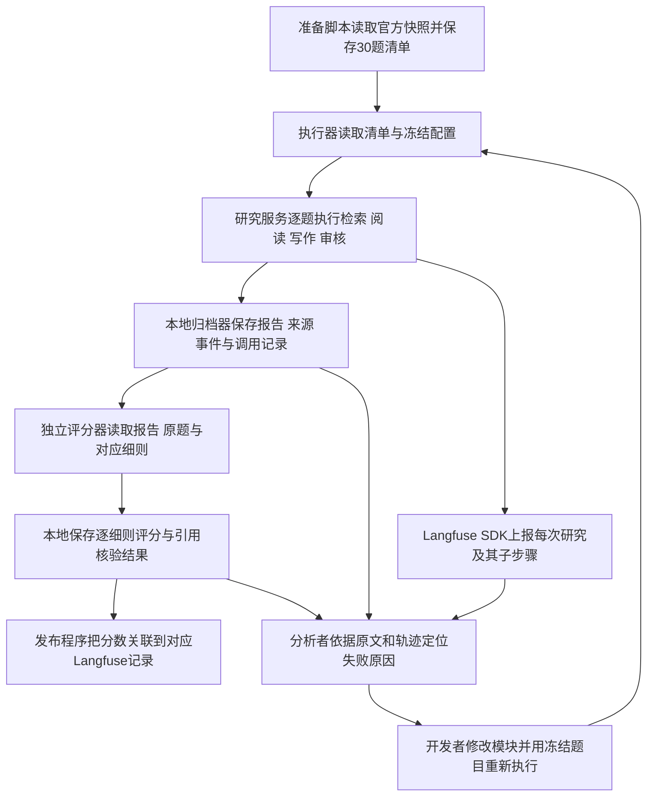

# DeepResearchBench三十题评测与Langfuse监控需求分析及实施方案

方案日期：2026-11-08，Asia/Singapore。版本：第一版。用户已确认样本来源为 DeepResearchBench 公开基准。本方案沿用项目已经使用的第一代 DeepResearchBench。

2026-11-08用户修订：采用旧18道中文题加12道官方中文原题，30题全部作为验证集，另选30道测试题；本轮离线裁判改为GPT-6 Astra与Claude，在线Critic改为三维。本文保留第一版设计记录，当前要求和实施结果以[中文验证集与裁判改造记录](DeepResearch中文验证集与GPT双裁判及三维Critic实施验证-20261108.md)为准。

建议建立一条可以反复执行的流程：**冻结30道题和运行配置 → 记录当前系统生成报告的全过程 → 用独立离线裁判评分 → 根据轨迹定位失败原因 → 每次针对一个原因修改 → 用相同题目比较修改前后，并在保留题上验证。**

本次完成的是需求分析、源码静态核查和实施设计，没有启动30题生成、模型评分或远端监控写入。方案建议默认采用15道中文、15道英文，其中20道用于分析和优化，10道保留到最终验证。语言比例、质量门槛与预算是本方案的建议值，尚未成为实际运行配置。

## 一 需求与验收目标

你的目标包含六项相互依赖的工作。只有报告得分与执行过程能够对应起来，失败分析才能指导修改。

| 工作 | 执行者与对象 | 必须交付的结果 |
| --- | --- | --- |
| 构建评测集 | 数据准备脚本从固定版本官方题库抽取原题 | 30题清单、抽样方法、来源版本、细则、分组和历史使用记录 |
| 接入监控 | 研究服务将每次研究及其模型、工具操作上报 Langfuse | 能从某题报告找到该次执行的完整过程及错误 |
| 批量生成 | 执行器逐题调用当前 `DeepResearchV2Service.research()` | 每题均有终态；成功保存报告，失败保存原因与已有过程 |
| 独立评分 | 离线评分器读取冻结报告、原题和对应细则 | 每份正式交付报告有细则分、维度分、总分、理由和评分状态 |
| 失败归因 | 分析者连接评分证据、研究步骤和来源原文 | 每个失败案例有可定位证据、原因假设和验证方法 |
| 定向优化 | 开发者修改原因对应的模块，再运行比较 | 修改前后逐题分差、失败变化、时间与成本变化、保留题结果 |

“所有报告”在第一版中指每轮正式评测、每次有效执行交付的最终报告；中途草稿全部归档，针对失败案例再补评草稿，避免默认给每个草稿重复支付全套裁判成本。没有生成报告的任务也必须保留评测记录，但报告质量标记为不适用，不能伪造一个裁判分数。

## 二 当前仓库已有能力与实际缺口

| 核查项 | 当前证据 | 对本轮实施的影响 |
| --- | --- | --- |
| 官方题库 | 历史冻结快照包含100题，中文50题、英文50题，22个领域 | 可以使用已保存、可核验版本的数据准备新清单 |
| 历史30题 | 2026-10-07按固定种子抽取30篇官方参考报告，中文18篇、英文12篇 | 这是评分器一致性实验，不能替代当前系统生成30篇报告的基线 |
| 生成入口 | `run_deepresearch_bench.py`调用当前真实研究服务，记录完成事件和失败 | 可以复用业务入口，不需要重新实现研究流程 |
| 数据准备 | 执行器默认读取的 `backend/eval/data/deepresearch_bench/query.jsonl` 本次不存在 | 实施时必须显式准备输入；仅照抄旧运行命令不能保证启动 |
| 抽样方式 | 当前 `--limit` 按已有顺序截取，默认语言为中文 | `--limit 30`不等于随机抽30题；新入口必须读取冻结清单并校验题号 |
| 逐题归档 | `run_one()`支持`artifact_dir`，默认批量调用没有传入它 | 正式批量运行必须启用逐题报告、事件和失败产物归档 |
| 完整采集脚本 | `采集通用研究评测集.py`已有源码快照、历史与事件导出 | 它固定五道中文题，并关闭部分引用/摘要核验；只能提取通用能力，不能直接当当前系统默认基线 |
| Langfuse | 已有模型调用、Scout、搜索、读取工具埋点；依赖固定`langfuse==4.15.1` | 主要工作是启用、核验覆盖、补研究根节点和实验关联，不是从零引入SDK |
| 监控状态 | 代码默认`LANGFUSE_ENABLED=false`，失败时告警并继续研究 | 本次未读取密钥或连接远端，不能据源码判定实际部署已经启用或关闭 |
| 离线评分 | 已有双裁判逐细则评分、重复评分、响应校验和加权汇总 | 历史脚本固定输入目录和参考报告，需要改为可传入新生成报告的通用入口 |
| 评分差异 | 当前在线Critic四维百分制；离线细则0—10分；本地RACE另有参考报告相对分 | 三者必须使用不同指标名，不直接合并均值 |
| 当前代码版本 | 工作区存在已修改文件和未跟踪的新提示词、评审契约 | 只记录Git提交号不足以复现实验，必须保存本次实际执行源码与提示词 |

对应源码：[批量执行器](../backend/eval/scripts/run_deepresearch_bench.py)、[完整采集脚本](../backend/eval/scripts/采集通用研究评测集.py)、[Langfuse埋点](../backend/eval/runtime/langfuse_tracing.py)、[逐细则双裁判](../backend/eval/scripts/DeepResearchBench参考报告双裁判一致性.py)、[加权计算](../backend/eval/scripts/生成DeepResearchBench评分页面与分析.py)、[当前在线审核契约](../backend/app/service/deep_research_v2/review_contract.py)。

另外发现两项需要在正式基线前处理的口径风险：

1. `record_generation()`在模型调用结束后创建Langfuse观测，并将`duration_ms`放入元数据。需要验证界面中的调用起止时间是否真实反映模型执行耗时；否则瀑布图可能显示“写日志所用的时间”。优先在真实调用前后建立观测，不改变业务模型请求。
2. 旧的[本地RACE/FACT脚本](../backend/eval/scripts/evaluate_race_fact_claude.py)会跳过未匹配细则，FACT提示词还允许“部分支持”判为支持。这与严格的细则完整性、完整来源支持口径不同。第一版不能把这些结果不加区分地接入主指标。

以上属于源码可见事实和待验证风险，不是新30题的性能结论。

## 三 30题如何抽取和使用

### 题库与抽样规则

优先复用已有官方快照对应的提交`469cce54ea7f6a63c163d3d9fec879cf289ec484`，冻结题目、评分细则和参考报告三个文件，并记录文件指纹。文件指纹是程序根据文件内容生成的校验值，用来发现输入是否被修改。若改用更新版本，应一次性重新冻结这三个文件，不能混用不同版本。

第一版采用以下可复现规则：

1. 准备脚本按题号排序候选题，先记录历史使用情况，包括是否生成过报告、是否用于改提示词、是否查看过官方参考报告。
2. 从未参与项目调优、且未查看过参考答案或详细评分的候选题中，按固定种子`20261108`选出10道保留题，中文和英文各5道。
3. 从剩余候选中抽20道开发题，中文和英文各10道；历史已使用题可以进入开发组，但必须打上历史暴露标签。
4. 脚本保存候选列表、排除原因、抽样顺序、最终题号和实际算法。语言内执行固定种子的随机抽样，不根据分数、运行成功与否替换题目。
5. 在开始运行前统计领域和任务要求，例如时间限定、数字比较、多来源证据和长报告。它们用于解释覆盖情况，不作为跑完后的换题理由。30题不能保证每个细分领域都有稳定统计量。

若没有足够符合上述条件的保留题，应将这轮定位为“30题回归与问题发现集”，明确它包含已见任务；不能通过换一个随机种子把旧题称为未见题。真正的未见验证需要另外准备未用于调优的任务。

默认15中15英是为了保留公开基准的双语范围。如果产品明确只服务中文用户，可以改为30道中文，并把结论限定为中文子集。原题不翻译、不改写，不把题目中的历史年份自动改成2026年。对“当前”等相对时间词，准备阶段统一记录解释规则；如需按当前日期改写，应另建任务版本和匹配细则。

官方将报告质量与引用可信性分别设计为RACE和FACT，任务、细则与报告应保持对应。[DeepResearchBench官方说明](https://github.com/Ayanami0730/deep_research_bench)

### 开发题与保留题的使用边界

开发题用于查看失败、修改代码和反复比较。保留题用于检查修改是否也对未据其结果调优的任务有效。

- 基线可以自动生成和评分全部30题，但分析者在调优期间只查看20道开发题的内容与质量结果；10道保留题的报告、质量分和细节保持封存，运维仅查看是否执行及评分完成。
- 修改完成并冻结候选版本后，再运行全部30题，最后一次性查看保留题的基线与候选结果。
- 保留题一旦被用于决定下一次修改，就转为开发题。之后再次使用这些题，只能称为回归检查。
- 如果你的目的就是对全部30题逐题归因和优化，也可以把30题全设为开发集，再从剩余题库增加独立验证题；这会扩大本轮题数与预算。

细则、参考报告和离线裁判意见只供评估器使用，不能传给受测研究服务，也不能预装进研究服务可检索的资料库。

## 四 Langfuse如何连接任务 报告和执行过程

Langfuse负责保存和展示过程记录。一次研究的整条过程称为`trace`，例如“第12题第一次生成”；其中一次搜索、一次网页读取或一次模型请求称为`observation`。评测执行器负责将它们与题目、报告和分数关联。

Langfuse支持使用数据集组织实验，也支持把外部评分程序生成的分数关联到执行记录，因此可以保留现有评分算法，由本地程序将结果上传。[实验接口说明](https://langfuse.com/docs/evaluation/experiments/experiments-via-sdk)、[评分对象说明](https://langfuse.com/docs/evaluation/scores/data-model)



### 运行身份与记录内容

每条结果至少保存`dataset_version`、`task_id`、`split`、`experiment_id`、`attempt_id`、`research_run_id`、`session_id`、`trace_id`、`report_sha256`和`evaluator_version`。前四项分别标识题库版本、题目、分组和这一轮配置；`attempt_id`区分同一题的不同执行尝试。运行服务已有的`research_run_id`继续表示一次实际研究，避免把批次时间戳误当单题执行ID。

同一题重试时创建新的研究运行和trace。评分结果同时绑定实际trace与报告指纹，防止改写后的报告误用旧分数。应保存SDK返回的实际trace ID；当前代码的确定性ID映射与新的实验根节点需要统一，不能另外生成一套互不相连的ID。Langfuse允许关联外部运行ID，也提供获取实际trace ID的方法。[trace关联说明](https://langfuse.com/docs/observability/features/trace-ids-and-distributed-tracing)

| 层次 | 需要观察的数据 | 帮助回答的问题 |
| --- | --- | --- |
| 整题研究 | 原题、配置版本、完成状态、最终报告、耗时 | 哪题失败，哪轮结果对应哪篇报告 |
| 规划与检索 | 子问题、搜索词、返回URL、来源选择、预算消耗 | 是问题拆错，还是没找到相关来源 |
| 网页读取 | URL、状态码、抽取器、正文长度、正文快照位置 | 是网页不可达，还是正文或表格丢失 |
| 上下文处理 | 输入历史、压缩前后内容、证据ID、字数或token | 信息是否已经找到，却在后续丢失 |
| 写作与审核 | 写作使用的证据、草稿、问题ID、返工和复审状态 | Writer是否遗漏证据，Critic意见是否被正确落实 |
| 引用核验 | 最终论断、实际引用、证据句、判定与未知原因 | 报告说法是否得到所引材料完整支持 |
| 模型请求 | 实际模型标识、提示词版本、起止时间、usage、错误 | 开销集中在哪里，是否存在失败重试或解析异常 |

实施时优先复用现有Scout和工具埋点，在研究入口增加根观测，并通过统一节点包装补齐其他阶段。子任务并发时必须验证父子关系与题号不串联。生成过程与离线评分使用不同阶段标签，分别统计用量和成本。

### 配置与可靠性

- 使用现有`EVAL_TRACE_ENABLED`、`LANGFUSE_ENABLED`、`LANGFUSE_PUBLIC_KEY`、`LANGFUSE_SECRET_KEY`、`LANGFUSE_BASE_URL`配置；由运行环境提供密钥，不写进报告或完整环境快照。
- 本轮优先保持仓库锁定的SDK版本。官方现行文档包含后续版本的接口变化，新增数据集和实验调用应按实际安装版本核验，不能把新版示例直接复制到旧环境。若确需升级，独立完成迁移与验证，再冻结基线；不增加新旧双套兼容层。[Langfuse实验SDK说明](https://langfuse.com/docs/evaluation/experiments/experiments-via-sdk)
- 评测期间将采样率设为全量，启用本地完整过程文件。线上监控异常时，研究服务可以继续；评测执行器必须将该题标为“监控不完整”，在补齐前不把它作为完整归因样本。
- SDK通常先将记录放入进程内存中的发送队列。程序调用`flush()`只是在请求SDK处理待发送记录，不能据此宣称远端已经完整保存；执行器应按ID查询远端是否能读回关键节点和分数。
- 本地归档器将内容写入文件并关闭后，数据可能仍在操作系统缓存中。若验收要求断电级持久化，需要对关键终态和清单显式`fsync`，并对临时文件替换及目录更新采用相应持久化步骤；普通文件关闭不能等同强制写入物理磁盘。
- 保存脱敏后的请求和响应，排除认证请求头、连接凭证。长正文保留本地完整文件和哈希，监控平台如有载荷限制，应明确标记截断及对应完整文件位置。

## 五 复用现有评估体系的具体口径

### 报告质量主指标

建议以现有“官方逐题细则＋独立双裁判”为第一版主指标：全面性、洞察力、指令遵循、可读性。执行器把新生成报告填入待评对象，评分器读取该题完整细则；每个裁判独立评分两次。

先在每个维度内按细则权重计算分数，再按官方维度权重计算总分；同一裁判的两次评分先取平均，再对两位裁判取平均。保留0—10原始尺度。这个流程复用已有[加权实现](../backend/eval/scripts/生成DeepResearchBench评分页面与分析.py)，不另造一套综合分。

每份合格响应必须满足：细则ID无缺漏与重复、分数有限且在范围内、理由完整、引用摘录可定位、流式响应完整结束。格式不合格或调用中断记为“评分失败”，只补跑评分，不重新生成报告。缓存键包含任务、报告、细则、完整提示词、实际模型和请求参数的指纹，避免读取不同输入的旧结果。

两裁判的模型沿用可用的既有配置，在预跑时确认实际返回的型号并冻结。不能因为某个模型分数较低而换裁判。报告正文作为待评资料处理，其中的任何指令不能改变评分规则。

| 结果 | 用途与边界 |
| --- | --- |
| 在线Critic百分制分数 | 解释生成过程中为何返工或交付；不能代替独立最终质量评价 |
| 本地逐细则双裁判0—10分 | 本轮主要质量指标；符合项目既有评价方式 |
| RACE相对参考报告分 | 如需对外比较，再独立运行固定版本官方流程；不能把本地0—10分乘10后称为官方RACE分 |
| FACT或独立引用支持结果 | 评价被引用材料是否支持说法；不能直接等同所有事实在现实中都正确 |

官方RACE使用任务对应的细则及参考报告比较，FACT则提取论断与URL并验证支持关系。更换裁判、正文清洗器、网页读取器或评分规则，都需要记录为不同的评估配置。[DeepResearchBench官方评估说明](https://github.com/Ayanami0730/deep_research_bench)

### 引用质量与运行指标

每份正式报告均保留生产核验结果，同时由离线流程对冻结的最终报告和来源材料进行独立审计。可复用抽取、定位与读取组件，但独立裁判不得把生产核验标签当答案；两条链路共享的组件也要记录，以免把共同错误误认为相互验证。

至少输出以下指标，分母随指标一起保存：

| 指标 | 计算方式 |
| --- | --- |
| 任务完成率 | 正常交付非空终稿的题数／固定30题；开发组和保留组另算 |
| 评分完成率 | 完成规定双裁判重复次数的报告数／需要评分的终稿数 |
| 报告质量 | 有效报告的总分和四维均分、中位数、逐题分；同时披露失败任务数与缺失评分 |
| 可判断引用支持率 | 完整支持的论断与引用关系数／可判断的关系数 |
| 全量支持与未知比例 | 完整支持数／全部已抽取关系数；未知数／全部已抽取关系数 |
| 引用覆盖 | 已抽取的需外部证据论断中，有有效引用的论断占比；不能声称覆盖所有真实事实 |
| 信息量 | 被完整支持的不同论断数量；防止通过删掉大部分内容获得漂亮支持率 |
| 资源消耗 | 每题端到端耗时、中位数与P95、模型token、检索/读取调用数、重试数、费用 |
| 监控完整性 | 已具备规定关键节点和本地归档的尝试数／实际尝试数 |

可判断分母为零时支持率记为不适用。无法访问、无法解析或信息不足的来源记为未知，不能当作“事实错误”，也不能从全量统计中消失。各题先分别计算再做等权宏平均，并补充全量关系合并的微平均，避免长报告自动支配结果。

token和费用未返回时保留未知状态，不填0。费用由明确的模型价格版本或服务账单计算，区分生成、独立评分与基础设施费用；不能单靠监控平台估价宣称账单已经精确核对。

## 六 失败案例如何判定和归因

失败分三类管理：执行失败、质量缺口、评估或监控失败。评分器报错不等于研究系统报告质量差，监控缺失也不能被忽略后继续给出确定归因。

第一版建议将总分低于7／10、任一维度低于6／10、关键要求遗漏、关键论断缺乏支持、裁判总分差超过1分的报告放入复核队列。前两项是待预跑校准的工程触发线，不是官方合格线；裁判分歧只表示需要复核，不自动认定报告失败。阈值在正式30题运行前冻结，不能跑完后为扩大收益再调整。

| 原因类别 | 分析者需要检查的证据 | 可验证的修改方向 |
| --- | --- | --- |
| 任务理解或规划 | 原题子要求与规划输出是否对应 | 补需求检查和子问题拆分 |
| 检索 | 查询与返回来源是否覆盖缺失要求 | 改查询生成、来源选择或补搜触发 |
| 网页读取 | 原网页有内容，保存的正文却缺失或乱码 | 修正正文、表格、附件读取流程 |
| 上下文与证据传递 | 前面已获得的材料是否进入后续Writer输入 | 修正证据选择、摘要保留或回读机制 |
| 写作 | Writer已拿到材料，却遗漏、混淆对象或使用错误分母 | 修正写作约束和论断证据对应 |
| 审核与返工 | Critic问题是否成立，修改后是否实际解决 | 修正审核意见定位、任务分发和复审判断 |
| 引用 | 引用URL、证据句与具体论断是否匹配 | 修正引用归属、证据窗口或支持标准 |
| 基础设施 | 限流、超时、资源耗尽、数据库或工具异常 | 调整重试、预算、并发和失败恢复 |
| 评估器 | 细则遗漏、摘录不实、缓存串用、裁判分歧 | 修正评估输入和校验，重新评旧报告 |

每个案例保存：任务与报告ID、失败细则、报告原句、来源片段、相关观察ID、主因、次因、证据强度、修改假设和验证结果。没有可追溯证据时，原因应标记“待验证”，不能根据低分直接写成“检索不够好”。

例如，报告缺少某地区的数据时，分析者先检查搜索返回是否包含相关页面，再检查读取结果，最后检查Writer实际收到的证据。如果网页正文已成功保存但写作输入没有这段材料，优先检验证据传递；继续扩大搜索预算未必能解决问题。这个例子用于说明方法，不是本轮实测发现。

历史已有具体风险可供预跑覆盖：五题引用分析中的第49题暴露了年龄范围、对象和分母判断问题；历史资料不可判断原因还包含正文残缺、编码损坏和来源绑定缺失。这些只作为核查方向，不能直接认定当前版本仍然存在相同问题。历史分析及原始数据入口见[评估机制源码分析](评估机制源码分析与面试回答要点-20261028.md)。

人工复核覆盖所有严重问题及高分歧案例，并从未触发失败规则的报告中固定抽5篇核查关键要求和关键引用，以发现裁判漏报。人工修改标签时保留原裁判结果、修订理由与复核人，不能覆盖原始评分。

## 七 优化前后如何公平比较

先按“影响题数、问题严重性、证据充分程度、修复成本”排序，第一轮只处理最有把握的1—2类原因。实现上每次只改变一个主要机制，保留其他模型、预算、工具后端和评分配置。

采用两层验证：

1. **固定材料验证。** 对正文抽取、证据选择、摘要或引用修正等模块，先让修改前后的代码处理同一份已保存输入，确认失败机制是否改变。这能减少网络波动，但不能替代完整系统效果。
2. **完整研究验证。** 执行器再次从原题开始生成报告，计算同一题的“候选分－基线分”，同时统计完成率、引用信息量、耗时和费用。尽量在接近时间内运行对照；记录网页读取时间、缓存策略与来源指纹，避免将网页更新误认为代码收益。

汇总应包含每题增益、改善/持平/退步题数、四维变化、开发组与保留组结果。若给出置信区间，按研究任务整体重采样，不能把同题的多条细则当成互相独立的样本。裁判重复评分的波动和研究生成本身的波动分别统计。

建议在预跑后冻结最小有意义增益及成本上限，例如平均增加0.3／10分、成本增幅不超过20%，仅作为讨论起点。若效果接近评分波动或保留组结果不稳定，应表述为“有改善迹象，需补测”。30题、尤其10道保留题，只足以支持有限范围的问题发现与初步验证。

## 八 分阶段实施和退出条件

| 阶段 | 具体实施 | 进入下一阶段前必须满足 |
| --- | --- | --- |
| 1 冻结数据与协议 | 整理历史暴露；准备30题、20/10分组、官方细则；冻结实际源码和配置 | 题号唯一、原题与细则一一对应、来源哈希可核对、分组无交叉 |
| 2 补齐观测与归档 | 给真实研究建立根观测；检查阶段覆盖、调用时间；传入逐题产物目录；增加实验与分数关联 | 本地题目、报告、trace、分数能够互相定位；监控错误可见 |
| 3 预跑3题 | 从开发组选择中文、英文及较长链路任务，完整跑生成和独立评分 | 关键节点可查、引用版本正确、评分完整；得到真实用量和耗时估计 |
| 4 运行基线30题 | 锁定系统，按预设并发和重试策略逐题执行；逐题评分归档 | 30题均有终态记录；每份报告均有有效评分或明确待补评分状态 |
| 5 分析开发组 | 查看20题失败与分歧，人工抽查，建立原因证据表 | 优先问题均有可验证假设；评分器错误与系统错误分开 |
| 6 定向修改 | 做固定材料验证，再在开发组运行候选版本 | 原失败得到修复证据，相关成功题没有明显退步 |
| 7 最终验证 | 冻结候选，运行30题并解封保留组结果 | 交付逐题比较、成本变化、剩余问题与明确适用边界 |

先以并发1完成预跑，再根据模型和搜索服务的实际限额决定是否提高并发。单题超时、最大返工轮数、总token与费用上限须在正式运行前写入配置；当前执行器默认1800秒超时，不应未经验证直接认定适合所有题目。

每题的首次执行结果保留为主要运行结果；基础设施失败可按事先规则额外重试，例如最多一次，并另报“含重试完成率”和累计费用。质量低分不触发“重跑到通过”。现有`--require-pass`会影响续跑跳过规则，因此不能用于本轮固定预算基线。CLI的`--resume`是按题跳过结果，不等同恢复某题执行到哪个节点。

预跑中若改变了代码、提示词、预算或评分配置，预跑结果不能混入正式基线；配置完全一致时可以按事先规则复用。

## 九 建议的代码改动范围

以下是待实施清单，不表示这些入口已经存在。

| 文件或模块 | 建议改动 |
| --- | --- |
| `backend/eval/scripts/构建DeepResearchBench三十题评测集.py` | 新增固定版本读取、历史暴露标记、分组抽样、清单与哈希校验 |
| `backend/eval/scripts/运行DeepResearchBench三十题闭环评测.py` | 新增统一编排入口，复用`benchmark_service()`和`run_one()`，传入产物目录，管理尝试状态与预算 |
| `backend/eval/runtime/langfuse_tracing.py` | 扩展身份字段、根节点支持、真实调用时间、关联发布和监控错误状态；保持业务异常隔离 |
| 研究入口与统一节点包装 | 在必要位置添加研究根观测和阶段观测，验证异步父子关系 |
| `backend/eval/scripts/评分DeepResearchBench生成报告.py` | 从既有双裁判流程提取通用评分能力，接收新目录、报告和细则，避免固定历史路径 |
| `backend/eval/scripts/汇总DeepResearchBench失败归因.py` | 汇总分数、失败类别、引用证据、trace链接和配对变化 |

只复用本轮确实需要的现有机制；不为旧报告格式或旧评分尺度新增兼容分支。历史结果保留原口径，不能覆盖历史文件或自动把旧分数转换为当前在线百分制。

必要的验证包括：抽样及分组不泄漏；并发题目ID不串联；评分缺项被拒绝；超时和重试记录不丢；报告变化使评分缓存失效；监控故障不改变研究业务结果；分数能在远端对应到正确报告。再用预跑验证真实链路，而非仅凭离线模拟宣布接入完成。

## 十 产物组织与成本估算

建议每轮创建新的中文结果目录；尖括号部分在执行时换成实际编号或时间。

```text
backend/eval/data/DeepResearchBench三十题闭环评测-<日期时间>/
  官方题库快照.jsonl
  官方评分细则.jsonl
  官方参考报告.jsonl
  三十题评测集.jsonl
  抽样与分组清单.json
  历史使用记录.json
  运行配置.json
  代码版本与源码哈希.json
  运行源码快照.zip
  基线运行/
    题<题号>/尝试<编号>/
      运行身份.json
      运行结果.json
      研究报告.md
      研究事件.jsonl
      完整过程埋点.jsonl
      来源证据.json
      独立评分.json
      裁判原始响应.jsonl
      引用核验.json
    执行状态清单.json
    监控与评分发布状态.json
  候选运行<编号>/
  逐题对比.json
  失败归因清单.json
  指标汇总.json
```

源码快照必须包含当前已修改及未跟踪、实际参与执行的源码和提示词，尤其是新的`deep_research_v2/prompts/`目录。配置只保存显式允许的非敏感字段，不复制完整`.env`。原始数据可能被Git忽略，应核对其确实在本地存在；大文件备份另按项目已有方式安排。

每轮另在`docs/`创建中文分析报告，列出评估日期、对象、版本、配置、原始结果路径、核心指标、逐题分析、失败例子、局限和下一步。失败或中断也照样生成报告。

第一版无法在未预跑前给出可靠金额。若两轮各有30份报告，采用两裁判各评两次，仅质量评分就有`30 × 2 × 2 × 2 = 240`次逻辑评分调用；这不包含引用逐条核验、失败重试和中间候选轮。研究生成的基线与最终验证合计60次，另计预跑和开发迭代。

预跑后按“生成费用＋质量裁判费用＋引用核验费用＋失败重试余量”估算总预算；用实际耗时分布估算排期，不能把30道长链路任务当成30次简单模型请求。报告同时给出计划预算、实际支出和未知费用覆盖范围。

## 十一 本次核查证据与尚未评估部分

本次机器可读记录：[现状核查.json](../backend/eval/data/DeepResearchBench三十题实施方案现状核查-20261108/现状核查.json)。该文件保存核查范围、源码哈希、Git状态摘要、已核对事实和证据边界。

历史原始材料：

- [历史30题抽样清单](../backend/eval/data/DeepResearchBench参考报告30题双裁判一致性-20261007/随机抽样清单.json)
- [官方100题冻结快照](../backend/eval/data/DeepResearchBench参考报告30题双裁判一致性-20261007/官方题目.jsonl)
- [历史30篇待评参考报告与细则](../backend/eval/data/DeepResearchBench参考报告30题双裁判一致性-20261007/冻结输入.json)
- [历史评分一致性分析](DeepResearchBench参考报告30题评分一致性与分歧分析-20261007.md)
- [后续源码与历史评分核对分析](评估机制源码分析与面试回答要点-20261028.md)

**已测量或核对：** 已有冻结题库100题、50中50英、22个领域；历史30题18中12英；执行器默认题库文件缺失；源码中的调用路径、归档参数、评分尺度和SDK固定版本。

**间接推断：** 现有组件能够作为闭环基础，但根执行树、真实时间、分数回写与输入参数化仍需联调。历史失败原因可以帮助选择检查项，不能直接作为本轮根因。

**尚未评估：** 新30题的具体抽样结果、当前Langfuse远端连通与完整性、当前系统完成率和独立质量、优化收益、真实费用。尚未调用模型复评分数，也未重新分析历史原始评分来宣称新的数值结论。

第一步应先完成数据和配置冻结，并用3道开发题验证“报告能生成、过程能找到、分数能对应”这三个条件；通过后再启动正式30题基线。
