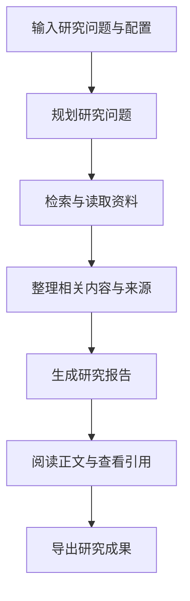

# GPT Researcher 产品需求文档

GPT Researcher 帮助用户把一个研究问题转化为带来源引用的研究报告：系统规划研究问题，收集网络或本地资料，整理证据，再生成可阅读、可导出的研究成果。产品面向需要持续开展资料研究的个人，以及希望将研究能力接入自身应用的开发者。

| 项目 | 内容 |
| --- | --- |
| 文档类型 | 根据开源项目公开资料逆向还原的 PRD，非官方内部文档 |
| 文档版本 | 1.0 |
| 编写日期 | 2026-10-22，Asia/Singapore |
| 还原对象 | [assafelovic/gpt-researcher](https://github.com/assafelovic/gpt-researcher) |
| 资料范围 | 当日访问的项目 README 与官方文档；未绑定特定 release 或 commit |
| 目标读者 | 产品、设计、研发和测试人员 |
| 范围边界 | 还原 GPT Researcher 自身，不包含本地仓库的行业或医学定制需求 |

本文使用两类标记：**已公开能力**表示官方资料明确描述的功能，不等同于本次运行验证；**还原口径**表示为形成可评审 PRD 而整理的用户场景、交互逻辑或验收方法。不同前端、SDK 与扩展工作流的能力分别说明，不假定所有入口完全一致。

## 1 产品背景与目标

### 1.1 要解决的问题

完成一项研究通常需要反复搜索、阅读、比较和写作。用户既要判断资料是否回答了问题，又要保留结论与来源的对应关系。只得到搜索链接，仍需要自己完成后续整理；只得到一段生成答案，又难以判断其依据和覆盖范围。

GPT Researcher 的公开设计以研究规划、资料采集和报告汇总组成自动化流程，减少用户在多个工具之间搬运资料的工作。[官方介绍](https://docs.gptr.dev/docs/gpt-researcher/getting-started/introduction)

### 1.2 产品目标

以下为依据公开定位还原的产品目标：

1. **完成研究交付。** 从一个主题出发，产出围绕问题展开的结构化报告。
2. **保留信息依据。** 将研究过程中使用的来源带入最终成果，便于用户回查。
3. **适应不同研究范围。** 支持开放网络、指定资料以及本地文档等输入方式。
4. **支持研究深度扩展。** 对复杂问题提供递归探索或多智能体协作路径。
5. **便于部署与集成。** 允许用户通过网页使用，也允许开发者嵌入研究能力。

带引用、使用多个来源和引入审阅环节，都不能单独证明报告真实、完整或无偏。PRD 将这些作为实现研究目标的能力，不作为结果质量保证。

## 2 用户与典型场景

本节为还原口径，不代表上游已发布用户调研数据。

| 用户 | 典型任务 | 主要痛点 | 期望成果 |
| --- | --- | --- | --- |
| 分析师与知识工作者 | 调研技术趋势、市场或公共议题 | 来源分散，研究与成文耗时 | 带依据的专题报告 |
| 学习者与研究人员 | 快速理解一个陌生主题 | 缺乏问题框架，容易遗漏分支 | 有结构的研究概览与阅读线索 |
| 持有资料的个人或团队 | 围绕已有文件开展研究 | 文档较多，跨文件整理困难 | 根据指定资料生成的综合分析 |
| 应用开发者 | 将研究功能接入业务系统 | 自建检索、阅读、写作流程成本高 | 可调用、可配置的研究组件 |

典型任务示例：“研究开源向量数据库的主要技术路线，比较部署方式和适用场景，并在报告中列出依据。”该示例用于解释流程，不包含对研究结果的预设结论。

## 3 产品范围与能力分层

### 3.1 核心能力

**已公开能力：**项目提供网络与本地资料研究、带引用的长报告、网页前端、报告导出以及 Python 包调用方式；还提供可选的图像相关能力。[项目 README](https://github.com/assafelovic/gpt-researcher#features)

| 层级 | 能力 | 在产品中的作用 |
| --- | --- | --- |
| 核心研究 | 研究问题规划、资料收集、内容整理、报告生成 | 完成单次研究闭环 |
| 数据范围 | 网络、指定 URL、本地文档、混合研究 | 让研究围绕用户选定的资料开展 |
| 深度扩展 | Deep Research | 沿子问题继续递归探索 |
| 协作扩展 | LangGraph、AG2 工作流 | 将规划、研究、审阅、修订和发布分工 |
| 使用入口 | 网页、Python 包及相关集成 | 满足直接使用和程序调用需求 |
| 外部数据集成 | MCP Client | 接入专业工具或数据源 |
| 对外能力集成 | 独立 MCP Server 项目 | 让其他 AI 应用调用研究能力 |

**入口边界：**Deep Research 是研究执行模式；多智能体是工作流组织方式；MCP 是集成方式。三者不应被设计成含义相同的三个选项。MCP Server 已迁至独立的 [gptr-mcp 仓库](https://github.com/assafelovic/gptr-mcp)，不应混同为主项目内部的所有功能。

### 3.2 本次还原不作现有能力承诺的范围

企业多租户、完整权限体系、订阅计费、团队共同编辑、周期研究调度、跨会话长期记忆、任意节点断点续跑，以及逐条论断的强制事实核验，不在本次已核实的能力清单中。这里不判断上游是否存在相关局部实现，也不将它们扩写为既有产品功能。

## 4 核心用户流程

### 4.1 标准研究

以下是依据官方流程整理的产品视图，节点名称不等同于代码中的状态枚举。

用户首先明确研究主题和资料范围。系统将主题展开为可研究的问题，收集相关内容，保留来源关联，再形成报告。用户最终检查结论及其依据，并将成果用于后续工作。[官方架构介绍](https://docs.gptr.dev/docs/gpt-researcher/getting-started/introduction#architecture)

### 4.2 深度研究

**已公开能力：**Deep Research 采用树状探索，支持广度、深度和并发设置，汇总不同分支的发现，并提供进度回调。部分查询失败时，可跳过失败查询继续其他分支。[Deep Research 文档](https://docs.gptr.dev/docs/gpt-researcher/gptr/deep_research)

**还原口径：**用户选择深度研究后，应能理解本次探索覆盖了哪些子问题以及当前执行位置。深度参数表示探索层数，广度参数表示每层探索范围；增加这些参数会扩大工作量，不应直接显示为质量等级。

### 4.3 多智能体研究

**已公开能力：**LangGraph 示例先进行初步研究和大纲规划，再并行研究各章节，经过审阅与修订后合成报告并输出文件；可配置人工反馈。[LangGraph 工作流](https://docs.gptr.dev/docs/gpt-researcher/multi_agents/langgraph)

**还原口径：**选择该工作流的用户希望获得更明确的章节结构和修订过程。人工反馈属于可选分支，不能将其描述为所有标准研究任务启动前都必须进行的步骤。

## 5 功能需求

为方便理解依赖关系，P0 表示核心研究闭环，P1 表示输入与交付扩展，P2 表示高级工作流或集成。这是本文的还原分类，不代表官方开发优先级或尚未上线的计划。

### 5.1 研究任务创建

**编号与分层：**F01，P0。

**已公开能力：**用户可以输入研究查询并调整研究参数；Python 包将研究执行与报告写作分别暴露为 `conduct_research()` 和 `write_report()`。[前端介绍](https://docs.gptr.dev/docs/gpt-researcher/frontend/introduction)、[Python 使用示例](https://github.com/assafelovic/gpt-researcher#run-as-pip-package)

**用户故事：**作为研究发起者，我希望描述目标并选择研究方式，让系统按照我的任务开展工作。

**还原口径：**任务输入应区分研究问题、资料范围和输出要求。SDK 或配置文件支持的参数，不必全部暴露给普通用户；前端支持哪些选项，应按所选实现核对。

**验收方法：**用一个明确主题发起研究，检查执行记录和最终报告是否对应同一查询；通过 SDK 完成研究和写作两步调用并取得报告结果。

### 5.2 指定来源与研究边界

**编号与分层：**F02，P1。

**已公开能力：**`source_urls` 指定研究 URL；`complement_source_urls=False` 时只研究给定来源，设为 `True` 时允许补充搜索。`custom_report` 可配合自定义指令调整研究和报告要求。[定制研究文档](https://docs.gptr.dev/docs/gpt-researcher/context/tailored-research)

**用户故事：**作为资料已知的研究者，我希望限定资料范围，避免系统自行扩大研究来源。

**还原口径：**“仅使用指定来源”与“以指定来源为起点补充研究”需要明确区分；格式指令与资料边界应分别检查，报告格式正确并不代表来源范围正确。

**验收方法：**为相同问题提供固定 URL，分别关闭和开启补充搜索，检查实际读取来源及报告引用是否符合对应模式。此能力按 SDK 文档还原，不承诺所有网页入口均有同名开关。

### 5.3 资料收集与来源追踪

**编号与分层：**F03，P0。

**已公开能力：**研究流程围绕子问题收集资料，整理相关内容并跟踪来源，再交给报告生成环节。[研究流程说明](https://docs.gptr.dev/docs/gpt-researcher/getting-started/introduction#architecture)

**用户故事：**作为报告使用者，我希望知道结论基于哪些材料，方便继续阅读与判断。

**还原口径：**应区分“搜索找到的链接”“已读取内容”和“最终引用来源”。来源数量用于描述资料覆盖，不宜替代质量判断；多篇转载也不应被直接解释为多个独立证据。

**验收方法：**抽查研究中保留的来源与报告引用，确认引用可关联到资料。对于引用是否真正支持结论，需要额外开展内容核验，不能只检查 URL 是否存在。

### 5.4 本地与混合资料研究

**编号与分层：**F04，P1。

**已公开能力：**本地研究通过 `DOC_PATH` 指定目录，并使用 `report_source="local"`；官方列出 PDF、纯文本、CSV、Excel、Markdown、PowerPoint 和 Word 等格式，同时介绍本地与网络混合研究。[本地文档说明](https://docs.gptr.dev/docs/gpt-researcher/context/local-docs)

NextJS 前端提供文件拖放上传和删除操作。[NextJS 前端说明](https://docs.gptr.dev/docs/gpt-researcher/frontend/nextjs-frontend)

**用户故事：**作为持有资料的用户，我希望围绕自己的文件提出问题，也可以结合外部信息进行研究。

**还原口径：**文件操作属于资料准备，研究来源选择决定实际使用范围。选择本地资料不等于推理过程完全离线；是否调用外部模型取决于部署配置。

**验收方法：**在文件中设置可明确定位的事实，执行本地研究并检查报告依据；在 NextJS 前端检查上传和删除操作。扫描件 OCR、复杂表格还原、单文件大小上限及删除后的历史数据清理语义，需按具体版本另行核实。

### 5.5 报告生成与交付

**编号与分层：**F05，P0；文件导出列为 P1。

**已公开能力：**产品输出带引用的研究报告，支持长报告和 PDF、Word 等导出形式；多智能体示例也提供 Markdown 输出。[项目功能列表](https://github.com/assafelovic/gpt-researcher#features)、[LangGraph 输出说明](https://docs.gptr.dev/docs/gpt-researcher/multi_agents/langgraph)

**用户故事：**作为成果接收者，我希望阅读一份有组织的报告，并将其保存到自己的工作环境中。

**还原口径：**报告应围绕原始问题组织内容。验收时分别检查内容可用性、引用可追溯性和导出完整性；篇幅较长不自动等同于覆盖充分。

**验收方法：**检查报告主题、正文与引用；对已启用格式进行导出，确认正文、标题层级和参考资料未在转换中丢失。文件发布在本 PRD 中指成果输出，不推导为公开互联网发布。

### 5.6 研究过程展示

**编号与分层：**F06，P0。

**已公开能力：**前端提供实时研究进度和结果展示；Deep Research 还提供当前查询、深度、广度与查询完成情况等进度信息。[前端介绍](https://docs.gptr.dev/docs/gpt-researcher/frontend/introduction)、[深度研究进度说明](https://docs.gptr.dev/docs/gpt-researcher/gptr/deep_research#progress-tracking)

**用户故事：**作为等待结果的用户，我希望了解研究正在推进到哪里。

**还原口径：**界面用可观察的任务活动描述进度。动态新增研究分支时，总任务量可能变化，因此不把分支计数直接当作固定总量的完成百分比，也不将它等同于剩余时间预测。

**验收方法：**执行多步骤研究，观察进度变化能否与运行活动对应，最终能否进入结果展示。刷新恢复、后台持续运行和断线重连的保证范围需要单独核实。

### 5.7 Deep Research 参数控制

**编号与分层：**F07，P2。

**已公开能力：**官方文档给出的配置包括 `deep_research_breadth`、`deep_research_depth`、`deep_research_concurrency` 和 `total_words`，示例使用 `report_type="deep"` 进入该模式。[Deep Research 配置](https://docs.gptr.dev/docs/gpt-researcher/gptr/deep_research#configuration)

**还原口径：**深度与广度控制探索规模，并发控制同时执行量，字数配置控制输出篇幅意图。参数配置和业务效果应分别验收，不要求最终篇幅逐字等于配置数值。

**验收方法：**固定研究主题，检查不同配置下的执行轨迹是否反映对应参数；模拟一个分支失败，观察其余分支是否继续。该方法用于验证机制，不预设质量提升幅度。

### 5.8 多智能体审阅与修订

**编号与分层：**F08，P2。

**已公开能力：**LangGraph 和 AG2 示例包含研究、编辑、审阅、修订、写作与发布等职责，并支持人工反馈配置；AG2 文档列出 `max_revisions` 等参数。[LangGraph 文档](https://docs.gptr.dev/docs/gpt-researcher/multi_agents/langgraph)、[AG2 文档](https://docs.gptr.dev/docs/gpt-researcher/multi_agents/ag2)

**还原口径：**该功能使章节草稿能够经过反馈后再汇总。审阅角色的输出是模型审阅意见，不能等同于经过人工认证的事实正确性。

**验收方法：**选定一个明确的工作流实现，检查规划、章节研究、审阅、修订和成果输出是否按该实现配置执行。人工反馈打开与关闭时分别检查路径，不假定两个框架的参数与行为完全一致。

### 5.9 配置与应用集成

**编号与分层：**F09，P1；MCP 集成列为 P2。

**已公开能力：**官方提供研究配置文档；NextJS 前端提供环境配置界面。MCP Client 可接入额外数据源，并支持与网络检索结合。[配置说明](https://docs.gptr.dev/docs/gpt-researcher/gptr/config)、[NextJS 文档](https://docs.gptr.dev/docs/gpt-researcher/frontend/nextjs-frontend)、[MCP 集成](https://docs.gptr.dev/docs/gpt-researcher/retrievers/mcp-configs)

**用户故事：**作为部署者或开发者，我希望选定可用模型、检索工具和数据来源，并通过程序调用研究流程。

**还原口径：**用户可配置范围取决于部署开放的能力。MCP 的价值在于连接数据或工具，不能直接推导为对任意连接器、认证方式或数据权限的统一支持。

**验收方法：**固定一种受支持配置完成调用；为一个可用 MCP 数据源配置连接，验证其返回内容可以进入研究流程。更换提供商后需要重新检查所用工作流支持情况。

## 6 页面与交互结构

以下是对网页产品的信息架构还原，不表示官方页面必须采用同样的布局，也不把 SDK 参数虚构成现有 UI 控件。

| 功能区域 | 用户操作 | 展示内容 | 能力边界 |
| --- | --- | --- | --- |
| 研究输入区 | 输入问题，选择当前前端支持的研究配置 | 任务文本与选中配置 | 具体选项按前端版本核对 |
| 文件管理区 | 上传、删除研究文件 | 可用于研究的资料 | 依据 NextJS 文档，不推及所有入口 |
| 设置区 | 调整开放的配置 | 研究环境与参数 | SDK、环境变量和 UI 不要求一一对应 |
| 执行展示区 | 查看当前研究活动 | 进度和阶段结果 | 不默认承诺暂停、续跑或精确剩余时间 |
| 报告区 | 阅读、查看来源、获取输出文件 | 报告正文、引用与导出结果 | 导出格式取决于入口及配置 |

从用户视角可将一次任务理解为“准备输入—研究执行—报告生成—结果可用”，异常时可能提前结束。这是交互模型；本次不据此声明上游已实现同名状态机。

## 7 异常场景与验收边界

除深度研究的分支失败处理外，下表是根据产品闭环整理的验收检查项，具体行为需要在选定版本上确认，不能视为已实现说明。

| 场景 | 要回答的验收问题 | 需要避免的误判 |
| --- | --- | --- |
| 输入为空或缺少必要配置 | 是否给出可理解的反馈，任务是否被正确阻止或结束 | 接口报错被当成正常研究结果 |
| 搜索无结果 | 是否能区分没有找到资料与已完成充分研究 | 无依据文本被当成事实报告 |
| 单页读取失败 | 是否记录失败，是否影响其他资料处理 | 搜索到链接被当成正文读取成功 |
| 深度研究某分支失败 | 其他分支是否继续，进度是否反映异常 | 部分成功被当成所有分支成功 |
| 文件无法解析 | 是否能识别不可用资料及其原因 | 上传成功被当成解析成功 |
| 模型或检索服务限流 | 用户能否辨识执行失败或等待状态 | 页面长时间无变化被当成正常执行 |
| 导出失败 | 正文是否仍可获取，导出错误是否可辨识 | 文件生成失败被当成正文未生成 |
| 网络连接中断 | 用户能否判断连接状态；重连与恢复是否受支持 | 未验证恢复机制就宣称可以续跑 |

## 8 质量指标与非功能要求

### 8.1 建议用于验收的指标

以下指标是还原 PRD 的验收设计，不是官方公布的效果，也不是本次测量结果。本文不设置缺乏基线支持的成功率、时延或成本承诺。

| 指标 | 计算或检查口径 | 用途 |
| --- | --- | --- |
| 研究完成率 | 产生可读取报告的有效任务数 ÷ 有效发起任务数；主动取消单列 | 衡量执行闭环，不能代替报告质量 |
| 任务要求覆盖率 | 人工判定已回应的明确要求数 ÷ 全部明确要求数 | 衡量是否回答了用户问题 |
| 引用支持率 | 被所引资料支持的抽样事实论断数 ÷ 已抽查的带引用事实论断数 | 检查引用与内容的对应关系 |
| 引用覆盖率 | 带可定位引用的应引用事实论断数 ÷ 已抽查的应引用事实论断数 | 发现缺少依据的事实陈述 |
| 来源可回查率 | 能重新定位资料的引用数 ÷ 抽查引用数 | 衡量成果追溯便利性 |
| 首次进度时延 | 提交任务到首条有效进度的时间 | 衡量等待体验 |
| 研究总耗时 | 提交任务到报告可用的时间，分模式统计 P50、P95 | 衡量交付速度 |
| 单次研究成本 | 所用模型、检索及其他计费服务的调用成本合计 | 衡量资源消耗 |
| 导出成功率 | 内容完整且可打开的导出数 ÷ 导出请求数 | 衡量交付可靠性 |

任何正式验收都应记录模型、检索器、运行版本、参数、数据来源、题目集合与失败任务；否则不同运行的结果不具备直接可比性。

### 8.2 非功能检查项

本节为还原口径，需在部署版本上验证：

- **可用性：**普通用户能理解研究输入、执行过程与报告输出之间的关系。
- **可观察性：**能够识别研究是否推进、是否失败，以及哪些外部依赖参与了执行。
- **资源控制：**深度研究的并发与规模配置生效，避免将可配置参数误当成无限资源承诺。
- **资料与凭据保护：**核实所选部署对文件、模型凭据和日志的处理，区分自托管服务与外部 API 的数据流向。
- **交付完整性：**导出后的正文与引用保持对应，中文等实际使用语言应纳入检查。

## 9 验收组织与交付范围

这是面向还原产品的验证顺序，不是上游发布路线图，也不代表本次已经执行这些验收。

| 验收组 | 覆盖功能 | 最小闭环 |
| --- | --- | --- |
| A 核心研究 | F01、F03、F05、F06 | 网页输入问题，观察进度，读取报告与来源 |
| B 资料与交付 | F02、F04、F05 | 指定 URL、本地研究、混合研究及已启用格式导出 |
| C 深度探索 | F07 | 深度模式配置生效，分支执行与失败处理可观察 |
| D 协作研究 | F08 | 选定框架完成规划、审阅修订与报告发布 |
| E 开发者集成 | F09 | Python 调用闭环及选定 MCP 数据源接入 |

执行前应锁定上游 commit、依赖和配置，按各入口分别验收。涉及未来评估时，原始结果应保存在 `backend/eval/data/` 对应中文命名目录，并在 `docs/` 新建中文结果分析报告；本次任务仅编写 PRD，未开展功能或性能评估。

## 10 资料索引与待核实事项

### 10.1 主要依据

所有来源访问日期均为 2026-10-22。

| 来源 | 支撑范围 |
| --- | --- |
| [官方仓库](https://github.com/assafelovic/gpt-researcher) | 产品定位、主要功能、SDK 和项目入口 |
| [官方介绍](https://docs.gptr.dev/docs/gpt-researcher/getting-started/introduction) | 研究规划、资料收集与报告汇总流程 |
| [前端介绍](https://docs.gptr.dev/docs/gpt-researcher/frontend/introduction) | 输入、进度和结果展示 |
| [NextJS 前端](https://docs.gptr.dev/docs/gpt-researcher/frontend/nextjs-frontend) | 文件管理、配置界面和工作流入口 |
| [定制研究](https://docs.gptr.dev/docs/gpt-researcher/context/tailored-research) | 指定来源、补充搜索和自定义报告 |
| [本地文档](https://docs.gptr.dev/docs/gpt-researcher/context/local-docs) | 文件类型、本地与混合研究 |
| [Deep Research](https://docs.gptr.dev/docs/gpt-researcher/gptr/deep_research) | 递归研究、参数、进度和部分失败处理 |
| [LangGraph](https://docs.gptr.dev/docs/gpt-researcher/multi_agents/langgraph) | 多智能体职责与工作流 |
| [AG2](https://docs.gptr.dev/docs/gpt-researcher/multi_agents/ag2) | AG2 工作流与修订参数 |
| [配置说明](https://docs.gptr.dev/docs/gpt-researcher/gptr/config) | 可配置研究环境 |
| [MCP 集成](https://docs.gptr.dev/docs/gpt-researcher/retrievers/mcp-configs) | MCP Client 数据接入 |

### 10.2 版本核实清单

1. 锁定需要还原的具体版本后，核对网页选项与 SDK、配置文件之间的支持差异。
2. 核对本地文件限制、删除语义、扫描件和复杂文档的实际处理范围。
3. 核对取消、重连、任务历史和恢复行为，避免把框架能力视为完整产品能力。
4. 核对各入口实际提供的报告格式及中文导出效果。
5. 单独验证报告质量和运行成本。官方示例中的耗时、来源数、篇幅与费用不作为本 PRD 的服务承诺。
