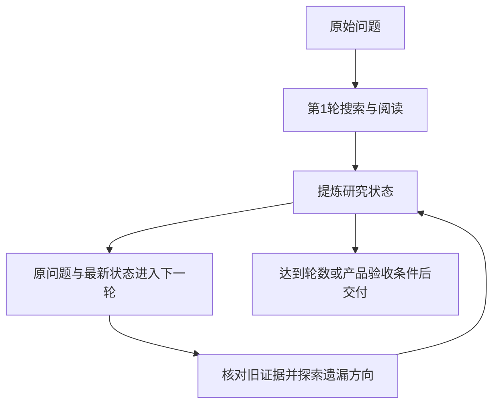

# RE-TRAC通俗总结实现说明及评估分析

RE-TRAC把复杂搜索组织成多轮探索：每轮结束后，把已找到的证据、暂定结论、失败方向和未解决的问题整理成研究状态，再交给下一轮。下一轮既能接着已有成果查，也能质疑旧结论、改换搜索方向。它最值得借鉴的是如何让多次尝试积累经验，并保留容易被长上下文淹没的线索。

## 核查日期与证据口径

- 分析日期：2026-10-11，Asia/Singapore。
- 对象：RE-TRAC论文、Microsoft InfoAgent官方推理实现，以及当前行业信息助手的接入设计。
- 论文：RE-TRAC: REcursive TRAjectory Compression for Deep Search Agents；[ICML 2026正式记录](https://proceedings.mlr.press/v306/zhu26bd.html)。方法、训练及具体实验表格按本次读取的[arXiv v1全文](https://arxiv.org/html/2602.02486v1)标注版本，不把不同版本的表格混用。
- 官方代码：固定提交 `8a6f17670a84f619505d117d13c6d26a2f3f21cf`，本次GitHub API返回的main提交；[代码目录](https://github.com/microsoft/InfoAgent/tree/8a6f17670a84f619505d117d13c6d26a2f3f21cf/retrac)。
- 本次仅整理作者指标、静态读取源码和提出接入方案，没有运行研究模型、安装官方框架、重新执行基准或修改应用逻辑。

原始机器可读记录：[来源与分析记录.json](../backend/eval/data/RE-TRAC原理与实现核查-20261011-204703/来源与分析记录.json)、[论文原文工具读取记录.json](../backend/eval/data/RE-TRAC原理与实现核查-20261011-204703/论文原文工具读取记录.json)。同目录保留官方源码、配置、说明和本项目相关源码快照及SHA256。

证据边界：**已测量**：本次无新增性能测量；**已核验**：在线论文与所列源码；**间接推断**：项目接入方案、静态代码行为及构造情境；**尚未评估**：本项目中文报告质量、遗漏率、引用保真、端到端时延和总费用。

## 先理解搜索轨迹

搜索轨迹就是一次研究从开始到结束的过程，例如“提出三个候选方向→搜索A→阅读网页→发现线索→核对年份→生成答案”。其中既有模型判断，也有工具调用、网页内容、错误和阶段产出。

ReAct让模型反复执行“思考→调用工具→阅读结果”。当问题复杂时，一个方向会带来很多网页和新线索，模型容易忘记早先安排的其他方向。即使继续增加搜索次数，也可能一直围绕同一个候选对象打转。

多次独立重跑可以得到更多候选答案，但每次都重新查相似资料。RE-TRAC让尝试之间传递研究状态：已经查过什么、哪些证据可信、哪个方向暂时走不通、哪些线索还没有跟进。压缩在这里承担的是交接研究进度的作用。

## 每轮怎样衔接

可以用两个操作描述它：

```text
本轮轨迹 = 研究模型（原问题，上一轮研究状态）
新研究状态 = 压缩模型（上一轮研究状态，本轮轨迹）
```

第一轮没有旧状态，按普通工具搜索执行。之后每轮结束时生成新的完整状态，下一轮从原问题和最新状态开始。旧状态已包含在本轮输入中，所以压缩本轮完整消息时，也能把更早的发现继续传下去。



图中的产品验收条件是接入建议。当前官方推理实现按 `max_cycles` 控制外层循环，不具备独立的“质量已足够”提前退出节点。这里的“递归”主要指状态逐轮更新并再次影响搜索，用循环即可实现。

## 状态应保留什么

官方公开配置使用五部分纯文本，并不要求JSON。以下是对[官方状态提示词](https://github.com/microsoft/InfoAgent/blob/8a6f17670a84f619505d117d13c6d26a2f3f21cf/retrac/retrac/deep_research.yaml)的中文解释。

| 状态部分 | 应留下的具体内容 | 后续用途 |
| --- | --- | --- |
| 当前答案 | 当前最有证据支持的答案；还不能确定时保留未确定状态 | 保存进展，同时允许修正 |
| 事实与证据 | 事实内容、来源URL或编号、核验状态 | 复用证据与定向核验 |
| 分析与结论 | 推断及其依赖的事实 | 看清结论为什么成立 |
| 来源清单与核验状态 | 查过哪些资料、资料的支持程度 | 避免盲目重查，识别薄弱来源 |
| 不确定性与缺口 | 尚未解决的变量、歧义、失败原因 | 安排下一轮探索 |

论文附录另有增强状态，额外记录失败尝试、出现但未追踪的线索、缺乏充分依据就被排除的候选。公开YAML是上述基础版本，不能把增强字段说成当前代码全部具备。

状态需要自成一体。例如“增长率12%”应带上年份、单位、统计范围和来源；“来源2支持该结论”需要保留来源2的实际标识。“详见上轮”不能帮助只拿到最新摘要的模型。

`Verified: yes/no/partial`是提示词要求模型填写的标记。公开推理代码没有单独的事实核验器来保证这个标记真实。接入时，模型自评与程序或审核模块的核验结果应分别保存。

## 一个便于理解的例子

以下为构造情境，不是真实公司调查或评测样例。

问题要求找到同时满足“成立年份正确、拥有指定专利、产品应用领域相符”的公司。第一轮找到A，确认了成立年份和产品方向，却一直没找到专利。网页里还出现了C的名字，但模型没有继续查。

如果摘要只留下“A最可能符合条件”，下一轮容易再围绕A搜索。更有用的状态应写成：

```text
当前答案：尚未确定。
已确认：A满足成立年份和应用领域条件，来源为S1、S2。
未确认：A是否拥有该专利。
失败尝试：按A的现用名称查专利，两次检索没有找到支持材料。
未探索线索：S3出现C，但还没有查C的专利和成立信息。
下一轮可尝试：查C；也可核对A的曾用名、子公司或专利申请人。
```

这样，下一轮有明确的切换依据。它也能分清“没有搜到”与“已有反证”：前者可能是关键词、名称或网页读取的问题，不能直接写成“A没有专利”。

## 继续研究的提示词为什么重要

[官方continuation配置](https://github.com/microsoft/InfoAgent/blob/8a6f17670a84f619505d117d13c6d26a2f3f21cf/retrac/retrac/deep_research.yaml)允许模型质疑摘要、忽略支持不足的结论、重新规划，并转向新的关键词或工具策略。

原因很实际：摘要可能已经写错，或者把第一轮的猜测说得过于肯定。如果后续模型必须沿用它，错误就会逐轮累积。接续提示词应同时传递两层意思：“已有成果可以复用”和“已有判断允许推翻”。

也不必把每条旧事实重新查一遍。更合理的接入策略是保留核验依据，优先检查会影响最终答案的薄弱事实、来源冲突和未完成问题。

## 官方代码怎样实现

官方实现使用LangGraph。主要文件及职责如下，链接均指向本次固定提交。

| 文件 | 职责 |
| --- | --- |
| [graph.py](https://github.com/microsoft/InfoAgent/blob/8a6f17670a84f619505d117d13c6d26a2f3f21cf/retrac/retrac/graph.py) | 轮内工具循环、轮末压缩、下一轮重建消息、轮数控制 |
| [deep_research.yaml](https://github.com/microsoft/InfoAgent/blob/8a6f17670a84f619505d117d13c6d26a2f3f21cf/retrac/retrac/deep_research.yaml) | 状态与接续提示词、模型和预算配置 |
| [components.py](https://github.com/microsoft/InfoAgent/blob/8a6f17670a84f619505d117d13c6d26a2f3f21cf/retrac/retrac/components.py) | 模型调用、工具绑定、失败重试和可选限速 |
| [tools.py](https://github.com/microsoft/InfoAgent/blob/8a6f17670a84f619505d117d13c6d26a2f3f21cf/retrac/retrac/tools.py) | 批量搜索、网页读取及按目标提取内容 |
| [run.py](https://github.com/microsoft/InfoAgent/blob/8a6f17670a84f619505d117d13c6d26a2f3f21cf/retrac/run.py) | 加载配置并调用图，支持流式与非流式运行 |

一轮内，`llm`产生工具调用，经`tools_prep→tools→tools_merge`把结果放回消息，再调用模型。没有工具调用，或源码中的token/工具消息限制触发时，进入`end_cycle`。

`end_cycle`将状态生成提示词加到本轮消息末尾，再调用模型。`cycle_histories`保存各轮状态，`process_details`保存各轮消息。下一轮的`start_cycle`重新构造系统提示、原问题和最新状态；它取的是 `last_summary`，不会把全部旧轨迹再次注入。

这说明“模型输入里的历史被折叠”和“旧记录从存储中删除”是两回事。记录可以完整保留，后续模型只看有用状态。

当前公开配置为 `max_cycles=8`、`max_turns=1000`、`max_context_length=122880`。这些是示例参数，不是适合所有任务的推荐预算。源码中的 `max_turns`实际按ToolMessage数量计数，与模型调用轮数也不完全相同。

## 自己实现的最小流程

以下为自行设计的伪代码，函数均为待实现接口；没有在本次运行。它表达的是RE-TRAC的状态传递方式，并额外将答案与研究状态分开保存。

```python
async def recursive_research(question, max_rounds=4):
    research_state = None
    last_answer = None

    for round_id in range(max_rounds):
        messages = build_messages(
            question=question,
            previous_state=research_state,
            allow_replanning=True,
        )

        # 轮内执行搜索、阅读、核验，直到生成答案或接近预算。
        trajectory, last_answer = await run_react(messages)

        # 压缩调用关闭工具，并预留输入和输出空间。
        research_state = await compress_state(
            question=question,
            previous_state=research_state,
            new_trajectory=trajectory,
        )

        await save_round(round_id, trajectory, research_state, last_answer)

    return last_answer
```

实现时，至少需要稳定的事实/来源编号、每轮轨迹存储、可验证的状态输出和总预算管理。状态可以继续用纯文本，也可以采用Pydantic/JSON；JSON是工程选择，不能把改成JSON本身当作论文方法的收益来源。

用于行业研究的一个扩展结构可以包括：

```text
research_state
  current_answer
  facts: fact_id、source_id、sentence_ids、内容、年份/单位/范围、核验依据
  conclusions: 内容、依赖的fact_id、仍然成立的条件
  sources: source_id、URL、正文定位、读取状态
  open_questions: 缺口、优先级、验收条件
  failed_attempts: 做过什么、失败类型、是否值得换方法重试
  unexplored_leads: 尚未跟进的URL、实体、关键词
  discarded_candidates: 候选、排除依据、是否需要重新检查
```

上述字段是接入建议，不是官方JSON协议。事实与来源最好主要从已有结构化库生成，模型负责分析缺口和探索方向，避免每轮都从自然语言日志重建全部证据。

## 阅读官方代码时需要留意的细节

这些是静态核查发现，未经过实际运行复核。

1. **最终答案与状态的区别。** `end_cycle`把摘要追加为最后一条消息，`final`直接返回最后一条消息的文本。因此，在成功摘要路径下，当前公开代码的输出是最终状态摘要。产品接入应分别保存答案和状态，再明确最终交付内容。
2. **给压缩调用预留空间。** 当前轮数/上下文检查发生在模型返回之后，摘要还要再次调用模型。应在窗口耗尽之前结束探索，并为摘要提示词和输出预留空间；不同API的token统计字段也需要核实。
3. **状态长度仍需管理。** 官方提示词强调保留所有重要事实，没有给摘要硬性长度上限。事实较多时，状态也会增长。可保留有界状态及原文索引，细节按需回读。
4. **本地运行配置以源码为准。** 外层 `retrac/run.py`与内层 `retrac/deep_research.yaml`位置不同；README示例的工作目录和配置路径不宜照抄。YAML里的 `api_key: EMPTY`还会覆盖环境默认值，使用真实API时应调整配置。
5. **示例日志需要清理。** `config.py`和`tools.py`包含打印密钥的语句，实际接入前应删除。这里记录的是已看到的源码行为。

若单独试跑，可从官方仓库的外层 `retrac/`目录执行以下入口，先完成依赖、模型、搜索和网页工具配置：

```bash
uv run run.py --config retrac/deep_research.yaml --question "你的研究问题" --non-streaming
```

本次未执行该命令。优先参考其研究循环并适配本项目工具，通常比引入整套示例服务更便于复用已有证据管理。

## 小模型怎样训练

作者让GLM-4.7用4轮RE-TRAC解答约33,000道合成问题，把各轮展开成训练样本：约132,000条原始样本筛选为104,000条，用于Qwen3-4B-Instruct和Tongyi-DeepResearch-30B-A3B的SFT。目标是让学生模型学会工具研究，并利用上一轮状态继续探索。具体数据口径见论文第4.4节和附录B。

对已有较强工具能力的模型，可以先通过提示词和外层循环接入。小模型的论文成绩包含SFT与多轮推理，不能归因于仅替换摘要提示词。当前官方说明给出30B权重链接，4B下载栏仍标为Coming soon；本次未验证完整训练复现。

## 作者报告的指标及逐类分析

以下均为**作者报告、未本地复现**。第一表按arXiv v1主表3的BrowseComp300、自托管共同搜索/访问工具、单次推理与8轮RE-TRAC口径整理。增益以百分点表示。

| 模型 | 单次推理准确率 | 8轮RE-TRAC准确率 | 差值 |
| --- | ---: | ---: | ---: |
| o4-mini | 25.7% | 46.8% | +21.1个百分点 |
| o3 | 54.9% | 69.8% | +14.9个百分点 |
| GPT-5-medium | 48.3% | 66.6% | +18.3个百分点 |
| DeepSeek-V3.2 | 45.3% | 60.8% | +15.5个百分点 |
| GLM-4.7 | 37.7% | 60.7% | +23.0个百分点 |

官方摘要与README概括为约15—20个百分点，但这张具体表的差值范围约14.9—23.0个百分点。解释实验时应给出具体模型与比较口径。主表与附录部分起始值和其他比较法数值存在差异，本次不将它们合并成一组实验。

按官方README与论文主表2，训练后的RE-TRAC-4B在BrowseComp上为30.0%，RE-TRAC-30B-A3B为53.0%。这是训练后的模型/研究系统结果，与上述同一模型的推理框架对比属于不同问题。

对多轮研究而言，后续轮次工具调用和token减少，支持“旧成果有助于减少重复探索”的解释。但8轮依然多于一次尝试，压缩也有成本；不能据此断言RE-TRAC总费用必然比单轮更低。公平的项目实验应同时比较一次运行、相同总预算的长运行、独立多次运行和状态接续的多轮运行。

## 失败样例与局限性

本次没有新增实测失败轨迹。以下均为**构造情境/间接推断**，用于设计后续验证。

| 情境 | 可能发生的错误 | 接入时应保留或检查的内容 |
| --- | --- | --- |
| 摘要保留数字，丢掉年份与统计范围 | 将不同口径的数据直接比较 | 数字、单位、时点、范围及原文定位 |
| 某来源没打开或关键词没搜到 | 把候选写成已经被证伪 | 区分读取失败、缺少支持与存在反证 |
| 第一轮暂定结论过于肯定 | 后续轮次围绕同一错误候选搜索 | 保留支持依据，允许质疑与重新规划 |
| 工具结果中出现新线索但未阅读 | 下一轮仍遗忘该方向 | 记录未探索线索及其出处 |
| 接近窗口上限才调用压缩器 | 摘要请求本身超限 | 提前估算完整输入与压缩输出预算 |
| 中间轮正确，最后一轮判断退步 | 直接使用最后答案丢失已有成果 | 保存各轮答案与证据；另测答案选择策略 |

此外，基准主要衡量找答案的准确率，不能直接代表行业长报告的需求覆盖、数字口径和引用质量。摘要可帮助导航，但精确引用需要回读原文；结构化状态本身也不能保证“重要信息全都保留下来”。

## 怎样接到本项目

以下依据当前源码提出接入方案，尚未实现或测量收益。

[agent_context.py](../backend/app/service/agent_context.py)已经用旧摘要和新增历史生成完整新摘要，也强调保存来源、冲突和最新研究要求；[state.py](../backend/app/service/deep_research_v2/state.py)已有 `research_contract`、`facts`、`raw_sources`、`critic_feedback`、`pending_research_tasks`等共享字段；[graph.py](../backend/app/service/deep_research_v2/graph.py)支持审核后的定向补搜和修订。这些可以复用。

建议将现有历史压缩继续用于控制单个智能体的输入，再增加整轮探索的研究状态。两个操作有不同职责：前者帮助当前模型继续工作，后者让下一轮知道全局进展与遗漏方向。

可以在Scout完成一轮探索后增加 `compress_research_state`节点，从结构化事实、来源读取记录和探索日志生成状态。由Planner/Scout读取该状态选择下一批研究任务；Critic的 `pending_research_tasks`可作为缺口输入，但不应成为唯一输入，因为“没被探索的候选”可能尚未出现在报告审核意见中。

建议的研究阶段可以表示为：

```text
Architect规划
→ Scout第一轮探索
→ 汇总研究状态
→ 根据未解决问题和未探索线索决定是否再探索
→ Scout下一轮探索
→ 更新研究状态
→ 达到验收条件或预算后交给分析与Writer
→ Critic定向审核与补证
```

事实、来源正文、原句定位与核验结果继续使用现有权威存储。研究状态保留引用和探索进度，避免把模型摘要重新写成已经验证的事实。状态版本应和run、轮次、有效研究契约关联，以便恢复和追溯。

## 结论和下一步建议

RE-TRAC适合借鉴的核心是“每次探索留下可继续使用的研究进度”，包括成功、失败与尚未跟进的方向。当前项目具备摘要、证据和补搜基础，可以先增加研究轮次间的状态接续，再决定是否需要训练专门模型。

建议先在固定开发集上比较现有流程和接入流程。至少记录需求覆盖率、未探索分支完成率、重复检索率、摘要事实及限定条件保留率、引用支持率，以及包含网页摘要和轮末压缩的总token、工具调用、时延和费用。回放适合查信息丢失，端到端重跑才能测下一轮搜索方向是否真正改善。

本报告新增文献与源码分析，保留此前比较文档；没有把作者成绩写成本项目测量结果，也没有实施上述接入方案。
