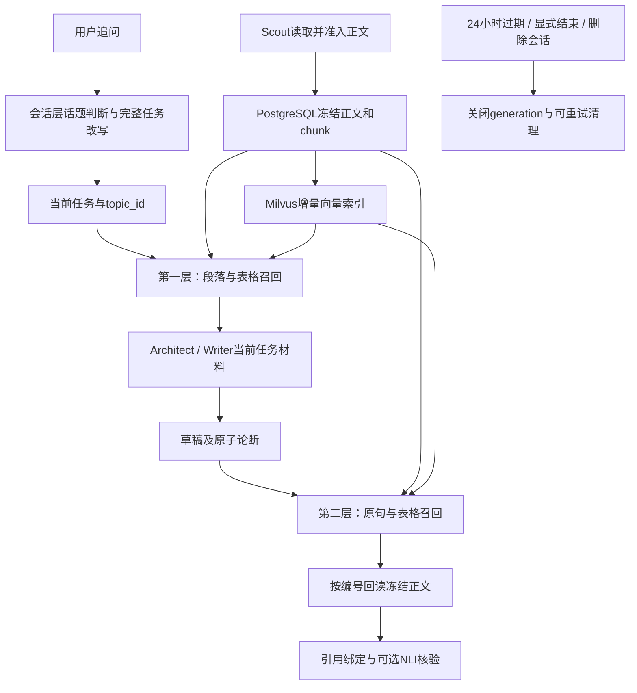

# 会话临时双层RAG实现与验证结果

评估日期：2026年10月8日，Asia/Singapore。实现及补充复评时间：20:05—20:56。

评估对象：会话临时证据库、两层检索、结构化表格、相邻chunk回读、检查点外置及证据生命周期。原32轮研究实验保持停止，本次没有继续生成研究报告，也没有调用付费模型API。

## 结论及测量边界

已经接入主链路，默认启用。会话层先形成当前完整任务，研究阶段召回按小节归组的段落/表格，Writer使用有token预算的材料；正文产出的原子论断再召回原句/表格。原文在PostgreSQL中冻结保存，向量使用独立Milvus集合。metadata包含`prev_chunk_id`、`next_chunk_id`以及分层邻居关系；长表分片按真实数据行顺序连接。

默认TTL为最后一次新消息提交后24小时；可以配置absolute模式。显式结束会话后立即禁止证据读写、取消关联运行并排队清理。正常完成某一轮、研究失败或SSE断开不会结束整个会话的证据生命周期。

已测量：集成回归372项，352通过、20跳过、0失败；后续引用兼容复评127项，126通过、1跳过、0失败；最终邻居行序验证14项全部通过。这些运行包含重复用例，不能将通过数相加作为独立样本数。

最终代码的第24轮离线回放：受保护输入从65,457降为11,662 tokens，缩减82.18%，输入限额65,536 tokens，留下53,874 tokens余量。131份冻结正文产生16,280个chunk；其中11份正文因格式/长度问题未入chunk索引，原文保留且失败有记录。

间接推断：有界材料视图和索引复用能缓解先前的证据膨胀。尚未评估：真实模型回答质量、语义召回率、引用支持率、在线成本/延迟，以及真实30+轮运行是否全部完成。32轮机制用例使用注入检索后端，不是32轮真实研究实验。

## 已接入的链路



会话判断仍由现有会话层完成，Agent内部不增加追问改写路由。检索优先使用当前`session_task.resolved_query`，再组合章节标题/描述；不会默认使用上一轮query。选定旧报告时复用其topic_id，新主题使用新空间分区。

两层都使用词法与向量召回、RRF融合及精排。研究层默认精排8个候选，引用层默认5个；最终数量受完整JSON序列化token预算约束，不保证填满top-k。向量或精排服务不可用时记录错误类型，使用有界词法视图，不退回全量证据prompt。

正文经过准入、编号及哈希校验后增量入库。相同document_id不允许覆盖为不同内容，旧引用持续指向原版本。相同来源复用已有索引；未完成索引的chunk在后续阶段重试。正文不直接进入LangGraph节点检查点，也不进入Writer章节task的持久化输入；执行时在后端恢复。

纯编辑仍以当前要求和已有章节/报告为主要对象，证据输入已改为按任务筛选的有界视图。首尾整合沿用之前实现的“章节正文＋当前问题、研究要求、输出格式”链路。

## metadata与相邻chunk

所有chunk保留用户、会话、主题、正文ID、正文哈希、URL、原文小节、标题路径、段落ID、原句ID、原文字符坐标、source_spans及chunker版本。句子还保留parent_chunk_id。表格/记录另有table_id、表头、数据行、注释坐标；表格有原行范围和row_ids。

```json
{
  "chunk_id": "当前单元编号",
  "document_id": "冻结正文编号",
  "parent_chunk_id": "父段落编号或null",
  "prev_chunk_id": "默认视图的前一单元或null",
  "next_chunk_id": "默认视图的后一单元或null",
  "adjacent_chunk_ids": {
    "context": {"prev_chunk_id": "前段/前表", "next_chunk_id": "后段/后表"},
    "citation": {"prev_chunk_id": "前句/前表", "next_chunk_id": "后句/后表"}
  },
  "chunk_index_by_layer": {"context": 3, "citation": 7}
}
```

该例展示共用表格的两个视图。段落通常只有context关系，句子只有citation关系。默认prev/next：段落与表格使用context视图，句子使用citation视图。补取邻居必须带layer参数，不能跨正文版本、主题、会话或用户。

长表每片重复原表头和必要注释，因此每片char_start可能相同。邻居排序使用实际数据行/字段位置，避免按共同表头位置和哈希排序打乱行序。最终metadata实例：[最终分块metadata与邻居示例.json](/Users/bxy/projects/industry_information_assistant/backend/eval/data/会话临时双层RAG实现验证-20261008/最终分块metadata与邻居示例.json)。其中ID属于已释放的离线验证空间，不能用于请求线上接口。

第一层目前生成段落chunk，并用source_section_id和heading_path按小节组织，不额外存一份包含所有段落的section聚合文本。这样可避免段落和整节重复进入prompt。

## 表格与引用处理

HTML article/main提取保留标题、段落和独立Markdown表格，支持常见rowspan/colspan及多级表头。无显式表头时使用中性列名，保留首条数据。管道字符转义发生在编号/哈希之前。原文位置指向冻结的规范化正文，不是远端HTML原始字节。

小表保持整表；大表按完整数据行切分，每片重复表头和注释，两层共用同一table chunk。读取字符上限落在表内时延后至完整表尾，不能把半行数据交给分块器；原有下载字节上限仍生效。结构不合法或单元过长时不猜列映射、不截断表格，保留正文并记录rag_chunk_error。

Writer可以用document_id＋evidence_unit_ids声明证据。程序从冻结正文的source_spans组装证据，再逐论断检索相关原句/表格。旧sentence_ids引用表格行时，升级为带表头的结构单元；无法恢复表头的旧管道表格引用标为非法，不能作为散句送进核验。旧普通原句保持精确回读。

精细召回独立于NLI开关：`retrieved_citation_bindings`是可回读的候选，`verified_citation_bindings`仅包含实际核验支持的证据。NLI关闭时verified为空，不产生虚假的通过率。引用改写策略也支持原有evidence_unit_ids子集，不能添加未提供编号或改成散句表格引用。

PDF当前仍使用既有文本提取器，未实现通用版面表格识别/OCR表头恢复。只有已形成可靠结构的表格才能保证上述分块性质；复杂PDF、扫描件和无法恢复结构的历史正文仍是限制。

## TTL、结束与清理

默认idle模式跟随用户或助手的新消息提交时间，检索、摘要、修改标题不续期。absolute模式从证据空间创建起计时。过期或关闭后的读写在数据库层立即拒绝，generation/fence防止旧任务恢复写入。会话自己的过期状态也参与校验。

新增接口（相对会话router，带当前用户鉴权）：

```text
POST /sessions/{session_id}/close
GET /sessions/{session_id}/evidence/chunks/{chunk_id}?topic_id={topic_id}&layer=context&radius=1
```

chunk回读radius允许0—2；layer允许context/citation。非法归属或过期返回404。close返回closed、purge_status和generation。前端/实验客户端应在用户明确结束整个会话时调用close；单轮完成不调用。现有删除会话入口也会排队清理。本次未新增前端“结束会话”按钮，不能以关闭浏览器标签代替显式结束。

清理任务包含：会话正文和chunk、该会话的Milvus向量、关联run的LangGraph检查点及写入、AgentMessage/AgentContext、研究事件和应用检查点、会话网页缓存、相关Redis上下文缓存；同时清空AgentRun输入/输出预览。运行统计、报告正文及原有行内引用可以保留，结束后原句回读停止。

清理采用独立outbox，聊天会话删除后仍可重试。调度器启动时补清理，此后每分钟执行。Milvus或检查点删除失败时保留pending任务，记录尝试次数和错误类型。物理删除时间取决于调度与服务可用性，不承诺正好第24小时所有介质立即删除。外部供应商/观测系统的保留策略未在本次测试中验证。

新证据读取使用会话独立网页缓存；改造前没有会话归属的共享网页缓存沿用原有清理策略，没有按URL批量删除其他会话可能仍使用的历史缓存。

AGENTS.md要求保留评估原始结果，因此backend/eval/data下的实验档案不随业务证据空间清理；这部分与应用临时证据库区分管理。

## 配置、源码与数据库

默认值见[backend/.env.example](/Users/bxy/projects/industry_information_assistant/backend/.env.example:322)。本地.env未写同名项时由服务默认值启用。

| 配置 | 默认值 | 含义 |
|---|---:|---|
| SESSION_EVIDENCE_ENABLED | 1 | 持久化研究链路启用临时RAG |
| SESSION_EVIDENCE_TTL_SECONDS | 86400 | 证据TTL |
| SESSION_EVIDENCE_TTL_MODE | idle | idle或absolute |
| SESSION_EVIDENCE_CHUNK_TOKENS | 1024 | 单元正文预算，完整句/行装包 |
| SESSION_EVIDENCE_CONTEXT_TOKENS | 8192 | 第一层完整材料JSON预算 |
| SESSION_EVIDENCE_CITATION_TOKENS | 2000 | 第二层每条论断检索候选预算 |
| SESSION_EVIDENCE_CONTEXT_TOP_K | 8 | 第一层精排候选数 |
| SESSION_EVIDENCE_CITATION_TOP_K | 5 | 第二层精排候选数 |
| SESSION_EVIDENCE_NEIGHBOR_RADIUS | 1 | 按需补取前后1块，可设0—2 |
| SESSION_EVIDENCE_HISTORY_RESERVE_TOKENS | 4096 | 证据prompt装包给内部历史预留空间 |
| SESSION_EVIDENCE_MAX_CHUNKS | 20000 | 检索视图数量上限，超过时明确报错 |

embedding复用text-embedding-v4/1024维，精排复用qwen3-rerank及现有检索API配置；本次没有更换摘要模型或修改SEMANTIC_CONTEXT_TRIM_TOKENS=none。RAG减少当前证据材料，现有摘要负责历史压缩，两者指标分开。

主要实现：[分块和邻居](/Users/bxy/projects/industry_information_assistant/backend/app/service/session_evidence_chunks.py:16)、[两层RAG及请求预算](/Users/bxy/projects/industry_information_assistant/backend/app/service/session_evidence_rag.py:70)、[权威存储](/Users/bxy/projects/industry_information_assistant/backend/app/service/session_evidence_store.py:19)、[Milvus适配](/Users/bxy/projects/industry_information_assistant/backend/app/service/session_evidence_vectors.py:7)、[生命周期](/Users/bxy/projects/industry_information_assistant/backend/app/service/session_evidence_lifecycle.py:60)、[模型](/Users/bxy/projects/industry_information_assistant/backend/app/models/session_evidence.py:10)、[结构化网页提取](/Users/bxy/projects/industry_information_assistant/backend/app/service/web_document_structure.py)。已有graph/service、Writer/Architect/Scout、引用协议、会话删除及调度器已经接入。

Graph版本升级为single-main-v5-session-evidence，保留既有图拓扑，恢复入口兼容之前的v4及已有旧版本检查点；有效编号正文在首次恢复时外置，不覆盖旧正文版本。未编号的古老来源仍需重新提取，不能自动伪造编号。

新增迁移：[20261008_0013_会话临时证据库.py](/Users/bxy/projects/industry_information_assistant/backend/alembic/versions/20261008_0013_会话临时证据库.py)。Alembic heads已确认是20261008_0013。

本地Alembic登记为20260919_0008，落后于现有代码；本次只通过prepare_session_evidence_schema补建四张新表，没有执行历史迁移，也没有更新登记版本或改写已有研究数据。新表为session_evidence_spaces/documents/chunks/purges。详情：[本地临时证据表初始化记录.json](/Users/bxy/projects/industry_information_assistant/backend/eval/data/会话临时双层RAG实现验证-20261008/本地临时证据表初始化记录.json)。其他部署环境应按其实际迁移状态初始化后加载新代码，不直接照搬本地的登记版本。

## 原始结果与逐类分析

所有本次原始结果位于[会话临时双层RAG实现验证目录](/Users/bxy/projects/industry_information_assistant/backend/eval/data/会话临时双层RAG实现验证-20261008)。逐次运行的JSON与日志保留，没有覆盖前次失败结果。

| 运行/补充复评口径 | 结果 | 原始JSON |
|---|---|---|
| 首轮SQLite机制验证 | 20通过 | 首轮机制回归结果.json |
| 首轮现有链路集成 | 281项，261通过、20跳过 | 集成回归首轮结果.json |
| 两层接入、真实LangGraph、隔离PostgreSQL、原生Milvus | 49通过 | 双层接入与原生Milvus回归结果.json |
| 表格读取与引用接入扩大回归 | 87项，86通过、1错误；旧Writer测试口径过时 | 表格读取与引用接入回归结果.json |
| 集成回归 | 372项，352通过、20跳过 | 最终集成回归结果.json |
| 最后的当前query及Writer复评 | 51通过 | 本轮query与Writer补充回归结果.json |
| 旧表格引用兼容补充 | 125项，123通过、2错误；新增路径遗漏re导入 | 旧引用表头兼容补充回归结果.json |
| 漏导入修复及普通原句兼容复评 | 127项，126通过、1跳过 | 旧引用表头兼容修复复评结果.json |
| 长表邻居实际行序修正及相关机制复评 | 14通过 | 相邻分片行序最终验证结果.json |

372项中的20个跳过分别为15个历史会话过期PostgreSQL集成测试、4个历史成果授权测试及1个历史迁移测试，没有打开它们的独立开关。临时RAG自己的隔离PostgreSQL用例已启用并通过。最后127项中的1个跳过是已经通过、适配器未变化的原生Milvus用例，复评未重复运行。

逐类结果：

- 作用域/生命周期：SQLite和隔离PostgreSQL验证用户/会话/主题边界、TTL临界点、读取不续期、新消息续期、absolute不滑动、关闭后旧generation提交被拒绝、取消信号和失败清理可重试。真实时钟连续24小时留存与生产全介质删除延迟未测量。
- chunk/表格：验证整表与长表分片、表头/注释、行范围、句子与段落父子关系、HTML合并单元格/转义管道，以及长表按数据行连接前后邻居。格式不合法的表格明确失败，不做补猜。
- 索引：验证重复入库不再embedding、索引服务失败使用有界词法视图。真实Milvus v2.3.3独立测试集合验证upsert、用户/会话/generation过滤及按会话删除，测试集合已删除；真实API embedding/rerank语义质量未测。
- 图/恢复：真实LangGraph内存检查点验证节点恢复正文、节点提交仅存引用、嵌套父成果首次外置、Writer章节task只保存引用且执行前恢复正文；现有章节失败恢复和终态交付补偿回归通过。新增RAG没有执行一次完整在线PostgresSaver跨进程研究恢复。
- 引用：验证结构单元编号规范化、精确原文回读、无效编号留错、NLI关闭不冒充核验通过、旧表格引用附带表头以及改写只能复用既有编号。真实模型引用正确率、召回率和NLI质量未测。
- 32轮机制：小语料、固定当前任务与注入检索后端，验证同一空间索引复用、稳定编号与有界输入；不能替代用户目标的真实32轮实验。

源码compileall、相关diff空白检查及迁移head检查均通过。新代码没有重启已有服务或启动原研究实验。

## 第24轮真实失败材料的离线回放

原始输入来自[第24轮研究状态](/Users/bxy/projects/industry_information_assistant/backend/eval/data/第20题32轮待合并结果恢复续跑-20261008-184009/真实运行/第24轮/研究状态.json)、[工作历史](/Users/bxy/projects/industry_information_assistant/backend/eval/data/第20题32轮待合并结果恢复续跑-20261008-184009/真实运行/第24轮/工作历史.json)及[原超限构成](/Users/bxy/projects/industry_information_assistant/backend/eval/data/第20题32轮待合并结果恢复续跑-20261008-184009/第24轮超限输入构成与压缩分析.json)。失败call_id为be31baa2-a510-4f40-ae80-48ec703d2a88。

回放脚本：[第24轮临时证据输入预算回放.py](/Users/bxy/projects/industry_information_assistant/backend/eval/第24轮临时证据输入预算回放.py)。运行实际Writer编辑输入构造，在第一次模型调用前截获；使用原冻结任务契约及本地Qwen tokenizer统计。注入二维向量/词法精排，不访问收费API。验证用SQLite在结束时释放。

20:38首次回放得到65,457→11,942 tokens。20:55在长表邻居行序和metadata补齐之后补充回放，以下采用最终代码口径；两份结果均保留。

最终原始结果：[第24轮失败材料输入预算回放结果.json](/Users/bxy/projects/industry_information_assistant/backend/eval/data/会话临时双层RAG实现验证-20261008/第24轮预算补充回放-20261008-205534/第24轮失败材料输入预算回放结果.json)。最终截获输入：[第24轮RAG编辑输入.json](/Users/bxy/projects/industry_information_assistant/backend/eval/data/会话临时双层RAG实现验证-20261008/第24轮预算补充回放-20261008-205534/第24轮RAG编辑输入.json)。初次结果保存在验证目录根层的同名文件；日志分别为第24轮失败材料输入预算回放日志.txt及第24轮失败材料最终预算回放日志.txt。

| 指标 | 原失败记录/输入 | 最终RAG回放 |
|---|---:|---:|
| 冻结正文数 | 131 | 131保留 |
| 全量当前证据文本tokens | 61,111 | 材料JSON 7,223 |
| 当前受保护输入tokens | 65,457 | 11,662 |
| 受保护输入缩减率 | — | 82.18% |
| 输入限额 | 65,536 | 65,536 |
| 当前输入距限额余量 | 79 | 53,874 |
| 含旧摘要/历史的最终上下文tokens | 66,975，超限1,439 | 未重新构造，未测量 |
| 此次输入选择的证据单元 | 全量格式134事实/56正文 | 3个完整单元 |
| 本次付费API请求 | 本回放不调用 | 0 |

全量证据与新材料JSON的结构不同，只能作为输入占用对比；相同protected_agent_messages口径的82.18%缩减率是主要指标。新余量还没有扣除真实恢复后的历史摘要/最近消息，不能报告真实完整上下文已经运行成功。

实际构建16,280个chunk：14,273句子、831段落、92表格、1,084结构记录。131份正文中11份没有可索引chunk：数据行列数不一致5份、表头/分隔行列数不一致3份、单句或单元超预算3份。这11份的原件可保留与恢复，但不会被新RAG当作有效chunk召回。

失败样例doc_31dce49f442cff9be3929af2：表头与分隔行列数不一致；doc_a50d69b0a3860ea5105613da：数据行列数不一致；doc_50c2729cb064512c916439e3：单元超过1024-token预算。完整逐正文错误在回放结果的ingest_audit.chunk_errors中，可关联原始研究状态；没有伪造表头、剪断数据行或以全库prompt补偿失败。

## 已记录指标、局限性与下一步

运行状态evidence_rag_metrics记录新增正文/chunk数、revision/generation、索引状态和失败、两层query/turn/task_hash、候选数、命中ID、所选tokens/预算、选择字符比例和耗时。模型发送前记录装包前后tokens、输入限额、历史预留及保留比例。完成事件包含这些指标、证据空间定位、候选与已核验引用定位；关闭清理记录purge_status、attempts、last_error及completed_at。

选择字符比例和RAG输入缩减率不等于历史摘要压缩率，也不等于Recall@k。检索命中是否真正支持论断仍需人工相关性标签和真实核验评估。

当前主要限制：11份旧语料尚不能分块，PDF/OCR复杂表格尚不能保证恢复，初次大量入库的真实embedding成本及性能未测，max_chunks容量仍有显式上限，关闭后全介质物理删除是异步过程，没有进行真实长时间/跨进程并发故障注入。召回候选和核验结果都只覆盖模型声明的claims，不能据此证明报告没有漏报论断。

下一步应先复查这11份来源，区分可修复的历史提取格式和确实超长的单元，按来源版本重新提取/修复；随后为段落和原句标注相关性，评估召回与引用质量，再在用户要求继续实验时从记录的断点运行真实30+轮，逐轮记录完整上下文、溢出原因、正确回答比例、引用支持率、运行成本和清理残留。本次没有自行启动这些研究任务。
