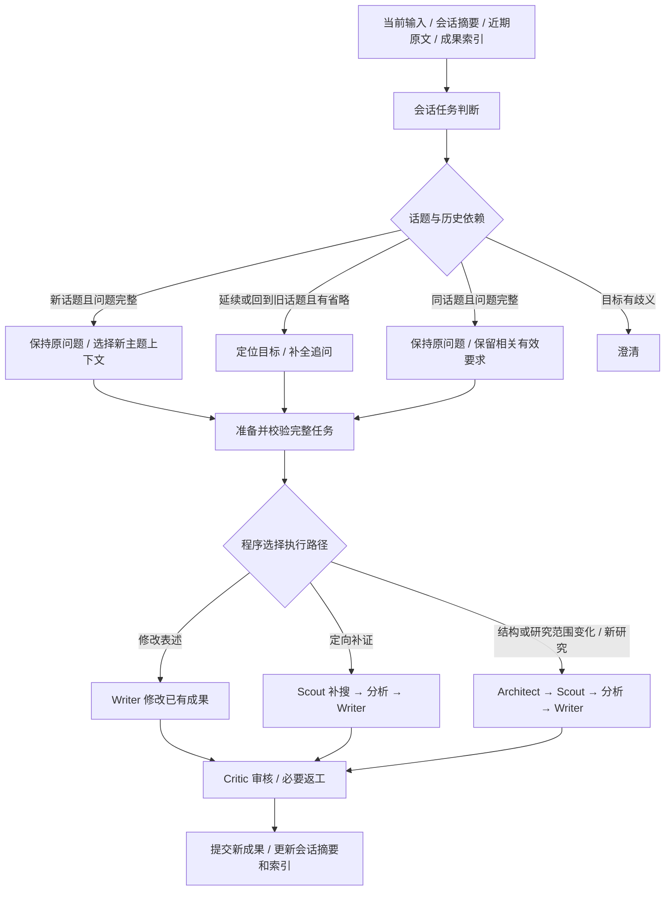

# 会话层智能路由与话题连续性方案及代码核查

日期：2026-10-05，Asia/Singapore。核查对象：话题连续性、追问改写、追问执行路由和现有研究入口。范围：只读源码核查与设计细化；本轮未实现新路由，未运行模型、搜索、数据库迁移或30轮实验。

本方案补充 [研究内历史隔离与追问路由删除实现及多轮会话链路方案](研究内历史隔离与追问路由删除实现及多轮会话链路方案-20261005.md)：将“所有任务进入 Architect”细化为“会话层准备完整任务，执行层按验证后的任务类型选择入口”。此前删除的内部 LLM 追问路由保持删除，智能体工作历史仍以本次 run 为边界。

## 一、推荐方案

建议增加会话层的智能任务判断，覆盖话题关系、是否依赖历史、追问操作三件事。判断后准备目标成果、有效要求和搜索任务，再由程序选择执行路径。纯改文可以省去重新规划与搜索；补证据可以省去全量规划，但不能省去后续写作与审核。

## 二、话题连续性与是否改写分别判断

话题关系建议分为四类：

| 关系 | 示例 | 处理 |
| --- | --- | --- |
| 延续当前话题 | “把这份报告缩到1500字”“那德国呢” | 找到目标报告或比较课题；有省略时补全；继承该主题仍有效的要求 |
| 回到更早话题 | “回到最开始那份汽车报告，补上出口数据” | 从会话成果索引找早期报告，不能自动取最新报告；按需补全 |
| 新话题 | 汽车研究后输入完整的“分析国内光伏行业2025年竞争格局” | 原 query 原样传入新任务；不自动携带汽车报告与其时间、网站、字数要求 |
| 无法确定 | 会话里有多个比较表，用户说“第二个再详细一点” | 澄清具体对象；不能靠默认最新成果代替用户选择 |

必须另设 `depends_on_history`。同话题的完整问题也可以直接传入，话题延续不等于必须改写。例如用户已明确行业、地域、时间和目标，不能为了“连续”把旧任务再拼进去。相反，“那德国呢”换了研究对象，仍可能依赖上一问题的年份和比较维度，不能只靠对象是否相同判新话题。

判定顺序在逻辑上为“关系与目标 → 历史依赖 → 按需补全 → 操作”。实现上可用一次结构化模型调用共同输出这些字段，避免为了三个逻辑步骤固定增加三个模型请求。上下文须有预算，只提供相关摘要、近期原文与候选成果索引。

若发现更早的报告候选不在首次输入中，再进行一次有界查找与目标确认。模型只能选择服务端提供的候选标识；服务端验证成果仍属于当前用户和会话，不能直接信任模型生成的 run_id。

新话题不等于清空会话记录。原始对话和各主题摘要继续保存；本轮输入按主题重新选择。明确具有全会话作用域的语言、表达偏好可以保留，上一研究的局部要求不能默认升级为全会话偏好。

## 三、路由到一条完整执行路径

| 用户操作 | 推荐路径 | 必要输入和前提 |
| --- | --- | --- |
| 缩短篇幅、调语气、改格式、改标题 | Writer → Critic | 目标报告与章节、已提交的当前要求、修改指令、已有证据引用；不需要新增事实或改研究结构 |
| 某个方面补更多来源、补最新证据、核实某项结论 | Scout → DataAnalyst → Writer → Critic | 定向搜索任务、目标章节或结论、旧证据及缺口、当前范围与来源限制；补搜结果必须回写报告 |
| 增加实质研究章节、换对象/范围/比较框架、多个要求共同影响结构 | Architect → Scout → DataAnalyst → Writer → Critic | 完整任务、相关旧成果、有效要求；Architect 先制定或调整大纲 |
| 完整的新研究问题 | Architect → Scout → DataAnalyst → Writer → Critic | 原 query 与本轮要求；不自动继承旧主题成果 |
| 目标有歧义或缺少不可恢复的修改对象 | 澄清后再分派 | 不先执行搜索或写作 |

“增加章节”需看章节内容。如果只是把已有内容整理为“总结”章节且没有新增事实，可以走 Writer；新增“政策风险”等实质研究维度应先走 Architect。“再详细一点”同样可能是表述展开、补证据或扩展研究，不能只按关键词决定。

“字数少一些”不能直接生成用户未指定的硬性字数上限。它是相对压缩指令，需要保留事实与关键要求；只有用户明确“1500字以内”时才更新数值限制，字符计数沿用项目现有正文口径。

补证据的搜索词由任务判断模块生成建议，再由程序和 Scout 按对象、时间、地域及来源限制校验和细化。每条任务至少关联 `target_section` 或目标结论、补证目标与 query。多个任务可以使用同一关键词，任务标识仍需独立，不能因为关键词重复把章节关系丢失。

一次追问可能含多种操作，例如“增加政策风险一章，再压缩到1500字”：先 Architect 规划，补搜新增维度，Writer 同时落实篇幅要求。又如“补两条近期证据并缩短结论”：走补证路径，再由 Writer 压缩。路由根据所需能力组合，不能只给一个意图后丢掉其他要求。

第一阶段补证路径保留现有 DataAnalyst 节点，沿用原分析与计算检查。是否可按没有数据计算的任务跳过该节点，待单独验证；本方案不把它当成已有优化。

## 四、统一决策数据与执行保护

建议扩展现有会话上下文契约，使用严格类型校验，至少记录：

- `topic_relation`、`topic_id`、`depends_on_history`、`target_artifact_refs`。
- `original_query`、`resolved_query`、`assumptions`、`unresolved_references`。
- `operations`：表述修改、结构变化、证据补充等可组合操作及用户原话依据。
- `requirements_patch`、基准版本、已提交的 `active_requirements`。
- `revision_instructions`、`target_sections`、`search_tasks`。
- 程序校验后生成的 `execution_plan`、决策版本、选择依据、回退原因。

服务端检查目标成果、要求变更依据、待搜任务和当前预算，再生成合法路径。模型自报“高置信”只能作为日志，不能替代这些检查。

进入 Writer 或 Scout 前，要求必须已提交，不能留下只有 Architect 才会解析的 pending 更新。用户修改与 Critic 反馈分别保留来源，避免把用户要求伪装成审核问题。

每条执行路径仍创建新 run，使用现有阶段保护、历史隔离、取消、检查点、预算和幂等交付。继承的是经过校验的业务材料；新 run 的耗时、搜索次数、节点重试、审核结论和完成状态重新初始化，不能复制父 run 的可变控制状态。

首次决策与目标成果版本冻结到当前 run。技术恢复读取已有决策和检查点，不因后续会话消息或环境变化重新判断路径。若审核要求补搜，记录升级原因并在当前 run 的允许返工路径执行；不得把错误路由藏成“原计划完成”。

新话题完整输入可以在任务判断不可用时走原 query 的完整研究路径。依赖旧成果但目标不明的输入不能同样降级，因为 Architect 无法补救错误目标，应进入澄清或保留任务准备失败状态。纯改文若缺失报告/章节状态、材料哈希不一致或需要新增事实，不能静默当作普通写作完成。

## 五、现有代码支持与需要修改的位置

| 位置 | 已核查的当前行为 | 所需改造 |
| --- | --- | --- |
| `ResearchContextService` | 有追问消解、假设和未消解指代；有历史或记忆时调用 resolver；完整问题保持原意主要依靠提示词 | 扩展话题关系、历史依赖和组合操作输出；新话题显式保留原 query；统一严格校验与澄清状态 |
| 会话摘要与成果选择 | 前一方案尚待完整实施；研究服务当前默认定位最近已交付成果 | 维护主题及成果索引；按目标选择，处理远距回指；将摘要范围与有效要求作用域纳入 builder |
| `DeepResearchV2Service._graph_input` | 已删除内部路由；有父成果时设置待 Architect 确认的要求；可自动继承上一研究网站范围 | 接受已校验的会话任务；依据显式成果选择继承；新话题不默认继承父报告或网站范围；在跳过 Architect 前完成要求提交 |
| `graph.py` | 入口固定 `START → plan`；已有审核后的 Writer 修订和 Scout 补搜路径 | 增加读取已验证执行计划的确定性入口选择，所有分支通过原阶段保护；复用审核/返工/交付尾部，避免再引入图内 LLM 路由节点 |
| `LeadWriter` | `_revise_report` 要求未解决 Critic 反馈和章节草稿；修订至少保留原章节55%且不少于300字符；普通写作要求 facts | 新增明确的已有成果编辑模式，支持用户压缩与格式指令；与 Critic 修订共用必要工具但保留不同语义；同步正文、章节、主张和引用版本 |
| `DeepScout` | 补搜要求非空 `pending_research_tasks`，每项 query 为非空字符串；正常搜索依赖 pending 大纲章节 | 提供会话定向补证任务适配，校验任务归属和目标；避免把几个搜索词直接扔进没有大纲/来源/事实账本的空 state |
| `contract_updates.py` | 已有要求补丁、版本校验和逐字用户依据校验 | 会话层复用要求提交规则；主题切换用明确作用域基线，避免与 Architect 重复提交 |
| 状态、恢复与评测入口 | 图版本和配置已冻结；此前评测仍有自组装历史入口 | 增加决策及执行计划版本、恢复兼容规则；生产和评测都调用同一个会话 builder |

源码中仍有“追问路由失败”“Critic 或追问路由器”等旧提示词或注释，不代表内部路由模块仍在执行。后续实施时应改成当前“会话任务/要求待确认”语义，避免误导模型或维护者。本轮没有修改这些源码。

直接把 `START` 指向现有 `revise` 不会实现可靠压缩：没有 Critic 反馈时该方法会直接返回审核，有反馈时也可能因最小长度规则拒绝大幅压缩。这是代码支持情况，尚未用真实模型验证。

## 六、核查证据、指标和失败场景

原始记录：[代码依据与方案口径.json](../backend/eval/data/会话层智能路由与话题连续性核查-20261005/代码依据与方案口径.json)。记录9个源码文件的 SHA256、具体定位行、设计口径及未评估项目。静态定位脚本第一次因将 `asyncio.to_thread` 调用写成同步调用文本而中断，修正定位串后完成；没有应用源码运行失败，过程在原始记录中保留。

| 核心指标 | 本轮结果 |
| --- | --- |
| 源码核查文件 | 9个，有哈希与定位记录 |
| 模型、搜索调用 | 均为0 |
| 测试执行 | 0；没有复用上一轮154项通过作为新路由验收 |
| 应用源码、数据库、运行服务修改 | 均无 |
| 话题判定、改写、路由准确率 | 尚未评估 |
| 成本、延迟和30轮回答质量 | 尚未评估 |

以下为需要新增验证的失败场景，属于设计样例，不是真实运行失败记录：

| 场景 | 错误表现 | 预期处理 |
| --- | --- | --- |
| 新行业问题仍继承旧父成果 | 带入旧研究网站限制、时间或旧结论 | 新主题筛选上下文与要求；不默认加载最新父成果 |
| 同话题完整问题被重复改写 | 加入用户未指定的比较对象或目标 | 依赖历史为false，保留原 query |
| 远距回指取最新报告 | 对错误报告做修改 | 候选成果检索与授权确认，目标不确定时澄清 |
| 缩短同时补证据只走 Writer | 没有新增证据却生成新事实 | 组合操作选择补证路径，最终落实两类要求 |
| 压缩更新 final_report 但草稿没更新 | Critic 返工后又恢复旧长文 | 同步成果状态和版本，引用与主张关联检查 |
| 跳过 Architect 时要求仍 pending | 旧篇幅限制或来源范围继续生效 | 会话任务提交要求后再选择快捷路径 |
| Scout 仅拿到关键词 | 补搜没有目标、结果不进入对应章节 | 结构化任务与目标章节，补搜后重新写作并审核 |

后续路由标注集至少覆盖纯压缩、格式调整、相同主题完整问题、新话题、回到旧话题、含糊指代、补证、结构变更、组合操作及要求撤销。可以在30轮开发集基础上增加这些用例，使用允许路径集合，避免把多种正确计划强行标为唯一正确路由。

指标分别记录：话题关系混淆矩阵与新主题误继承率、历史依赖判定与不必要改写率、目标成果命中率、要求变更正确率、执行路径准确率、需要检索却跳过检索的比例、需要规划却跳过规划的比例、回退/澄清率、原文和证据保留情况，以及路由/摘要/各智能体的token和耗时。

使用成对任务比较统一完整研究路径与会话路由路径，分别报告答案质量和成本。原报告编辑、补证、结构改造分组分析。少走模型调用是否节省总成本，仍取决于判断模块成本和错误路由导致的返工，当前只是待验证假设。

## 七、实施顺序与结论边界

1. 先实现统一会话任务判断、话题/成果选择和有效要求提交；暂时所有研究任务仍走完整路径，验证判断结果。
2. 打通 Writer 已有成果编辑路径，保留 Critic 和交付检查，验证压缩及格式任务。
3. 打通 Scout 定向补证路径，验证搜索目标、来源回读、报告回写和质量审核。
4. 结构变化和新研究沿用 Architect 完整路径；之后再评估局部规划与分析节点跳过等优化。
5. 与会话摘要链路使用统一 builder，完成生产迁移及应用验收后，运行分组用例和同会话30轮实验。

**已核查**：现有代码具备规划、审核、定向补搜和历史隔离基础，但没有本方案的会话决策与多个新任务入口；Writer 用户编辑接口和会话要求提交仍需补齐。

**间接推断**：纯编辑与定向补证可减少重复全量规划/检索，话题筛选可减少错误继承。尚不能承诺准确率、成本或质量改善。

**尚未评估**：新路由实现、话题判断与改写模型效果、真实压缩/补证质量、30轮窗口超限情况。现用服务的已有迁移与重启缺口沿用前一报告，本轮未作部署操作。
