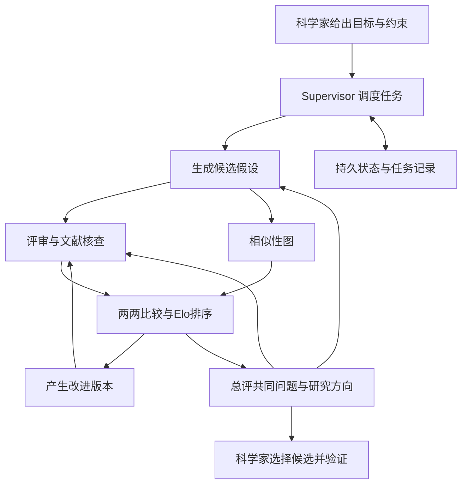

# 协作科学家2025至2026通俗总结与实现及评估分析

## 阅读与分析口径

- 分析日期：2026-10-07，Asia/Singapore。
- 评估对象：Google AI Co-Scientist。2025 年预印本《Towards an AI co-scientist》与 2026 年正式论文《Accelerating scientific discovery with Co-Scientist》，以及官方介绍、企业版说明和相关验证论文。
- 数据/配置口径：读取固定版本 arXiv:2502.18864v1、v2，Nature 正文及补充材料。分别区分 Gemini 2.0 核心研究与补充材料中部分 Gemini Flash 2.5 实验；分别区分模型内部评价、有标准答案的问答、专家主观盲评与实验室验证。
- 本次性质：公开资料阅读、论文指标转录、显示值算术复算和证据边界分析。没有运行 Google Co-Scientist，没有复现作者实验，也没有修改本项目业务实现或开展接入效果评测。
- 本文的例子、数据结构、预算和工程方案是自行整理的建议，均不代表 Google 的内部实现、实验配置或已测得效果。

## 原始材料与结果路径

材料目录：`backend/eval/data/论文分析/协作科学家2025至2026资料核查-20261007/`。

- [2025 年固定 v1 论文](../backend/eval/data/论文分析/协作科学家2025至2026资料核查-20261007/2025年论文原文.pdf)及[全文提取](../backend/eval/data/论文分析/协作科学家2025至2026资料核查-20261007/2025年论文全文提取.txt)。
- [2026 年固定 v2 论文](../backend/eval/data/论文分析/协作科学家2025至2026资料核查-20261007/2026年论文原文.pdf)及[全文提取](../backend/eval/data/论文分析/协作科学家2025至2026资料核查-20261007/2026年论文全文提取.txt)。
- [Nature 补充材料](../backend/eval/data/论文分析/协作科学家2025至2026资料核查-20261007/2026年论文补充材料.pdf)及[全文提取](../backend/eval/data/论文分析/协作科学家2025至2026资料核查-20261007/2026年论文补充材料全文提取.txt)。
- [原始材料索引、抓取结果与 SHA-256](../backend/eval/data/论文分析/协作科学家2025至2026资料核查-20261007/原始材料索引.json)。
- [网页检索读取记录](../backend/eval/data/论文分析/协作科学家2025至2026资料核查-20261007/网页检索读取记录.json)。保存实际读取的网页工具响应，不是作者逐题实验日志。
- [论文指标转录及口径核查](../backend/eval/data/论文分析/协作科学家2025至2026资料核查-20261007/论文指标转录及口径核查.json)。保存作者报告的数字、来源定位和本次算术复算，不是本地模型测量结果。

另外保存了 2025/2026 官方介绍与企业版说明 HTML。直接下载 Nature 网页得到访问验证页，不能充当正文存档；正文分析依据网页检索工具实际返回的全文与固定 v2 PDF。肝纤维化论文直接下载返回 HTTP 403，但网页检索工具成功读取其内容；相关结果保存在读取记录中。两项限制均记录于材料索引。

## 一、用容易理解的话说明它做什么

Co-Scientist 可以理解为一个协助科学家选研究方向的 AI 团队：读资料，提出多种解释，挑出问题，比较解释，再把有潜力的想法改成能够验证的研究方案。它的典型产物是候选假设及其排序、依据、评审意见、研究概览和实验方案。

例如，研究者发现一种材料在特定条件下失效，但不知道原因。系统可以提出“界面损伤”“杂质影响”“测量误差”等不同解释，查找相关证据，检查各解释能否说明已有现象，并建议能够区分这些解释的实验。这是自行构造的教学例子，没有运行系统。

普通文献检索帮助回答“别人已经知道什么”；Co-Scientist 进一步尝试回答“根据这些知识，下一步值得验证什么”。这里的假设是待验证判断。AI 生成、AI 评审与 AI 排名均不能代替现实验证。[2025 官方介绍](https://research.google/blog/accelerating-scientific-breakthroughs-with-an-ai-co-scientist/)、[2026 Nature 论文](https://www.nature.com/articles/s41586-026-10644-y)

## 二、2025 和 2026 是什么关系

| 时间/版本 | 可以确认的内容 | 应如何理解 |
|---|---|---|
| 2025-02-19 官方介绍 | 基于 Gemini 2.0，介绍多代理、候选锦标赛和推理时计算；通过 Trusted Tester 项目面向研究组织 | 早期系统公布 |
| 2025-02-26 arXiv v1 | 题名为《Towards an AI co-scientist》；已经包含六类专门代理、Supervisor、持久状态、专家评价与三类生物医学验证 | 原始技术报告 |
| 2026-05-19 Nature 在线发表 | 题名为《Accelerating scientific discovery with Co-Scientist》；仍延续原有架构，扩充机制分析和实验验证，包括 AML 药物组合实验 | 同一研究路线的正式发表与扩展 |
| 2026-05-19 官方产品介绍 | 宣布通过 Gemini for Science 的 Hypothesis Generation 工具向个人研究者逐步开放；介绍 ChEMBL、UniProt 工具整合及选择性合作中的 AlphaFold 测试 | 工具化与应用扩展；公告不等于所有账号已可用 |
| 2026-06-29 arXiv v2 | 同一个 arXiv 编号更新为正式论文相关版本 | 阅读时需要固定版本，避免把现行摘要当作 2025 原文 |
| 截至 2026-10-07 企业版说明 | Gemini Enterprise 中为 Preview，访问受限，需联系 Google 客户团队 | 企业版已经有公开说明，使用仍有访问条件 |

来源：[2025 官方介绍](https://research.google/blog/accelerating-scientific-breakthroughs-with-an-ai-co-scientist/)、[arXiv 版本历史](https://arxiv.org/abs/2502.18864)、[Nature 正式论文](https://www.nature.com/articles/s41586-026-10644-y)、[2026 官方介绍](https://deepmind.google/blog/co-scientist-a-multi-agent-ai-partner-to-accelerate-research/)、[企业版说明](https://docs.cloud.google.com/gemini/enterprise/docs/co-scientist-and-alphaevolve)。

应特别区分三件事：

1. **发表年份与实验发生时间不同。** 203 个研究目标分析使用的是截至 2025-02-03 输入系统的目标；2025 v1 和 2026 正式论文均包含该分析。11 个问题的专家评价及 3.64/3.09/2.36 这些数值也已经见于 2025 v1。
2. **核心研究与补充实验的基础模型不同。** 正式论文 Methods 明确核心研究使用 Gemini 2.0；补充材料 Note 3 中部分排序与 Meta-review 实验涉及 Gemini Flash 2.5。不能据此断言“2026 整套系统统一换成某个新模型”，也不能把产品当前底座与论文配置混为一谈。
3. **公开方法与完整源码不同。** 正式论文没有公开完整系统源代码；补充 Note 8 提供代理逻辑伪代码，Note 9 提供代理提示词。可以参考方法构建自己的系统，但本次未获得 Google 内部部署、精确资源预算和完整复现包。

## 三、系统如何运转：六个专门角色加一个调度者

“Agent”可以理解为“带着固定职责、输入和工具工作的模型调用程序”。论文以 Gemini 为底座，通过不同提示词、策略和工具定义职责。一个职责可以执行多次模型调用，也可以有多个工作实例；角色数量不等于独立训练的模型数量。

| 角色 | 通俗职责 | 主要工作产物 |
|---|---|---|
| Generation，生成 | 提想法 | 研究方向、候选假设及研究方案 |
| Reflection，评审 | 检查想法有什么问题 | 文献核查、前提检查、支持/反对证据与缺陷 |
| Ranking，排序 | 比较哪个更值得投入 | 两两比较记录、辩论理由、Elo 排名 |
| Proximity，相似性 | 整理相近想法，帮助覆盖不同方向 | 假设相似关系图、聚类与匹配信息 |
| Evolution，演化 | 根据批评产生改进版本 | 补证、合并、简化或发散得到的新候选 |
| Meta-review，总评 | 从多次评审中找共同问题 | 后续代理的反馈、研究概览与研究路线 |
| Supervisor，调度 | 管任务、资源和停止条件 | 任务队列、调度决策、进度统计与状态保存 |

来源：[Google Cloud 架构说明](https://docs.cloud.google.com/gemini/enterprise/docs/co-scientist-and-alphaevolve)、[Nature Methods](https://www.nature.com/articles/s41586-026-10644-y)。

可用下面的图理解反馈关系。图为根据公开方法自行绘制的概括，真实系统采用异步任务执行，运行顺序不必是固定的一条流水线。



### 1. 先把问题变成研究任务配置

科学家给出的内容不止一个问题，还可以包含已有研究、自己的初步想法、实验条件、希望得到的方案和不允许使用的技术。系统解析这些内容，得到研究目标、限制、偏好和评价准则；后续生成、比较与改进都围绕同一份准则进行。

例如，“尽量新颖”与“一个月内能验证”可能相互冲突。把这些要求提前写清楚，排序才有意义。研究者也可以在运行过程中修改目标、加入候选假设或提供人工评审。[Nature Methods：From research goal to research plan configuration 与 Expert-in-the-loop](https://www.nature.com/articles/s41586-026-10644-y)

### 2. 用多种方式提出候选

Generation 的策略包括查阅文献、模拟多轮科学讨论、把中间假设逐步组合成完整解释，以及根据此前候选和总评扩展尚未探索的方向。

这一步需要同时产出“认为发生了什么”“依赖哪些前提”和“如何验证”。如果只能生成一个听起来有意思的结论，却没有检验方式，后续很难判断价值。[Nature Methods：Generation agent](https://www.nature.com/articles/s41586-026-10644-y)

### 3. 评审不止打一个分数

Reflection 有多种评审策略：先快速筛选明显问题，再通过工具检索核查；把复杂判断拆成中间前提和子前提，独立检查；判断能否解释已有实验中的特殊观察；按步骤推演机制或实验，找出可能失败之处；并根据锦标赛与总评结果重复审查。

需要把“模型在语言层面推演实验”与“执行真实数值模拟或实验”分开。Simulation review 本身不能算实验验证。发现某个前提错误时，还要判断它是否会推翻核心假设，或只是可修复的细节。[Nature Methods：Reflection agent](https://www.nature.com/articles/s41586-026-10644-y)

### 4. 让候选两两比较，形成锦标赛

Ranking 把两个候选放在一起，围绕目标匹配、正确性、新颖性和可检验性进行比较。重要候选采用多轮辩论，较低排名候选可以使用单轮比较。结果被转成胜负并更新 Elo；论文中新候选初始 Elo 为 1,200。

Elo 可以理解为“在这批候选的比较中表现如何”。胜过强候选通常比胜过弱候选带来更多分数。它是内部相对排名，不能解释为假设成立的概率，也没有建立不同研究目标之间的统一质量刻度。

系统优先安排新候选、高排名候选以及相近候选的比赛；Proximity 提供相似性图以帮助配对和组织不同方向。科学辩论提示词还被用于降低 A/B 放置顺序对模型裁判的影响。[Nature Methods：Ranking agent 与 Proximity agent](https://www.nature.com/articles/s41586-026-10644-y)

### 5. 产生新版本，再重新接受评审

Evolution 会补充依据、修复推理缺口、改善实验可行性、组合多个候选、简化复杂解释，也会探索偏离现有方向的新想法。

公开方法中一个很实用的设计是：**演化产生新的候选，不直接覆盖原候选。** 改进版必须重新评审、重新比赛。这样可以追溯修改过程，也避免一次不成功的修改毁掉此前的好版本。[Nature Methods：Evolution agent](https://www.nature.com/articles/s41586-026-10644-y)

### 6. 总结反复出现的问题，让后续工作有针对性

Meta-review 汇总多次评审与比赛中的共同问题。例如，多个方案都依赖某个未经证实的前提，就让后续生成与评审更加关注这个前提。它还整理领先候选和研究概览，供科学家决定下一步。

这里的自我改进主要是任务内的反馈、检索、候选修改和选择。公开架构的这套循环不要求每轮重训模型权重；论文把利用人类与实验反馈的强化学习列为未来方向。[Nature Methods 与 Discussion](https://www.nature.com/articles/s41586-026-10644-y)

## 四、为什么给它更多推理资源可能有效

“Test-time compute”是模型被使用时花费的计算，可以用来生成更多候选、查更多资料、进行更细评审、完成更多比较或尝试改进。Co-Scientist 把这些计算安排成一个围绕研究目标的探索循环。

这类任务通常存在许多候选解释，一次生成容易碰到不够好的解。更充分的探索和核查有机会找到更好的候选，但计算量增加不保证现实正确性单调增加。相同底座模型可能让不同代理共享盲点，内部裁判也可能偏好越来越符合自己评价习惯的文本。

因此应同时观察外部正确性、证据支持、候选多样性和真实预算，而不能只观察 Elo 曲线。论文中的内部对比也并非所有基线都享有相同总推理预算；作者明确指出部分推理模型用少得多的计算与时间也有竞争力。[2025 v1 第 4 节](https://arxiv.org/pdf/2502.18864v1)、[Nature 自动评价部分](https://www.nature.com/articles/s41586-026-10644-y)

## 五、怎样自己实现一套类似系统

以下是本次整理的工程方案，不是 Google 代码复现，也没有在本仓库执行。

### 1. 先建立可以检查的状态

建议保存七类记录：

| 记录 | 必须有的信息 | 解决的问题 |
|---|---|---|
| ResearchPlan | 目标、约束、评价维度、预算、来源范围 | 让所有代理围绕同一任务 |
| Hypothesis | 唯一编号、正文、前提、可推翻条件、父版本编号 | 防止把假设当事实，保留演化关系 |
| Evidence | 网址/DOI、原文片段、来源时间、支持或反对关系 | 让具体判断能追溯依据 |
| Review | 对应版本、缺陷、依据、问题严重程度 | 避免评审只给印象分 |
| Match | 两个候选编号、顺序、胜负、理由、裁判配置 | 复查排名与位置偏差 |
| MetaReview | 共同问题、遗漏方向、后续检查要求 | 把跨轮经验用于后续任务 |
| Task/Checkpoint | 任务状态、输入版本、重试、成本和已完成结果 | 支持异步运行、故障恢复和预算控制 |

持久记忆可以先用 SQLite 或 JSON 文件，规模增加后再迁移到数据库。向量索引可以帮助找相似文献或候选，但不能替代假设版本、引用关系与任务状态这些明确记录。

### 2. 把角色实现成职责明确的函数

先使用一个现有模型，分别定义生成、评审、比较、改进和总评函数，每个函数有专门提示词、输入字段和输出 schema。LLM 执行语言推理；程序验证字段、引用编号、状态转移和资源预算。六个角色不要求六个不同品牌模型，也不要求六个独立微调模型。

示例字段结构如下，字段是本次建议：

```json
{
  "id": "H017",
  "parent_ids": ["H003"],
  "statement": "待验证的解释",
  "assumptions": ["成立所需的前提"],
  "supporting_evidence_ids": ["E008"],
  "opposing_evidence_ids": ["E012"],
  "falsification_condition": "哪种观察足以推翻该解释",
  "validation_plan": "怎样区分该解释与替代解释",
  "status": "needs_review"
}
```

提示词应明确要求区分已知事实、推断和未验证前提；支持与反对证据都要搜索；找不到证据时记录缺口；不得把模型猜测填写成真实论文结论。

### 3. 先做好检索核查

搜索结果用于定位来源，读取原文后保存支持具体判断的片段。核查主张是否真的出现在来源里，研究对象、条件和时间是否一致。对新颖性，应搜索同义表述、相关机制和相近实验，区分“问题首次提出”“旧机制换场景”“已知内容重新组合”等不同程度。

2026 官方介绍确认系统整合了网页搜索、ChEMBL 和 UniProt；AlphaFold 在选定研究合作中作为工具测试。自建系统可以根据研究领域接入相应数据库，但工具调用成功仍不意味着假设已被证实。[2026 官方介绍](https://deepmind.google/blog/co-scientist-a-multi-agent-ai-partner-to-accelerate-research/)

### 4. 把相似性与比赛分开实现

可先用 embedding 找出相似候选，再用模型检查它们是否只是换了一种说法。这是建议的简化实现，不代表 Google 的 Proximity 具体内部算法。按聚类保留不同思路，避免大量近似候选占满预算。

比赛让裁判返回赢家及依据，程序更新 Elo。先随机化 A/B 顺序，对关键比较交换顺序复核；不强求所有候选两两比较。给新候选和不同思路保留预算，同时对领先候选做更细评审。

如采用标准 Elo 更新，可由程序计算预期胜率和分数变化；例如 K=32 仅是可以尝试的工程参数，本次没有读取到足以把它当作 Google 固定配置的证据。任何 K 值都不能把模型裁判分数转成现实正确率。

### 5. 用异步队列调度，并保留检查点

新候选产生后，排入评审任务；评审通过后进入比赛；领先候选排入改进任务；多轮之后生成总评。程序控制任务去重、超时、重试和成本，完成结果落盘。监督模块根据状态决定下一步任务，并允许研究者反馈。

一个初步原型可试用 10–20 个初始候选、保留数个不同方向、每个方向进行有限改进，再生成研究概览。这些数量是起步建议，不是论文默认值或效果保证。停止条件应包括总成本、时间或轮数预算，以及近期是否还获得重要新证据或新的有效方向；内部评分升高本身不宜成为唯一继续理由。

下面的概念伪代码演示异步任务的关联；函数名称表示职责，不代表已有库接口。没有在本地运行。

```python
async def run_co_scientist(goal, llm, tools, store, budget):
    plan = await parse_goal(goal, llm)
    store.save_plan(plan)
    queue = make_queue(initial_task="generate", plan=plan)

    while queue and budget.available():
        task = queue.pop_ready()
        state = store.context_for(task)
        result = await execute_role(task, state, llm, tools)
        validate_schema_and_evidence_references(result, store)
        store.commit_task_result(task, result)
        budget.charge(result.usage)
        queue.extend(follow_up_tasks(result, store))
        # 新候选 -> 评审；通过评审 -> 比赛；领先候选 -> 新版本
        # 周期性总评 -> 后续生成/评审的反馈
        store.checkpoint(queue, budget)

    return await write_research_overview(store, llm)
```

真正并发运行时，需要多个 worker 获取就绪任务，并对结果写入和状态更新做原子提交。以上伪代码没有展示这些部署细节；也没有实现真实实验执行。

### 6. 迁移到行业 DeepResearch 时的建议

行业研究可以参考候选池、竞争性解释、反证核查、版本记录和共同缺口总结。例如对“利润为何增长”保留销量、售价、成本和一次性收益等解释，再用资料筛选。这里的新颖性不应压过事实准确性与用户要求覆盖；常规事实问题的正确答案可能早已公开。

对于本项目，建议先研究证据绑定、反证处理和有限改进能否带来收益，再决定是否增加大规模锦标赛。该建议是机制层面的间接推断，本次没有审计本项目代码与 Co-Scientist 的功能对应关系，没有实现接入或证明效果。

## 六、作者评估到底支持什么

### 核心指标与口径

以下数值均为作者公开资料转录，或本次对显示值的算术复算，不能归为本地效果测量。

| 评价对象 | 作者报告 | 可以支持的理解 | 边界 |
|---|---|---|---|
| 2025 v1 GPQA Diamond | Top-1 准确率 78.4% | 排名靠前的输出在有标准答案问题上有一定正确性 | 不是开放科学假设的发现成功率 |
| 推理时间与候选质量 | 203 个研究目标，最高/Top-10 Elo 随进程上升 | 内部评价显示后期候选优于早期 | Elo 是内部相对自动评价，且同一分析已见于 2025 |
| 专家候选对照 | 7 名专家提供 15 个目标及最佳猜测 | 可以观察 AI 裁判如何比较候选 | 不能视为客观证明科学家被全面超越 |
| 专家盲评 | 11 个开放问题；新颖性 3.64/5，影响力 3.09/5，偏好排名 2.36 | 小样本中专家总体更偏好该系统输出 | 主观评价；偏好 1 最好、4 最差；2025 已有这些数值 |
| 新颖性评审是否联网 | 已发表想法评分 6.14 → 2.38，满分 10 | 搜索帮助识别“已有研究并非新发现” | 分数降低在这里是正确方向 |
| Evolution 与 GPQA | 70.9% → 75.4%，差 4.5 个百分点 | 所分析子集的点估计有改善 | 150 题中选择改进候选排名最高的 134 题；差值 95% CI 为 -2 至 11 个百分点，跨 0 |
| Evolution 与 paper QA | 最高质量均分 4.7 → 5.6，差 0.9 | 构造任务上的评价有改善 | 95% CI 0.05–1.7；不是湿实验发现率 |
| Meta-review 与 GPQA | AUC 0.629 → 0.634 | 对正确性的识别点估计略有改善 | 1,680 个候选，Flash 2.5，提升很小 |
| Meta-review 与 paper QA | AUC 0.521 → 0.597 | 构造任务上识别正确性有所改善 | 600 个候选，Flash 2.5；不直接代表业务效果 |

定位：[2025 v1 第 4.1–4.3 节](https://arxiv.org/pdf/2502.18864v1)、[Nature 自动评价与专家评价](https://www.nature.com/articles/s41586-026-10644-y)、[补充 Note 3，PDF 第 7–9 页](https://media.springernature.com/original/springer-static/esm/art%3A10.1038%2Fs41586-026-10644-y/MediaObjects/41586_2026_10644_MOESM1_ESM.pdf)。

不能把 2025 的 78.4% 和补充材料中的 70.9%/75.4% 直接比较成年度退步或进步：它们属于不同分析口径，后一项明确选取了特定子集。也不能只读正文的正向概括就称 Evolution 的 GPQA 增益具有统计显著性；补充材料的差值置信区间包含 0。

### 逐类验证分析

| 应用类别 | 实际验证了什么 | 尚未建立什么 |
|---|---|---|
| AML 药物再利用 | 专家选取候选并进行细胞实验；新颖单药候选中 KIRA6 在若干 AML 细胞系出现活性；2026 还验证七种药物组合 | 不能据此建立患者疗效、广泛适用性或系统总体命中率 |
| 肝纤维化 | 人类肝脏类器官实验支持部分候选；相关论文报告 Vorinostat 减少 91% 的 TGFβ 诱导染色质结构变化 | 91% 是具体实验终点，不是病人治愈率 |
| 抗菌药物耐药性相关机制 | 系统提出 cf-PICI 与不同噬菌体尾部结合扩大宿主范围的解释，匹配团队当时尚未公开的实验发现 | AI 推理没有重新完成全部实验，也不能推导所有科研问题均能按同样速度解决 |
| 2026 其他合作案例 | 官方介绍细胞衰老、ALS、植物免疫等应用探索 | 本次未取得所有项目逐题数据，未独立核验其完整实验效果 |

来源：[Nature 生物学验证与讨论](https://www.nature.com/articles/s41586-026-10644-y)、[Advanced Science 肝纤维化论文](https://advanced.onlinelibrary.wiley.com/doi/abs/10.1002/advs.202508751)、[2025 官方对机制重新发现的说明](https://research.google/blog/accelerating-scientific-breakthroughs-with-an-ai-co-scientist/)、[2026 官方案例介绍](https://deepmind.google/blog/co-scientist-a-multi-agent-ai-partner-to-accelerate-research/)。

没有获得作者所有候选的逐题原始输出，因此不能进一步计算每类开放研究问题的失败率或系统整体真实发现率。

## 七、失败样例与局限性

### 已在作者材料中核查到的失败或效果边界

1. **把旧研究误判为新发现。** 非新颖的已发表想法在未联网评审中平均得到 6.14/10 的新颖性分数，联网后降为 2.38/10。这是作者公开的机制对照，本次没有重跑。
2. **入选药物并非全部有效。** 2026 单药新候选选择 nanvuranlat、KIRA6、leflunomide；正文指出前者与后者在 MOLM-13 中作用有限，重点报告 KIRA6。不能把三个入选候选写成三个全部成功，更不能从这个选择性子集计算通用成功率。
3. **组合方案受实验背景影响。** 七种组合在 MOLM-13 中主要出现协同作用，在 KG-1a 中则混合出现协同与拮抗。候选需要在具体细胞背景中验证，不能用一个背景的成功代替所有背景。
4. **统计证据有限。** Evolution 的 GPQA 差值置信区间跨 0；Meta-review 的 GPQA AUC 差仅 0.005。应保留点估计与不确定性，不把所有模块描述为已被证明具有普遍强收益。

### 自行构造、尚未运行的工程风险示例

- 生成代理与评审代理共享同一错误前提，比赛持续给错误解释更高分。
- 来源标题与假设相关，但正文并不支持具体机制；引用编号存在，引用支持关系却不成立。
- 演化只让句子更完整，没有增加新证据，却被内部裁判认为进步。
- 大量候选只是同一解释的改写，排名靠前但探索方向单一。
- 新颖性检索遗漏付费文献、未发表结果、失败实验或不同术语下的旧研究。

以上五项是机制风险示例，没有被本次测量为 Google 系统的具体失败轨迹。正式论文也承认公开文献范围、负结果缺失、来源质量、幻觉与评价覆盖不足等限制。[Nature Discussion](https://www.nature.com/articles/s41586-026-10644-y)

## 八、已测量、间接推断和尚未评估

- **已测量/直接核查：** 固定版本材料已保存并计算哈希；读取论文题名与版本历史、代理方法和公开代码状态；转录上述指标并复算 4.5 个百分点与 0.9 分差值；核查子集、置信区间和实验终点。作者报告的实验数字不是本地独立测量。
- **间接推断：** 有版本的候选池、证据关系、外部核查、反证和共同问题反馈具有明确工程作用；这些机制适合做自建原型的起点。能否提高本项目质量尚需测量。
- **尚未评估：** Google 完整源码与内部资源配置、作者逐题原始轨迹的独立复核、自建原型的效果、本项目接入后的质量与成本、吞吐和失败率、广泛领域泛化能力。

## 九、结论与下一步建议

Co-Scientist 的核心贡献可以概括为：把科研构思组织成有候选池、有评审、有比较、有改进、有记忆和有人类反馈的持续流程。2025 与 2026 的主线一致，2026 增加正式发表、补充机制实验、进一步生物医学验证和产品入口。

它已经给出了部分现实实验支持，也展示了值得借鉴的实现方法，但内部 Elo、小样本偏好、有标准答案问答与实验室验证回答的是不同问题。现有材料不足以证明它能自主替代科学家，或在所有任务上稳定产生新发现。

如继续实现，建议先构建小规模版本：结构化目标与候选 → 支持/反对证据核查 → 有理由的两两比较 → 保留父版本的有限改进 → 总评与人工选择。完整系统源代码未公开，因此目标应明确为方法复现与工程验证。

如后续评估，在同一模型、检索范围和总预算下比较基础研究流程与新增机制，并记录外部事实正确性、引用支持、用户要求覆盖、反证处理、多样性、耗时和成本。开放科学任务还需专家评审或实验验证；本次仅提出建议，没有启动这些评估。

## 来源与许可说明

本文以中文重新概括并加入教学例子和工程建议。Nature 正式论文及 Google Cloud 说明标注 [CC BY 4.0](https://creativecommons.org/licenses/by/4.0/)；原作者为 Gottweis、Weng、Daryin 等及 Google 相关团队。本文不是原文逐字翻译；所有自行拟定的参数和实现结构已单独标明，原始材料用于来源追溯。
