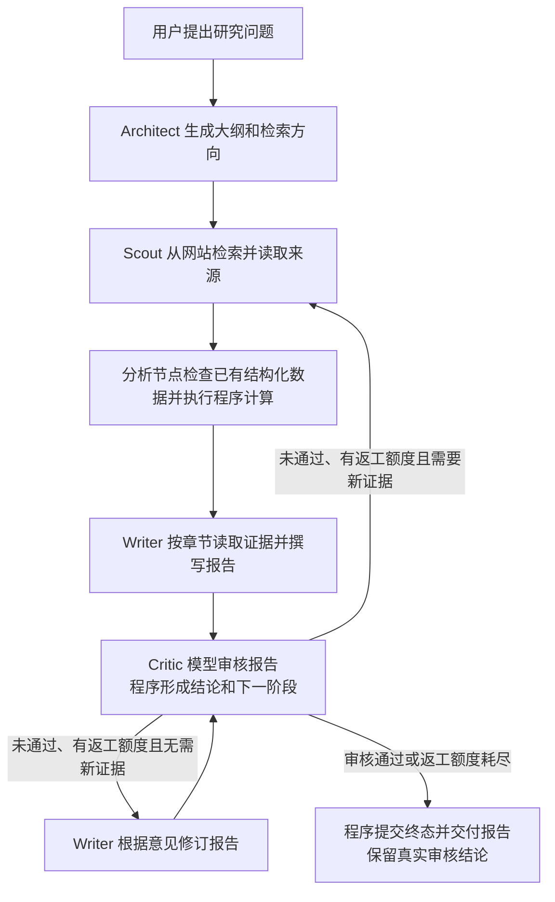

# 多智能体协作范式与本项目选型分析

- 分析日期：2026-11-01（Asia/Singapore）。
- 分析对象：当前工作区 DeepResearch 主图、角色实现、审核路由和恢复入口。
- 数据与配置口径：读取当前工作树，包含已有未提交修改；以实际调用路径为准，不把类注释、历史 README 或未调用的方法当作当前行为。本次没有修改业务代码。
- 方法：静态源码核查与官方架构资料查阅；未调用研究模型、未运行任务或性能评测、未复评历史基准。
- 原始证据：[源码核查证据.json](../backend/eval/data/多智能体协作范式源码核查-20261101/源码核查证据.json)，包含被核查源码的哈希、行号和片段。

## 1. 结论与术语

当前项目最准确的描述是：**由程序集中编排的多角色研究工作流，以顺序阶段为骨架，组合计划与执行、条件路由和审核反馈返工。**

“范式”在这里指多个智能体如何分工、由谁决定下一步、通过什么材料协作。多个角色可以调用同一种底层模型；角色数量不等于模型种类，也不等于同时执行的数量。

这里的“工作流”是开发者预先规定阶段和可走的分支，运行时由程序调用各角色。“自主调度”则是让模型持续决定调用谁、做什么、何时结束。两者可以组合，区别在于决策权放在哪里。

本项目中，Architect 生成研究大纲和检索方向；LangGraph 主图负责调度；Critic 模型给出评分、问题和是否需要新搜索，Critic 程序按规则形成下一阶段，主图执行该阶段。Architect 没有在每个角色完成后重新接收结果并动态指挥全部角色。

## 2. 常见协作方式

以下是便于工程理解的归纳，不是统一、互斥的行业分类。其中顺序、并行、路由和反馈也适用于普通多次模型调用，不意味着每个步骤都具备完整自主行动能力。

| 方式 | 谁控制过程，数据如何流动 | 示例与适用条件 | 主要代价 |
| --- | --- | --- | --- |
| 顺序工作流 Pipeline / Workflow | 程序依次调用角色，把上一步产物交给下一步 | 检索者取回资料，写作者据此成稿，审核者检查成稿；适合依赖关系清楚的任务 | 前一步错误可能影响后续；串行等待累积 |
| 主管与执行者 Supervisor / Orchestrator–Workers | 主管模型拆分任务并委派执行者，再接收结果和调整安排 | 用户提出开放研究题，主管按需要派出政策、技术和市场研究员 | 调度本身消耗模型调用；主管可能成为瓶颈 |
| 路由 Router | 路由器识别输入类别，程序送入对应专家或流程 | 用户只要润色就进入写作，要求补证就进入检索 | 路由错误会选择不合适的处理路径 |
| 控制权交接 Handoff | 当前角色判断自己处理完或遇到其他职责，再把任务及必要上下文交给下一角色 | 咨询助手把退款请求交给售后助手继续处理 | 交接遗漏、反复转交和结束条件需要管理 |
| 并行分工与汇总 Parallel / Map–Reduce | 调度器同时分配独立子题，各角色返回结果后由程序或汇总者合并 | 同时研究三个国家的政策，再比较差异 | 任务需要足够独立；增加瞬时资源需求和合并工作 |
| 群聊与辩论 Group Chat / Debate | 成员共享讨论记录，轮流发言、质疑或修订观点；管理者或规则决定发言与停止 | 多方讨论技术路线，提出不同假设 | 讨论记录增长；一致意见不等于事实正确。辩论是群聊的一种组织方式，并非所有群聊都辩论 |
| 生成与审核反馈 Evaluator–Optimizer | 生成者提交结果，审核者指出问题，程序让生成者或检索者返工 | 报告缺少证据就补搜，表达有问题就改写，再次审核 | 审核也会犯错；增加轮数不保证持续改善 |

来源：[Anthropic 的工作流分类](https://www.anthropic.com/research/building-effective-agents)、[LangChain 的多智能体模式](https://docs.langchain.com/oss/python/langchain/multi-agent/index)、[AutoGen 的群聊执行机制](https://microsoft.github.io/autogen/stable/user-guide/agentchat-user-guide/selector-group-chat.html)。这些来源采用不同分类视角，因此本表按控制方式重新归纳，不能把表中七项说成某篇文献的固定七分类。

“共享黑板”描述另一维度：多个角色通过共享任务记录交换材料。例如研究者把来源登记到证据记录，写作者按需要读取。它可以与上述多种调度方式组合。本项目有结构化共享研究状态，但不能仅凭共享字典就认定实现了自主触发的黑板调度系统。ReAct 主要描述一个智能体内部的思考、工具执行和观察循环，也不与上述组织方式处于同一分类层级。

## 3. 本项目的实际路径

正常首跑、启用审核时的简化流程如下。箭头表示程序交付阶段产物并调用下一角色，不表示角色之间自由聊天。

具体源码依据：

1. [主图 graph.py](../backend/app/service/deep_research_v2/graph.py)：`build_graph` 注册角色和阶段，使用固定连接串起 plan → research → analyze → write；review 根据状态进入 re_research、revise 或 finish。它是含返回路径的图，不应笼统称为完全无环的 DAG。
2. [Architect](../backend/app/service/deep_research_v2/agents/architect.py)：规划提示要求输出 outline、research_contract 和 hypotheses。类注释包含“动态DAG调度”等描述，但当前主图没有每轮回到 Architect 的调度闭环，不能以注释代替实际调用事实。
3. [Critic](../backend/app/service/deep_research_v2/agents/critic.py)：模型本轮读取用户问题、大纲和完整报告；程序从明确标注 `requires_new_search` 的问题生成补搜任务，再设置下一阶段。当前工作区是四维百分制审核，历史 README 的三维描述不作为本次依据。
4. [审核规则](../backend/app/service/deep_research_v2/review_contract.py)：程序计算四维均分、检查严重问题并形成通过结论。模型影响审核内容和补搜需求，但图的可选路线、通过规则和返工上限由程序限定。
5. [分析角色](../backend/app/service/deep_research_v2/agents/data_analyst.py)：当前主图关闭图表生成，该角色处理已有结构化数据，不在写作前重新生成语义摘要。随后主图调用 [确定性分析](../backend/app/service/deep_research_v2/deterministic_analysis.py)，由程序检查单位、冲突值、权重以及明确声明的计算。不能把这个阶段描述成每次都独立调用模型分析全部文献。
6. [Scout](../backend/app/service/deep_research_v2/agents/scout.py)：正常章节检索的 `batch_size = 1`，虽然使用 `asyncio.gather`，每批仍只有一章。[Writer](../backend/app/service/deep_research_v2/agents/writer.py) 也是逐章等待完成。因此当前主链路的主要收益不能归因于多角色或多章节并行。

会话追加请求另有三类入口：`replan` 进入完整规划；`edit` 进入 Writer 后审核；`augment` 进入 Scout 补证后分析、写作、审核。这属于在明确边界内选择路径。关闭审核的显式配置另走未审核交付路径，不能与正常启用审核的流程混称。

## 4. 为什么这一组合适合项目

以下是根据业务目标和当前实现推导出的工程理由，不是已测得的性能优势，也不代表已经找到最初设计者的完整决策记录。

### 4.1 研究报告具有明确的产物依赖

用户提出研究问题后，规划者先确定研究范围；检索者据此寻找来源；写作者需要来源才能形成报告；审核者需要报告才能判断覆盖、深度和表达。用明确阶段表达这些依赖，程序可以检查上一步有没有交付必要材料。

例如用户要求“研究某行业的政策、市场和技术风险”，Architect 把要求整理进大纲，Scout 按大纲获取原文，Writer 根据各章问题读取证据，Critic 再检查完整报告。流程的骨架可预先确定，而每次的章节、检索词、材料和审核问题仍由任务决定。

### 4.2 各角色需要看到的材料不同

检索者重点处理查询和来源；写作者重点处理本章问题、相关证据和已有稿件；审核者重点处理用户问题、大纲和最终报告。程序因此可以为各角色组装不同输入，避免把全部过程都作为共同聊天记录反复输入模型。

当前 Writer 使用 `evidence_prompt` 获取章节相关材料；Critic 使用 `isolated_agent_input`，不向本轮审核输入回放旧工作历史。共享研究状态是程序传递数据的容器，不等于所有内容都进入每个角色的模型输入。该机制提供控制上下文的手段，但本次未测量其准确率或 token 收益。

### 4.3 能区分“缺证据”和“稿件需要修改”

假设审核模型发现报告没有回答某一必要问题，并明确标记需要新搜索，Critic 程序把问题、检索词和修改目标整理为补搜任务，主图调用 Scout 获取材料，再由分析节点、Writer 和 Critic 处理。

如果审核模型指出结构或论证表达问题且不需要新来源，程序直接调用 Writer 修订，再调用 Critic。这让返工动作与问题类型对应，而不是要求写作者凭空补充外部事实。

这些是机制示例，不是本次真实运行的成功样例。Critic 的判断可能错误，独立角色也不保证与 Writer 的错误统计独立。

### 4.4 长任务需要明确的进度和恢复边界

阶段名称、输入输出和终止条件由程序管理，便于定位问题发生在检索、写作还是审核。生产服务通过 [service.py](../backend/app/service/deep_research_v2/service.py) 以 `durability="sync"` 执行图，并由 [checkpointer.py](../backend/app/service/deep_research_v2/checkpointer.py) 提供 PostgreSQL 检查点保存器。

程序中的研究状态先是内存数据；保存器负责把可恢复状态提交到 PostgreSQL。仅完成内存修改或发出进度事件不能证明状态已持久化。恢复以数据库成功提交的检查点及其相关产物为依据；不等于能从任何尚未提交的模型生成位置继续，也不等于本次已经验证所有故障场景。

### 4.5 在固定边界内保留动态能力

角色和合法阶段是固定的，研究大纲、查询、正文、审核问题和返工选择会因任务而变化。这个组合适合“交付研究报告”这种目标较明确、内容变化较大的应用。

如果所有决策都交给主管模型，系统需要额外处理任意委派、循环、重复工作和停止判断。如果改为所有角色共享群聊，则需要处理发言选择及讨论材料增长。当前项目选择明确阶段，是对控制能力与灵活性的取舍；本次没有同条件实验足以证明它优于主管型或群聊型。

## 5. 核心指标与证据边界

| 项目 | 本次结果 | 证据性质 |
| --- | --- | --- |
| 主图角色对象 | 创建 Architect、Scout、DataAnalyst、Writer、Critic 五类对象 | 静态源码确认，不等于五次模型调用 |
| 会话执行入口 | replan、edit、augment 三种 | 静态源码确认 |
| 审核后出口 | 补搜、修订、结束三种 | 静态源码确认 |
| 正常章节检索批大小 | 1 | 静态源码确认，不覆盖所有底层工具的并发行为 |
| 已测量的在线效果指标 | 无 | 未运行真实研究任务 |
| 报告质量、耗时、调用成本、失败恢复成功率 | 未测量 | 尚未评估 |
| 分工与审核有利于控制职责、上下文和返工范围 | 设计适配性判断 | 间接推断，不能替代效果实验 |

本次原始结果是源码证据清单，没有新增模型输出、逐题得分或运行轨迹。

## 6. 失败样例、限制与取舍

本次没有执行线上或离线研究任务，**没有新增已观测失败样例**。下列是源码揭示的边界或假设风险：

- 已确认的终止边界：返工次数耗尽时仍可能交付审核未通过的报告；`completion_reason` 为 `revision_limit`，不能把“执行结束”解释成“审核通过”。
- 假设风险：审核模型错误地把证据缺口判成写作问题，程序会走修订路径；程序正确执行路由不代表模型判断正确。
- 假设风险：早期大纲遗漏关键方向，后续阶段可能沿着不完整计划继续工作；审核是否能发现必须用实际任务验证。
- 结构代价：多个顺序阶段与重复审核会增加调用、等待和维护工作；对简单问题可能没有必要。
- 分类限制：五个角色类不等于五个完全自主智能体；当前分析阶段主要是程序处理。共享状态也不意味着完整黑板式自主调度。
- 结论范围：工作树已有修改，本报告对应本次记录的源码哈希；未核查部署环境是否正运行同一版本，也没有把历史评估迁移到当前代码。

## 7. 下一步建议与可直接复述的回答

讲解本项目时，优先使用“工作流编排型多 Agent，组合计划执行、条件路由和审核反馈返工”。若使用“集中式”，补充说明集中调度者是程序主图。不要把 Architect 讲成随时指挥其他角色的主管模型，不要宣称当前主要依靠并行提速。

如果要进一步证明选型效果，可以在同一模型、资料访问能力和预算口径下，比较单 Agent、无审核工作流、当前工作流以及主管型系统，记录质量、成本、时延和失败类型。该建议尚未执行。

可直接复述：

> 本项目采用程序集中编排的多 Agent 工作流。Architect 把问题拆成研究大纲，Scout 获取来源，分析节点处理结构化数据，Writer 依据证据撰写，Critic 审核完整报告。模型负责理解任务、生成内容和提出审核问题，程序负责阶段顺序、合法分支和返工上限。这样设计是因为研究报告的阶段依赖明确，同时需要控制每个角色看到的材料、按问题类型返工，并在长任务中保存可恢复进度。它牺牲了一部分任意调度的自由度，也增加了调用成本；是否比其他范式更好，需要同条件实验验证。
