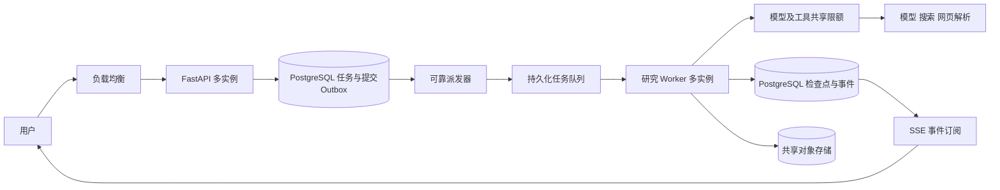

# 智能体大规模用户接入架构评估及改造建议

## 评估日期、对象与口径

- 评估日期：2026-10-06，用户时区 Asia/Singapore。
- 评估对象：当前工作区的 FastAPI 接口、DeepResearch 主链路、模型调用、运行租约、事件账本、LangGraph 检查点、数据库连接、Redis、附件及维护调度。
- 数据口径：当前源码静态核查，共 16 项、15 个独立源码文件；原始结果保存源码 SHA-256 和相关行号。工作区包含既有未提交修改，以所保存文件哈希为准。
- 配置口径：只讨论源码默认值和实现；没有读取 `.env`、生产部署配置、账号额度或线上遥测。默认值不等于当前运行实际值。
- 本次未启动研究、未压测、未调用付费模型；仅新增本报告及原始静态结果。
- 原始结果：[静态核查结果.json](../backend/eval/data/智能体多人并发架构核查-20261006-6fee26d8/静态核查结果.json)。

## 结论

本项目可沿用现有研究算法、PostgreSQL 检查点、运行租约和事件账本，逐步改造成支持多实例的服务。首要改造是持久化任务提交与独立研究 Worker，使研究执行和客户端 SSE 连接具有独立生命周期；随后补齐跨实例调用限额、任务配额、文件共享和运维指标。

“很多用户”需要区分注册人数、同时在线人数、同时运行研究的数量以及每分钟新研究数。这四者不能互相替代；目前没有证据证明本项目支持某个具体规模。

## 核心指标与证据边界

| 指标 | 本次结果 | 边界 |
| --- | --- | --- |
| 静态核查覆盖 | 16 项、15 个源码文件 | 已测量：源码读取和计数，不是性能测量 |
| 研究执行方式 | `/research/stream` 直接消费研究异步生成器 | 已核查源码 |
| 持久化与协调 | PostgreSQL 事件、运行租约、fencing token、异步图检查点 | 已核查机制存在，未实测故障恢复 |
| Redis 连接上限 | 源码配置 `max_connections=20` | 每进程配置，不代表研究并发上限 |
| 运行租约默认时长 | 60 秒 | 源码默认值，服务会续租 |
| 取消轮询默认间隔 | 0.25 秒 | 源码默认值，实际Redis请求量未测 |
| Writer 默认输出上限 | 60,000 token | 允许上限，不是实际输出或费用 |
| 累计研究 token 上限 | `max_llm_tokens()` 未配置时返回 0，即不限制 | README 提到的配置值不能替代运行时配置核实 |
| 最大研究并发、在线人数、吞吐 | 尚未评估 | 不能给出承载人数承诺 |
| 排队和研究时长 P50/P95、成功率 | 尚未评估 | 无压测原始数据 |
| 每任务模型调用、token、搜索量与费用 | 尚未评估 | 不复用其他质量评测指标作为并发证据 |
| 生产模型 RPM/TPM 与搜索额度 | 尚未评估 | 需按实际账号、地域、模型核实 |

“间接推断”仅用于说明代码机制在多实例、高流量下可能产生的影响。以下失败场景是待验证假设，并非本次观测到的线上故障。

## 逐类分析

### 1. 研究任务与网络连接

依据：[research_router.py](../backend/app/router/research_router.py)、[service.py](../backend/app/service/deep_research_v2/service.py)。接口直接把 `service.research()` 交给 `StreamingResponse`；服务在 `asyncio.CancelledError` 分支调用 `request_cancel()`，流关闭时还有释放租约的兜底。

间接推断：客户端断开会影响研究执行，API 发布也会影响该进程正在承载的研究。已有检查点能为恢复提供基础，但不能直接当作自动重新调度任务的系统。

建议：提交研究返回 `202 + run_id`，独立 Worker 执行；SSE 只订阅已提交事件，浏览器刷新只重连事件流。用户主动取消通过独立控制接口发出。现有恢复接口需要改成恢复任务提交，避免恢复请求再次承担整段研究执行。

### 2. 队列可靠性与任务隔离

依据：[research_events.py](../backend/app/service/research_events.py)、[checkpointer.py](../backend/app/service/deep_research_v2/checkpointer.py)。源码已有数据库原子租约获取、递增 fencing token、续租和事件提交机制；图执行位置另存于 PostgreSQL。

建议：复用这些能力。可先采用 Celery + Redis 或 RabbitMQ，并在 PostgreSQL 保存权威任务状态及提交 Outbox。任务创建和 Outbox 写入同事务提交，由派发器可靠投递；队列只传任务标识，Worker 根据已持久化的输入与冻结配置执行。拿到执行名额后再获取运行租约，避免任务排队期间提前占租约。

必须处理重复投递、Worker 崩溃和发布期间接管；以 `user_id + session_id + turn_id/run_id` 校验任务归属与提交幂等。检查点不保证外部模型调用恰好执行一次，调用完成但检查点尚未提交时恢复仍可能重复消费。需要记录调用与费用，并明确不可重复副作用的处理规则。Celery 官方也要求会被重新执行的任务具备幂等性：[任务文档](https://docs.celeryq.dev/en/stable/userguide/tasks.html)。

会话话题判断当前发生在接口提交阶段，并可能调用模型。迁移时也应纳入任务执行和预算，避免 API 在排队前就启动昂贵研究准备。队列中的取消状态应持久化，Worker 消费时检查；不能直接沿用启动时无条件清取消标志的行为来表示排队取消。

### 3. 外部 API 吞吐与成本

依据：[llm_client.py](../backend/app/service/llm_client.py)、[base.py](../backend/app/service/deep_research_v2/agents/base.py)。主 Agent 已使用异步模型客户端，已有超时、SDK 重试和 Agent 层重试。这些能力可继续复用；本次查看的调用工厂和主调用点未见跨实例 RPM/TPM 调度。

建议：模型调用前按真实供应商额度边界统一申请许可；可用 Redis 原子操作实现共享请求速率、token 预算及并发控制。为搜索、网页读取、浏览器解析和 OCR 分别设置资源限制；单个研究里的 Semaphore 不覆盖全部 Worker。

加入单用户并行任务数、每日用量、每次研究 token/搜索/时长上限、队列长度上限与公平调度。容量不足时显示排队或暂时拒绝受理；队列不应无限增长。遇到 429 遵守 Retry-After、退避并加入随机抖动，避免 SDK、Agent 和整任务重试叠加放大流量。

阿里云官方文档区分 RPM 与 TPM，并说明充值不会提高限流额度、额度按主账号配置。因此增加服务器或同一账号的新 API Key 不能视为增加额度的措施；具体地域、模型及获批额度需核实：[限流文档](https://www.alibabacloud.com/help/en/model-studio/rate-limit)。Celery 的任务 `rate_limit` 默认针对单个 Worker，不能直接充当所有实例的模型总额度限制：[任务限流说明](https://docs.celeryq.dev/en/stable/userguide/tasks.html#Task.rate_limit)。

### 4. API、数据库与 Redis

依据：[Dockerfile](../backend/app/Dockerfile)、[database.py](../backend/app/core/database.py)、[redis_client.py](../backend/app/core/redis_client.py)、[research_control.py](../backend/app/service/research_control.py)。镜像启动没有配置 Uvicorn 多进程；业务 ORM 和 Redis 是同步客户端，图检查点使用独立异步连接池。取消等待协程会轮询同步 Redis。

间接推断：同步操作若在事件循环中直接执行，延迟可影响其他请求；每个新增进程会增加各自数据库和 Redis 连接需求。是否已成为瓶颈尚未测量，不能仅因使用同步客户端就断言当前性能不够。

建议：API 放在负载均衡后按需增加实例；配置并统筹业务池、检查点池、Worker 和维护进程连接总量。长时间模型等待期间释放业务事务与连接。对热点同步 I/O 使用合适的线程隔离或异步客户端，并通过事件循环延迟、连接等待和数据库慢查询决定进一步改造。检查事件索引和查询分页，避免大量 SSE 客户端高频全量扫描事件表。FastAPI 官方说明了多进程部署能力：[部署文档](https://fastapi.tiangolo.com/deployment/server-workers/)。

### 5. 文件、缓存与维护调度

依据：[attachment_router.py](../backend/app/router/attachment_router.py)、[web_reader_service.py](../backend/app/service/web_reader_service.py)、[app_main.py](../backend/app/app_main.py)、[scheduler_service.py](../backend/app/service/scheduler_service.py)。附件保存在 `/tmp/chat_attachments`；网页缓存默认使用本机临时目录，缓存和锁也包含进程内状态；API lifespan 启动维护调度器。

间接推断：请求转到其他机器可能读不到附件；相同网址在不同进程可能重复抓取；每个 API 进程都会初始化自己的维护调度器。`max_instances=1` 不代表全系统单实例，是否造成实际重复处理还取决于业务任务的数据库领取协议。

建议：附件和正式成果进入 OSS/S3/MinIO 等共享对象存储，数据库记录对象标识；网页公开原文缓存可共享并带有效期，私人文档和会话缓存必须按用户隔离。维护调度器独立部署或使用经过验证的分布式领取协议。SSE 代理配置心跳、合理超时与关闭响应缓冲，断线后通过 `after_seq` 补发账本事件。

### 6. 多用户访问控制

现有研究状态读取通过 `_owned_run()` 校验归属，事件查询带用户过滤，研究提交校验会话归属，具备复用基础。

需要补齐的一处静态发现：`cancel_research()` 验证会话属于当前用户，随后对传入的 `run_id` 写取消标志，本函数未验证该运行也属于该用户及该会话。建议同时验证运行与会话的关联和归属，再发控制信号。此处仅为静态核查，未执行跨用户取消或漏洞利用测试。

私有文档检索、附件、长期记忆、报告、队列控制都应包含同样的归属边界；本次未全面审计这些路径。上线前以两个用户验证不可互读、互改、互取消，并保留资源配额，避免单个用户占满任务执行名额。

## 建议目标架构

同一个 Worker 可以以异步方式同时推进多个隔离研究，实际执行名额应按资源与配额测定。API 进程数、Worker 进程数、Worker 内并发名额和外部模型在途请求数是不同参数，不应使用同一个“并发数”代替。FastAPI 官方提到后台任务跨多个进程或服务器时可以采用 Celery 等工具：[背景任务文档](https://fastapi.tiangolo.com/tutorial/background-tasks/)。

## 容量计算口径

先收集每分钟任务到达率 `λ`、平均执行时长 `T`、各模型每任务平均请求数 `r_m` 与 token 数 `k_m`、各工具每任务调用次数，再估算需求：

- 稳定运行、无持续积压时，平均执行中的研究数约为 `λ × T`，时间单位必须一致。
- 模型 `m` 的平均请求需求约为 `λ × r_m` RPM，token 需求约为 `λ × k_m` TPM。需要分别与该模型及账号的限额比较，还应计入其他业务、重试与峰值。
- 每日费用估算应分模型计算输入、输出及工具用量，然后乘以预期每日任务数；源码中的输出上限不能直接作为平均消耗。

示意：每分钟 10 个新研究、平均执行 8 分钟，稳定情况下平均约 80 个研究同时执行。这是数学示例，不是本项目测量结果；若真实容量不足，任务排队时间会持续增加。

不直接按注册用户数购买机器，也不承诺某个实例数就支持上千个同时研究任务。当前主 Agent 使用外部模型 API，扩用户首先需要计算 API 吞吐和任务资源；是否自部署模型及采购 GPU 是后续独立选型。

## 失败样例与待验证场景

以下均是机制推导的待验证场景，本次没有故障运行日志。

| 场景 | 当前代码对应机制 | 验收目标 |
| --- | --- | --- |
| 研究中浏览器刷新或断网 | SSE 消费者与执行器耦合 | 断线只影响订阅，任务继续或按产品策略暂停，重连按序补发 |
| Worker 崩溃后重复投递 | 租约、检查点和外部调用各有提交边界 | 过期租约可接管，旧执行器不能提交，重复副作用与费用可追溯 |
| 高峰流量超过模型额度 | 多实例共享供应商总限额 | 总调用受控，公平排队，429 重试不放大流量 |
| 请求转到另一台机器 | 附件依赖本机临时目录 | 权限正确且可从共享存储读取 |
| 多 API 进程同时启动维护任务 | 各进程初始化调度器 | 任务领取和清理不会产生冲突或无意义重复 |
| 用本人会话提交不属于本人的 run_id 取消 | 取消入口归属校验不完整 | 拒绝请求，不写入其他运行的取消标志 |
| 排队任务在开始前被取消 | 现有启动路径清除取消标志 | 已取消任务不启动，不依赖短期缓存作为唯一状态 |
| 流量长期大于处理能力 | 无界队列只能延缓问题 | 有受理上限、最大等待时间及可理解的状态反馈 |

## 改造顺序与后续测量

1. 先确定产品目标：峰值新研究数/分钟、允许等待时间、同时在线人数和每日模型费用预算。先记录真实单任务执行时长、各模型调用与 token、搜索和网页读取量。
2. 优先实现持久化任务提交、独立 Worker、事件订阅解耦、重复提交保护、排队取消和 Worker 恢复；保留现有图、检查点、事件和租约协议。
3. 同步补齐用户公平配额、模型与工具共享限额、任务成本上限和取消归属检查。限制执行名额，避免扩实例后把负载全部转移给供应商。
4. 使用共享对象存储，协调维护调度器；在负载均衡后部署多个 API/Worker 实例，测量并调整连接池。按队列等待、执行名额和外部额度判断是否扩 Worker。
5. 先用可控的模拟模型/工具测 API、队列、SSE、数据库和故障恢复，再用少量真实任务核实外部额度及成本。可从 5、10、20、50 个并发任务逐级增加；这些是测试档位，不是容量结论。混入普通问答和多用户长研究，避免只测试健康检查接口。
6. 每档记录成功率、P50/P95 受理/排队/研究时长、每分钟交付数、429、重试率、数据库连接等待、事件循环延迟、CPU/内存及每个成功任务的费用；执行断线、进程退出、重复投递和多用户隔离测试。新结果按项目约定创建中文报告与机器可读结果。

第一版可用容器和独立任务服务完成。后续在跨机器调度、发布与弹性伸缩管理成为实际需求时，再决定是否引入 Kubernetes，不能用部署平台代替任务可靠性和额度控制。

## 局限性

本次仅查看主链路相关源码，没有完整审计所有业务、没有生产账号或数据库性能数据，也没有实测队列、SSE 代理和对象存储。关于瓶颈的排序是针对当前实现的架构建议，性能影响属于间接推断。未评估任何指定并发规模下的质量、延迟、稳定性或成本；后续承载结论必须基于固定代码、明确配置、可追溯的真实测量。
