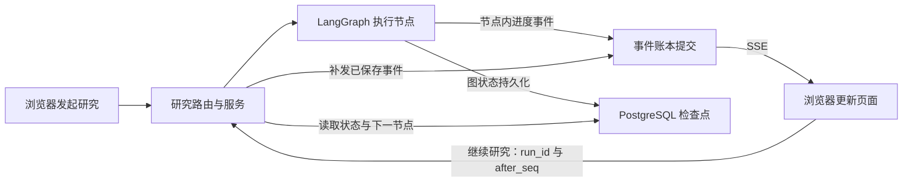

# 流式事件与检查点恢复逐行代码讲解

阅读日期：2026-09-29。依据：当前工作区代码，包括尚未提交的修改。

本文是源码阅读教程，不是运行评估。本次没有启动模型、数据库或故障注入测试；文中的问题、事件序号和中断场景都是教学示例，不是实测日志。代码块摘录实际关键语句，并添加中文解释；标明“节选”或“简化”的代码省略了周边逻辑，不能直接替换源文件。

## 1. 先分清三件事

假设用户问：“整理阿尔茨海默病近期治疗研究进展。”研究需要规划、检索、分析、写作、审核，不会立刻结束。

| 机制 | 好懂的解释 | 回答的问题 | 项目对应实现 |
| --- | --- | --- | --- |
| SSE | 保持一次 HTTP 响应打开，后端陆续发送消息 | 现在做到哪里了？ | `StreamingResponse`、`data: ...\n\n` |
| 事件账本 | 把发给页面的研究事件按顺序存起来 | 页面漏看了哪些消息？ | `AgentEvent`、`seq`、`after_seq` |
| 图检查点 | 保存研究资料以及图接下来要执行的位置 | 研究中断后从哪一步继续？ | `AsyncPostgresSaver`、`snapshot.values`、`snapshot.next` |

SSE 本身不负责存档。收到“正在写作”也不代表写作结果已经进检查点。事件可以在节点内部产生，检查点则由图执行器在相应执行边界提交。



下面沿真实调用链阅读。所有路径相对于仓库；链接可直接定位当前工作区源代码。

## 2. 前端发起一个流式 POST 请求

位置：[session.ts 第 126 行](/Users/bxy/projects/industry_information_assistant/frontend/src/api/session.ts:126)。

```ts
return request.post<ReadableStream>('/research/stream', params, {
  headers: {
    Accept: 'text/event-stream',
  },
  responseType: 'stream',
  adapter: 'fetch',
  loading: false,
  ...options,
})
```

逐行解释：

1. `request.post<ReadableStream>(...)`：向研究接口发送问题、会话 ID、轮次 ID；TypeScript 类型说明返回的数据是可读流。
2. `headers`：开始配置请求头。
3. `Accept: 'text/event-stream'`：告诉后端，希望收到事件流。
4. `responseType: 'stream'`：逐步读响应，不等待整个响应变成一个完整 JSON。
5. `adapter: 'fetch'`：让请求库使用 fetch 适配器承接浏览器的流。
6. `loading: false`：关闭请求库的通用加载提示，研究页自行展示进度。
7. `...options`：合并调用方配置，后面的同名配置会覆盖前面的值。

这里没有使用浏览器的原生 `EventSource`。项目采用 POST 加 fetch 流式读取；恢复游标也通过 `after_seq` 显式传递，不是依靠 `Last-Event-ID`。

几个 ID 的区别：`session_id` 是聊天会话；`turn_id` 是这一轮提问；研究路由把这一轮的 `turn_id` 同时用作 `run_id`；图再把 `run_id` 用作 `thread_id`。因此同一聊天会话中的不同研究，不会共用一个执行检查点位置。

## 3. 后端把异步生成器变成 HTTP 事件流

位置：[research_router.py 第 190 行](/Users/bxy/projects/industry_information_assistant/backend/app/router/research_router.py:190)。之前的代码已经检查会话归属、保存用户消息、取得运行租约。

```python
stream = service.research(                 # 创建能陆续产出字符串的异步生成器
    query=request.query,                  # 本次问题
    session_id=session_id, user_id=user_id,# 指定会话及用户
    run_id=turn_id, turn_id=turn_id,        # 本轮对应一次研究运行
    research_context=research_context,    # 多轮上下文
    allowed_domains=allowed_domains,      # 本次允许检索的网站
    lease=run_lease,                       # 已取得的执行权
)
return StreamingResponse(                 # 边迭代生成器，边向客户端发送响应
    _stream_with_lease(                    # 包装收尾逻辑，断线也要释放执行权
        stream, run_lease,
        on_failure=lambda: _mark_turn_status(session_id, turn_id, "failed"),
    ),
    media_type="text/event-stream",        # 标明响应内容是 SSE
)
```

`service.research()` 返回的是生成器；路由不先等整份报告完成。框架开始迭代时，里面的执行逻辑逐步运行，每遇到一个 `yield` 就交出一段响应内容。

普通 JSON 响应类似“一次性交整份答案”；这里是“同一条响应中陆续发出研究开始、检索进度、报告内容、完成结果”。

## 4. Agent 的事件如何走到 SSE

位置：[graph.py 第 133 行](/Users/bxy/projects/industry_information_assistant/backend/app/service/deep_research_v2/graph.py:133)。节点开始执行时注入事件出口：

```python
work.update({
    "_run_id": run_id, "_user_id": user_id, "_session_id": session_id,
    "_node": node_name, "_attempt": attempts[node_name],
    "_emit_event": get_stream_writer(), "messages": [],
})
```

第一组字段说明这次执行属于谁；第二组说明哪个节点、哪次尝试；`get_stream_writer()` 取出 LangGraph 的自定义流发送函数。把这个函数放进临时状态，Agent 就能调用它报告进度。

位置：[base.py 第 540 行](/Users/bxy/projects/industry_information_assistant/backend/app/service/deep_research_v2/agents/base.py:540)。`add_message()` 的关键语句：

```python
message = {                                  # 构造业务事件
    "type": event_type,                      # 例如 thought、section_content
    "agent": self.name,                      # 由哪个 Agent 产生
    "node": state.get("_node", ""),          # 所属图节点
    "iteration": int(state.get("iteration", 0) or 0),
    "attempt": int(state.get("_attempt", 1) or 1),
    "timestamp": datetime.now().isoformat(),  # 事件时间
    "content": content,                      # 实际消息内容
    "progress": progress_counts(state),      # 当前统计进度
}
emit_event = state.get("_emit_event")          # 取出刚才注入的发送函数
# 原码接下来检查 None；没有图上下文时只记调试日志并返回。
emit_event(message)                           # 把消息送入图的 custom 流
```

注意：最后一行只是送入 LangGraph 流，此时既没有在这里写 SSE，也没有在这里保存检查点。

位置：[service.py 第 211 行](/Users/bxy/projects/industry_information_assistant/backend/app/service/deep_research_v2/service.py:211)，节选：

```python
async for event in graph.astream(              # 图一边执行，我们一边接收它的事件
    graph_input,                              # 首跑是初始状态，续跑是 None
    config=config,                            # 包含本次运行的 thread_id
    stream_mode="custom",                     # 接收上面的自定义进度事件
    durability="sync",                        # 下一步开始前同步持久化检查点
):
    # 原码在此检查是否丢失租约；丢失则抛异常。
    envelope = await asyncio.to_thread(recorder.record, event)
    yield encode_sse(envelope.to_wire())
```

倒数第二行：用线程执行同步数据库写入，避免直接阻塞异步事件循环；`await` 会等它提交成功并返回带序号的事件。

最后一行：转换成前后端协议字典，编码为 SSE，然后交给 `StreamingResponse` 发送。顺序是“先提交事件，再发送事件”。`durability="sync"` 约束图检查点的提交时机，不表示每个 custom 事件都生成一个检查点。[LangGraph 官方检查点说明](https://docs.langchain.com/oss/python/langgraph/checkpointers)

位置：[service.py 第 70 行](/Users/bxy/projects/industry_information_assistant/backend/app/service/deep_research_v2/service.py:70)：

```python
def encode_sse(payload: Dict[str, Any]) -> str:
    return "data: " + json.dumps(payload, ensure_ascii=False) + "\n\n"
```

`payload` 是 Python 字典；`json.dumps` 转成 JSON 文本；`ensure_ascii=False` 保留中文；前面的 `data: ` 表示 SSE 数据行；后面的两个换行结束一条 SSE 消息。

示意输出如下，省略部分元数据；实际报文由 `to_wire()` 额外平铺部分业务字段，兼容旧页面：

```text
data: {"version":1,"run_id":"运行R","seq":12,"type":"phase","data":{"phase":"writing","content":"开始撰写报告"}}

data: {"version":1,"run_id":"运行R","seq":13,"type":"thought","data":{"content":"整理已检索的资料"}}

```

`seq` 位于 JSON 内部，是项目自定义协议字段；当前编码器没有生成 SSE 的 `id:` 行。示例中的“运行R”仅为便于阅读，真实接口使用 UUID。

## 5. 为什么能补发：事件先写数据库

位置：[research_events.py 第 294 行](/Users/bxy/projects/industry_information_assistant/backend/app/service/research_events.py:294)，节选：

```python
run = (
    db.query(ResearchRun)                       # 找运行记录
    .filter(
        ResearchRun.run_id == self.run_id,      # 必须是本次研究
        ResearchRun.owner_id == self.lease.owner_id,
        ResearchRun.fencing_token == self.lease.fencing_token,
        ResearchRun.lease_until > datetime.utcnow(),
    )
    .with_for_update()                         # 锁住这条运行记录，避免并发分配同一序号
    .one_or_none()                             # 找不到则返回 None
)
# 原码接下来在 run 不存在时抛 ResearchRunLeaseLost。
run.next_event_seq += 1                        # 分配下一个事件序号
```

`owner_id` 是执行者身份；`fencing_token` 是本轮执行权的版本号；`lease_until` 是有效期。三者共同检查当前写入者仍持有执行权。

接下来的 `make_research_event(...)` 将 `run_id`、`seq`、时间、事件 ID 与业务内容包装在一起，`db.add(AgentEvent(...))` 把它加入数据库事务。

真正提交的位置：[research_events.py 第 365 行](/Users/bxy/projects/industry_information_assistant/backend/app/service/research_events.py:365)：

```python
envelope = self._record_in_session(db, raw_event, event_id) # 分序号、准备事件写入
db.commit()                                              # 序号与事件一起提交
return envelope                                          # 成功后才交回服务层发送
```

数据库写入失败会回滚并按配置重试；同一次写入重试复用 `event_id`，发现已有记录就返回已有事件。重试最终失败会抛错，服务层停止流，不把这条未可靠保存的事件发给页面。

假设第 13 条事件已提交，但网络断了，浏览器只收到第 12 条。下次按 `after_seq=12` 查询，就能从数据库补到第 13 条。

这保证的是“相同事件可以补发并识别重复”，不保证重跑节点不会产生内容相近、序号不同的新事件。

## 6. 浏览器怎样拆开网络分片

位置：[research-events.ts 第 350 行](/Users/bxy/projects/industry_information_assistant/frontend/src/pages/chat/research-events.ts:350)。实际核心实现，逐行加注释：

```ts
const decoder = new TextDecoder('utf-8') // 把字节转换成文字，包括中文
let buffer = ''                         // 保存尚未拼成完整一行的文字

const consumeLine = async (line: string) => {
  if (!line.startsWith('data:')) return // 空行等非数据行直接忽略
  const event = parseResearchSseData(line.slice(5).trim()) // 去掉 data: 并解析 JSON
  if (event) await onEvent(event)       // 有业务事件就更新页面；[DONE] 会解析为 null
}

while (true) {
  const { value, done } = await reader.read() // 读下一个网络字节块
  buffer += decoder.decode(value, { stream: !done }) // 保留跨字节块的未完整字符
  let newline = buffer.indexOf('\n')         // 找第一条完整行
  while (newline >= 0) {                    // 一个字节块可能包含多条完整行
    const line = buffer.slice(0, newline).replace(/\r$/, '') // 取行，兼容 CRLF
    buffer = buffer.slice(newline + 1)       // 已取走的行从缓冲区移除
    await consumeLine(line)                 // 处理完整数据行
    newline = buffer.indexOf('\n')          // 继续找剩下的完整行
  }
  if (done) {                              // 网络流结束
    if (buffer) await consumeLine(buffer.replace(/\r$/, '')) // 处理最后的剩余文字
    return                                 // 退出读取循环
  }
}
```

网络可能第一次只送来 `data: {"type":"pha`，第二次才送来 `se",...}\n\n`。所以不能对每个 `reader.read()` 的结果直接 `JSON.parse()`，必须先缓冲。

这里按“每个 data 行一个 JSON”解析，适配本项目编码器；没有实现通用 SSE 中把多个 `data:` 行拼成一个事件的完整语义。

`[DONE]` 是项目约定的结束标记，不是成功证明。当前解析函数忽略它，读取循环在流结束时返回；研究成功通过 `research_complete` 业务事件判断。首次研究流结束而没收到完成事件时，页面会提示连接已结束但研究未完成，见 [index.tsx 第 385 行](/Users/bxy/projects/industry_information_assistant/frontend/src/pages/chat/index.tsx:385)。

## 7. 前端怎样防止重复和漏消息

位置：[research-events.ts 第 399 行](/Users/bxy/projects/industry_information_assistant/frontend/src/pages/chat/research-events.ts:399)：

```ts
if (state.runId && state.runId !== event.run_id && event.type !== 'research_start') {
  return { state, accepted: false, reason: 'run_mismatch' }
}
const sameRun = state.runId === event.run_id
if (state.runId === event.run_id && event.seq > 0 && event.seq <= state.lastSeq) {
  return { state, accepted: false, reason: 'duplicate' }
}
if (sameRun && event.seq > state.lastSeq + 1) {
  return {
    state,
    accepted: false,
    reason: 'gap',
    gapAfterSeq: state.lastSeq,
  }
}
```

第一段：不把另一研究的普通进度混进来；`research_start` 是切换运行的例外。

第二段：同一运行中，已经应用到 12，再收到 12 或更小的正序号，直接忽略。

第三段：已经应用到 12，却直接收到 15，说明中间有缺口；先不应用 15，返回 `gapAfterSeq=12`。

调用方在 [index.tsx 第 457 行](/Users/bxy/projects/industry_information_assistant/frontend/src/pages/chat/index.tsx:457) 读取 `/research/runs/{run_id}/events?after_seq=12` 补回账本事件。接受一条事件后，会更新 `lastSeq`，并根据 `type` 更新页面。恢复时的 `reduceRecoveryProjection()` 把阶段、资料、报告等写入页面状态；例如第 245 行把 `report_chunk` 的文字追加到报告，第 252 行用 `research_complete.final_report` 设置最终报告。

## 8. 检查点到底保存在哪里

位置：[checkpointer.py 第 53 行](/Users/bxy/projects/industry_information_assistant/backend/app/service/deep_research_v2/checkpointer.py:53)，节选：

```python
pool = build_pool(database_url)                            # 创建 PostgreSQL 异步连接池
await pool.open()                                         # 打开池
await pool.wait()                                         # 等连接准备好
app.state.research_checkpointer = AsyncPostgresSaver(pool) # 创建持久化保存器供请求复用
```

应用关闭时，`finally` 清空引用并关闭连接池。建表在独立部署函数 `prepare_checkpoint_schema()` 中通过 `await saver.setup()` 完成，不是每次请求建表。

检查点保存器使用 psycopg3 异步连接；事件账本等业务表使用现有 SQLAlchemy 会话。它们可以指向同一数据库，但不是一个共享事务。

位置：[graph.py 第 275 行](/Users/bxy/projects/industry_information_assistant/backend/app/service/deep_research_v2/graph.py:275)：

```python
return builder.compile(checkpointer=checkpointer) # 把保存器装进图执行器
```

注册检查点能力之后，由 LangGraph 执行器负责保存图状态。项目不需要在每个 Agent 中手写 `save_checkpoint()`。

紧接着 [graph.py 第 278 行](/Users/bxy/projects/industry_information_assistant/backend/app/service/deep_research_v2/graph.py:278)：

```python
def graph_config(run_id: str) -> Dict[str, Any]:
    return {"configurable": {"thread_id": run_id}, "recursion_limit": RECURSION_LIMIT}
```

`thread_id` 告诉保存器“使用哪一次研究的存档”；`recursion_limit` 是图执行步数的保护上限，不是 SSE 重连次数，也不是检查点序号。恢复时保持相同 `run_id`，才能找到这次研究的检查点。

## 9. 节点什么时候把业务状态交回图

位置：[graph.py 第 122 行](/Users/bxy/projects/industry_information_assistant/backend/app/service/deep_research_v2/graph.py:122)，以下是不连续关键行的节选：

```python
work = deepcopy(graph_state["research"])           # 复制上一个已提交业务状态
work["phase"] = phase                             # 记录当前阶段
# 中间注入身份、事件出口、历史存储，执行节点保护逻辑。
result = await execute_stage(run_stage, work, phase) # 等当前 Agent 节点执行结束
if not isinstance(result, dict):                   # 返回值必须是业务字典
    raise TypeError(f"{node_name} 节点未返回研究状态")
# 写作类节点还必须有非空 final_report。
return pack_state(result)                          # 整理后交回图执行器
```

`deepcopy` 的作用是让节点使用自己的工作副本，不直接修改传入的旧快照。节点内部发出的事件可以先到页面；只有节点返回的业务更新才能交给图执行器持久化。

`pack_state()` 位于 [graph.py 第 97 行](/Users/bxy/projects/industry_information_assistant/backend/app/service/deep_research_v2/graph.py:97)：

```python
saved = {key: value for key, value in work.items() if key not in RUNTIME_ONLY_KEYS}
leaked = [key for key in saved if key.startswith("_")]
if leaked:
    raise RuntimeError(f"未登记的运行期字段进入了图状态: {sorted(leaked)}")
saved["messages"] = []
json.dumps(saved, ensure_ascii=False, allow_nan=False)
return {"research": saved}
```

逐行解释：

1. 去掉 `_emit_event` 等显式登记的临时字段；函数引用等运行对象不能当研究存档。
2. 检查是否还有未登记的下划线字段混进来。
3. 如果有，就报错，避免静默保存错误对象。
4. 清空这里的 `messages`；独立 Agent 历史由另一路存储管理，不能把这里理解成全部聊天历史存档。
5. 检查业务状态能否转换为合法 JSON。这一行是校验，不是数据库写入。
6. 返回图约定的 `research` 字段，由图执行器接管持久化。

对当前以串行节点为主的主图，检查点可以理解成“完成一个图步骤就保存一份状态”。内部一次搜索、一条 token 或一个进度事件，不因此自动成为独立恢复点。[LangGraph 官方对 super-step 的说明](https://docs.langchain.com/oss/python/langgraph/checkpointers)

## 10. 续跑最关键的代码：同一个 ID，加 None 输入

位置：[service.py 第 337 行](/Users/bxy/projects/industry_information_assistant/backend/app/service/deep_research_v2/service.py:337)。`_graph_input()` 在 `resume=True` 时执行：

```python
snapshot = await graph.aget_state(config)   # 用相同 thread_id 读最新快照
if not snapshot.values:                    # 没有存档，不能声称能续跑
    raise LegacyRunNotResumableError(
        "没有可恢复的图状态；该运行属于旧版本，请重新发起研究"
    )
research = snapshot.values.get("research") or {} # 读取已保存的业务状态
# 原码在这里检查追问配置哈希、上下文策略、图版本兼容性。
if not snapshot.next:                      # 没有待执行节点，图已结束
    raise ValueError("图已执行结束，应读取报告或补做幂等交付")
return None                                # 不提交一份新的初始研究输入
```

首次执行时返回 `pack_state(initial)`；续跑时返回 `None`。服务层随后仍然调用之前那段 `graph.astream(graph_input, config=...)`。

将两处代码合起来看，续跑等价于下面的教学简化写法：

```python
config = graph_config(run_id)             # 还是原来的研究 ID
async for event in graph.astream(
    None,                                # 从已有执行状态继续
    config=config,
    stream_mode="custom",
    durability="sync",
):
    ...                                  # 落事件账本，再发 SSE
```

`snapshot.values` 是存下来的研究资料；`snapshot.next` 是接下来该运行的节点。例如 `("write",)` 意味着接下来运行写作。执行位置不是拿 `phase` 字符串或 `seq` 自己猜出来的。

当前技术中断恢复不走人工审批的 `Command(resume=...)` 路径，也没有恢复 Python 函数的指令指针。若写作节点没有成功返回，恢复通常会从这个节点的入口重新执行。

## 11. resume 接口先补事件，再续跑

位置：[research_router.py 第 206 行](/Users/bxy/projects/industry_information_assistant/backend/app/router/research_router.py:206)。

接口先验证本人运行归属、检查是否有图状态和待执行节点、重新取得运行租约。随后在第 245 行：

```python
replay_payloads = _pending_events(db, run_id, current_user.id, after_seq)
```

这行查询客户端尚未应用的事件。底层条件在 [research_router.py 第 445 行](/Users/bxy/projects/industry_information_assistant/backend/app/router/research_router.py:445)：

```python
db.query(AgentEvent)                  # 查事件账本
.filter(
    AgentEvent.run_id == run_id,      # 只查这一轮研究
    AgentEvent.user_id == user_id,    # 只查当前用户的事件
    AgentEvent.seq > after_seq,       # 只查已读序号之后的事件
)
.order_by(AgentEvent.seq.asc())       # 按从旧到新的顺序
.all()                               # 取出待补发的事件
```

上面是查询表达式节选；实际代码用括号把整条表达式包起来。

接下来 [research_router.py 第 247 行](/Users/bxy/projects/industry_information_assistant/backend/app/router/research_router.py:247)：

```python
async def generate() -> AsyncGenerator[str, None]:
    for payload in replay_payloads:                # 第一段：补发数据库已有的消息
        yield f"data: {json.dumps(payload, ensure_ascii=False)}\n\n"
    try:
        async for chunk in service.research(       # 第二段：真正继续运行图
            query=original.content if original else "",
            session_id=run.session_id, user_id=user_id, run_id=run_id,
            turn_id=str(original.turn_id) if original and original.turn_id else None,
            resume=True, lease=run_lease,           # 明确走检查点恢复分支
        ):
            yield chunk                            # 新事件继续经同一响应发送
    # 后面还有版本不兼容异常处理，完整代码见源文件。
```

这个代码块截断了 `try` 的异常处理，只用于逐行阅读。外围 `StreamingResponse` 与首次请求使用相同的 SSE 类型。

关键区别：`after_seq` 决定补发哪些页面事件；同一个 `run_id` 对应的检查点决定执行哪些研究节点。改变 `after_seq` 不会让图“跳到第几步”。

## 12. 刷新页面与点击继续，不是同一个动作

位置：[index.tsx 第 1557 行](/Users/bxy/projects/industry_information_assistant/frontend/src/pages/chat/index.tsx:1557)。

```ts
const requestedRun = requestedResumeRunRef.current // 用户明确点击继续时设置
const res = await api.session.getResearchRunState(targetRun) // 读取图状态
// 中间验证状态是否存在。
let projection = projectionFromRunState(runState)  // 用检查点资料建立页面底稿
let protocol: ResearchProtocolState = {
  ...initialResearchProtocolState,
  runId,
  lastSeq: 0,                                     // 新页面从 0 重建事件进度
  status: projection.status,
}
```

这是不连续关键行节选。完整逻辑还会选择目标运行并处理历史记录。

这里特别容易看错：当前代码初始化 `lastSeq: 0`，随后按页重放事件；它没有把检查点的 ID 当成事件游标。首次加载恢复页面会查询状态和历史事件，但不因此自动重跑研究。

第 1656 行的条件决定是否真正调用续跑接口：

```ts
while (!disposed && Boolean(requestedRun) && !researchStopRequestedRef.current && projection.status === 'running') {
  // 实际代码还有 try/catch、补漏、退避和清理逻辑。
  const streamRes = await api.session.resumeResearch(runId!, protocol.lastSeq)
  recoveryReader = streamRes.data.getReader()
  // 后续使用 consumeResearchSse 读取事件并更新页面。
}
```

逐项理解条件：页面还在；用户请求了继续；用户没有点停止；当前仍需运行。只有这些条件满足才续跑。

恢复流再次中断时，这个循环会尝试重连，并从最新 `protocol.lastSeq` 补事件。普通失败累计到阈值会停止重连；收到新事件会重置重试计数。HTTP 409 表示可能有其他执行者持有租约，前端会尝试读取其新增事件。

## 13. 用“写作中断”把整个过程串起来

以下是教学假设，不是一次真实执行结果。

1. 用户提交问题，`run_id=R`。后端配置 `thread_id=R`，首跑输入包含问题与初始研究状态。
2. `plan` 完成，保存大纲；`research` 完成，保存检索资料；`analyze` 完成，保存分析结果。下一节点为 `write`。
3. `write` 开始，产生第 12 条“正在写作”事件。事件数据库提交成功，浏览器也收到了它，所以 `lastSeq=12`。
4. 第 13 条进度事件已存数据库，但浏览器没收到就断线；假设写作节点尚未成功返回。
5. 后端收到请求取消信号时，`service.py` 的 `CancelledError` 分支请求取消同一运行，并在收尾时释放租约。若进程直接崩溃，则需要等已有租约过期后才能由新执行者接手。
6. 用户刷新页面。页面读到保存的资料和 `pending_nodes=["write"]`，并从事件账本重建进度。这一步是在恢复展示。
7. 用户点击继续。前端以回放后最新的序号调用 `/research/resume/R?after_seq=...`。若是已有页面直接从 12 继续，则后端先补 13；若刷新时已回放到 13，就不必再补它。
8. 后端获取租约，读取相同 `thread_id=R` 的检查点；`_graph_input()` 返回 `None`。
9. 图从待执行的 `write` 节点继续。已经完成并保存的规划、检索、分析无需在这个场景下重跑；未完成的写作节点重新进入其执行逻辑。
10. 新的 `research_resumed`、写作和审核事件取得后续序号，继续发给浏览器。最终交付成功后发 `research_complete`，随后关闭流。

如果中断发生在检索节点内部，例如内部搜索做了 7 次但节点尚未完成，图级恢复并不等于“精准从第 8 次搜索继续”。是否复用内部成果，还取决于 Agent 历史、工具存储及节点业务逻辑，不能由 SSE 或主图检查点单独保证。

## 14. 为什么不会两个页面同时重跑同一研究

位置：[research_events.py 第 106 行](/Users/bxy/projects/industry_information_assistant/backend/app/service/research_events.py:106)。获取租约使用数据库原子插入或更新；只有同一持有者、无人持有、没有有效期或租约已过期等允许条件才取得执行权。

后端为一个 `run_id` 记录 `owner_id`、`lease_until` 和 `fencing_token`。新的接管会增加 token；旧执行者拿着过期 token，再写事件或交付时会被拒绝。服务层后台任务会定期续租，续租失败就请求取消。

这里可以把租约理解为“有到期时间的执行许可证”。它防止正常并发请求同时拥有这次研究的执行权；不要因此扩大理解为所有外部工具副作用都具备严格的恰好一次语义。

## 15. 如何确认研究真的完成

位置：[service.py 第 227 行](/Users/bxy/projects/industry_information_assistant/backend/app/service/deep_research_v2/service.py:227)：

```python
snapshot = await graph.aget_state(config)          # 执行结束后再读图状态
if snapshot.next:                                 # 还有下一节点，不能宣布完成
    raise ResearchStatePausedError(
        f"run {run_id} 仍有待执行节点: {snapshot.next}"
    )
envelope = await asyncio.to_thread(commit_result, snapshot) # 提交报告及完成事件
terminal_status = "completed"                     # 交付成功才设置完成
yield encode_sse(envelope.to_wire())               # 再通知前端研究完成
```

`commit_result()` 在 [delivery.py 第 194 行](/Users/bxy/projects/industry_information_assistant/backend/app/service/deep_research_v2/delivery.py:194) 中，把最终助手消息、运行完成状态和 `research_complete` 事件放进同一个 SQLAlchemy 事务。已有完成事件时会返回原事件，避免重复交付。

图检查点由 LangGraph 提交，不在这个业务事务里面。因此“图已经结束”和“业务结果已经交付”仍是两个阶段，不能把它们说成跨组件原子提交。当前 `/resume` 遇到没有待执行节点会拒绝续跑；图已结束而业务交付失败时，应区别于未完成节点的恢复，不能认为重连 SSE 就一定自动补交付。

`yield "data: [DONE]\n\n"` 在正常收尾路径的最后发出。错误被捕获并记录后也可能走到它，所以它只表示这条流结束。

## 16. 阅读顺序与边界

建议按以下顺序对照源文件：

1. `frontend/src/api/session.ts`：请求 `/research/stream` 与 `/research/resume/...`。
2. `backend/app/router/research_router.py`：鉴权、租约、StreamingResponse、旧事件补发。
3. `backend/app/service/deep_research_v2/service.py`：首跑与续跑输入、执行图、落事件、发 SSE。
4. `backend/app/service/deep_research_v2/graph.py`：节点边界、业务状态整理、thread_id。
5. `backend/app/service/research_events.py`：事件序号、事务、租约。
6. `frontend/src/pages/chat/research-events.ts`：拆网络分片、解析、去重和恢复页面状态。
7. `frontend/src/pages/chat/index.tsx`：把读取状态、事件回放、用户点击继续连接起来。

仓库中还有普通聊天 SSE，以及 `checkpoint_service.py` 和 `/legacy/...` 历史快照接口。本文讲的是当前研究主链路；旧快照接口用于只读展示，不应拿它们解释当前主图的执行恢复。

本文没有测量恢复成功率、延迟、数据库故障表现或真实模型重跑效果，也没有修改业务代码。源码能说明机制和控制条件，实际运行表现需单独验证。
