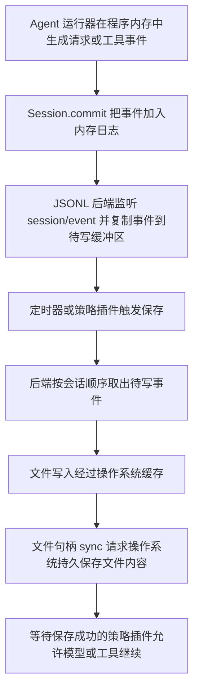

# 深度求索检查点机制迁移与数据库插件设计分析

评估日期：2026-10-27（Asia/Singapore）。

评估对象：`/Users/bxy/Documents/ChatGPT/deepseek_harness` 的语义检查点、会话持久化、崩溃修复和投影缓存；当前项目的 LangGraph PostgreSQL 检查点、工具执行、智能体历史与事件提交机制。

## 结论与证据边界

可以封装成插件。建议在当前 Python 项目中提取“持久化策略组件＋PostgreSQL 存储适配器＋恢复判定组件”，保留 LangGraph 负责图执行位置和节点/章节结果的恢复。先统一现有可靠性约定，再补结果未知的处理与稳定操作标识，不需要引入整个 Cordis/TypeScript 框架，也不需要先替换 PostgreSQL。

本文是源码静态阅读与设计适配分析，不是运行可靠性评测。已核实的是所列源码中的调用顺序、数据结构、错误处理和测试用例定义；间接推断是这些设计迁移后的预期收益与潜在故障；尚未评估的是实际数据库参数、断电恢复、部署拓扑、恢复成功率、性能和所有执行入口的覆盖率。没有运行模型、数据库写入或崩溃测试，不能据此声称“不丢不重”已经得到运行验证。

原始机器可读材料：[源码核查记录](../backend/eval/data/深度求索检查点迁移分析-20261027/源码核查记录.json)。该文件保存仓库提交号、所读重点源码的 SHA-256、静态结论和未测项目。本次不覆盖 2026-10-25 的历史阅读报告，也不修改运行时代码。

| 核心指标或口径 | 本次结果 |
|---|---|
| 源码确认的 Harness 强制保存时机 | 3 类：模型派发前、顶层工具执行前、下一 agent 步骤前 |
| 本次实际执行的故障注入测试 | 0；阅读测试定义不等于执行通过 |
| 数据库运行参数核查 | 未执行 |
| 丢失率、重复率、恢复耗时、写入延迟 | 尚未评估 |
| 适配结论 | 设计可迁移；当前项目已有大部分基础能力，重点是统一约定与恢复语义 |

## 先区分四种“检查点”

检查点可以泛指程序为将来恢复而保留的数据或保证，但以下四种对象不能混为一谈。

| 对象 | 谁产生、保存什么 | 恢复时如何使用 | 是否能单独保证不重复执行工具 |
|---|---|---|---|
| Harness 语义持久化检查点 | 策略插件在关键执行时机要求存储后端把事件保存到可靠存储 | 恢复器读取已保存事件，判断有哪些调用及结果 | 不能；只有意图没有结果时仍然未知 |
| Harness 投影缓存检查点 | 投影服务把原始事件计算出的当前状态保存为 `{ver, seq, val}` | 读取缓存，再处理该序号之后的事件，减少重复计算 | 不能；它是可重建的派生状态 |
| 上下文压缩检查点 | 压缩组件生成供模型阅读的摘要及来源标记 | 模型用摘要继续对话，原始日志仍承担审计职责 | 不能；摘要不是工具执行凭证 |
| 本项目 LangGraph 检查点 | 图运行器保存图状态、下一节点以及相关 task 输出 | 从已保存的图执行位置或 task 结果继续 | 不能覆盖每个节点内部尚未保存结果的外部副作用 |

另一个同名概念是 PostgreSQL 内部的数据库 checkpoint，它属于数据库管理数据页与恢复日志的机制，不能代替应用判断“这次工具是否执行过”。

## Harness 实际怎样保存数据

### 三个语义时机

`packages/session/session-checkpoint-policy/src/index.ts:63` 的 `apply()` 安装三个监听器：

1. 模型调用：`llm/stream` 包装器先等待 `ctx.sessions.flush(session)`，成功后才创建/消费下游模型流。适用范围是能够关联到实时 Session 的请求；没有 Session ID 或找不到实时 Session 的请求直接交给下游。
2. 工具调用：`tools/execute` 对有关联 agent 的顶层调用先等待保存；等待期间收到取消时返回 `ABORTED_BEFORE_DISPATCH`，不进入工具正文。嵌套调用复用外层边界，不能据此推导每个内部副作用都有独立恢复记录。
3. 下一步骤：`agent/pre-step` 先等待此前响应和工具结果保存完成，再继续构建下一次请求。

该策略自身没有存储状态。它依赖事件已经被正确记录、持久化后端正确挂载以及请求走受控入口。它不能仅凭一个插件名覆盖任意绕过框架的网络调用。

### 从程序内存到磁盘的完整链路

源码中的 `Session.commit()` 只把事件纳入程序内存日志并通知监听者，不是数据库 COMMIT。JSONL 后端的待写缓冲区也在程序内存中，进程崩溃会丢失尚未保存的内容。普通文件写入返回不等于已经抗断电；本实现调用文件句柄 `sync()`，首次发布文件还处理目录的持久化。保证依赖文件系统和硬件正确兑现同步操作。

三个同名或近名入口的职责如下：

| 方法 | 对象和职责 |
|---|---|
| `ctx.sessions.flush(session)` | Session 管理服务发起并等待该会话的 `session/flush` 监听者；它本身不编码文件、不直接执行 SQL |
| JSONL 写句柄的 `drainLive()` | 后端把内存待写事件按顺序交给物理写入路径；失败时把事件放回缓冲区并抛出异常 |
| `SessionHandle.flush()` | 存储接口承诺此前接纳的追加事件已经持久保存；JSONL 的具体 append 已经同步文件，因此此方法主要还处理尚未实体化的空会话 |

接口只要求 `append()` 返回后事件被有序接纳并可读，统一的持久性保证在 `flush()`；不能把 JSONL 当前较强的 append 行为误当所有后端都必须具备的保证。

当前 JSONL 后端的批处理等待常量为 200ms，首条事件启动计时器，后续事件不会重置截止时间。这是开始写入前的有意等待上限，不是总持久化延迟上限，更不是存储故障下的数据丢失时间保证。并发调用会加入同一个排空过程，句柄的修改操作按顺序执行。

## 当前项目已有的能力与真正需要补的地方

| 能力 | 当前代码证据 | 迁移判断 |
|---|---|---|
| 图执行位置与节点结果保存 | `deep_research_v2/service.py:303` 使用 `durability="sync"`；`graph.py:335` 编译时注入 checkpointer | 保留现有 LangGraph 路径 |
| 防止失去所有权的执行器提交 | `checkpointer.py:require_lease/lease_transaction` 使用运行行锁、owner、递增 fencing token 和数据库时间校验 | 复用；数据库多执行器场景需要这个能力，不能换成仅进程内锁 |
| 实际模型请求先保存 | `agents/base.py:301` 等待 `llm_request` 写入后才调用模型客户端 | 已有相同思想；提取统一策略时保留实际请求、模型参数和请求哈希 |
| 工具调用先保存 | `tool_runtime.py:155` 等待 `tool_dispatch` 写入后创建执行任务 | 已有基本边界；核查所有入口都有必需的历史 scope |
| 历史事务提交 | `agent_history.py:_append` 在 `session_factory.begin()` 中保存数据 | 方法正常返回前事务上下文已经提交；其中 `db.flush()` 本身仅发送 SQL，不代表提交 |
| 产物与完成通知一起提交 | `checkpoint_events.py` 和 saver 的 `_cursor()` 在同一事务提交后才唤醒发送器 | 保留现有事务发件箱思想，不新增第二份发送状态 |
| 原文、摘要分开 | `AgentMessage` 保存原文；`AgentContext` 保存摘要及覆盖序号 | 继续保持，摘要不能覆盖原始执行凭证 |
| 跨存储依赖核验 | `storage_reconciliation.py` 核验产物引用的历史、证据、预算和交付指针 | 保留；缓存或索引重建不能冒充原始证据恢复 |
| 部分细粒度结果恢复 | `agents/writer.py:569` 使用章节 task | 按长步骤的实际成本扩展，不能声称现有所有模型/工具调用均有独立 task |
| 调用级恢复判断 | 已读通用工具入口每次创建新 UUID；未见该入口根据既有调用结果决定复用或核验 | 建议优先补齐；这是已读入口的静态发现，不是全仓库不存在此能力的证明 |

两个特别需要保留的限制：

- `record_agent_message()` 没有历史 scope 时返回 `None`；`ToolRuntime` 也允许没有 scope 的调用。因此现有“先保存再执行”是有条件成立的，生产持久化执行应显式要求运行身份和存储能力齐全。
- 工具取消检查位于中间件及 `tool_dispatch` 保存之前；保存期间或非并发工具等待锁期间可能收到取消。建议在实际 `definition.handler()` 执行前再次检查取消与执行权限。检查只能缩小窗口，不能撤回已经到达远端服务的请求。

历史存储的 `_authorize()` 已验证运行身份和 fencing token，但所读实现没有与 saver 相同的租约到期校验。因此提取组件时应明确不同写路径的所有权保证，而不是把“检查 token”直接等同完整租约校验。

## 值得借鉴的原则、方法与理由

| 原则或方法 | 在项目中的具体做法 | 借鉴理由与边界 |
|---|---|---|
| 1. 分开“何时保存”和“如何保存” | 策略组件定义模型/工具/步骤边界，PostgreSQL 适配器拥有事务和 SQL，LangGraph 拥有执行位置 | 存储实现和业务执行可以独立变化；不把相同 SQL 分散到每个 Agent |
| 2. 先保存意图，再允许外部动作 | 执行器把操作 ID、参数及权限身份提交到数据库，成功后调用工具 | 崩溃后能知道有一项可能已经执行的操作；意图记录不证明副作用成功 |
| 3. 定义明确的成功返回保证 | `record_durable()` 返回时事务已提交；若有队列则另设等待指定水位的持久化屏障 | 防止把“已排队”“ORM flush”“日志打印成功”当成可恢复保证 |
| 4. 无法保存关键记录就停止执行 | 请求或调用意图保存失败时抛错，不继续发 HTTP；生产模式不静默降为内存保存 | 避免做出没有可靠记录的外部动作 |
| 5. 原始事实追加保存，派生状态单独维护 | 原始请求、工具结果和修复事件保留；摘要、统计和页面状态从它们推导 | 能审计与重新计算；不会用压缩摘要猜测工具是否完成 |
| 6. 用明确序号与版本标识状态 | 区分每个 context 的历史 seq、每个 run 的事件 seq、LangGraph checkpoint ID；记录 schema/图版本 | 不同编号属于不同数据流，不能直接比较；版本不兼容时不能盲目恢复 |
| 7. 同一运行只能有一个有效写入所有者 | 数据库事务锁住 run 行，验证 owner、租约有效期和 fencing token 后写入 | 旧执行器恢复运行后不能覆盖新执行器的数据；这仍不能单独阻止旧进程向外部服务发送请求 |
| 8. 把“结果未知”作为正式状态 | 调用意图存在而结果不存在时，恢复器记录 UNKNOWN，交由工具规则决定重试或核验 | 崩溃可能发生在远端完成后、本地保存结果前；直接当失败重试可能重复操作 |
| 9. 给逻辑操作稳定身份，并校验内容 | 同一次逻辑操作在恢复后沿用 operation ID；重试保留 ID、另增 attempt ID；参数哈希冲突时报错 | 避免同一操作每重启一次就获得全新身份；同参数的两个合法独立操作也不能被误合并 |
| 10. 缓存可以落后，不能凭空超前 | 缓存保存对应日志身份、版本和已处理序号；原始数据先持久化，再保存缓存 | 缓存落后可补算；缓存领先会显示数据库没有依据的状态 |
| 11. 并发写入按明确范围串行化 | 一个 run/context 内保证顺序，独立 run 可并行；批次保存失败保留待写项 | 既避免重号乱序，也避免全局大锁拖慢所有用户；当前无需先引入内存批处理 |
| 12. 产物提交后才发布完成通知 | 产物、必要事件和引用关系共用事务；发送器只读取已提交事件 | 用户不会看到“已完成”但恢复后找不到结果；网络可重复投递，客户端按 ID/seq 去重 |
| 13. 恢复要区分重算状态与重做动作 | 读取历史计算摘要/状态不调用模型和工具；执行器另行决定尚未完成动作如何继续 | “重放事件”可以确定性计算，“重发请求”可能收费或改变外部系统 |
| 14. 用强杀进程验证边界 | 在意图提交前后、远端完成后、结果提交前后和租约接管时注入故障 | 普通异常会走 finally 清理，不能代替真实进程消失的测试 |

其中 1—8 是第一阶段应明确的可靠性约定；9 和 12 决定重复执行与通知一致性；10、11 的性能优化应在观测恢复时间和写入成本后实施。

## 插件应该怎样封装

这里的插件指“应用启动时可注入、替换和关闭的 Python 组件”。工具或模型不能自行决定是否启用它，因为保证必须发生在执行器真正发出请求之前。

建议一个包内部包含四个职责，先不做复杂动态加载系统：

| 组件 | 输入 | 负责什么 |
|---|---|---|
| `DurabilityPolicy` | 运行身份、实际请求、操作标识 | 决定哪些边界必须等待保存，保存失败时阻止执行 |
| `PostgresOperationStore` | 规范化操作记录、结果、当前租约 | 拥有短事务、唯一约束、权限校验、提交与读取；复用既有历史/运行表 |
| `RecoveryPolicy` | 数据库中的调用状态、工具声明、远端核验结果 | 决定复用结果、安全重试、核验远端或暂停等待人工处理 |
| 现有 `LeaseFencedPostgresSaver` | 图状态、节点/task 结果 | 继续由 LangGraph 调用，保证图恢复位置及产物提交 |

宿主在应用生命周期中创建连接池并注入组件；执行器必须经过统一模型入口和工具入口；停机时宿主先停止接收新工作，再等待有界的已开始保存、释放所有权，最后关闭池。强杀场景仍由持久记录和恢复逻辑处理。

现有 `ToolMiddleware.before/after/on_error` 可用来组合策略，但直接添加一个普通 before 回调还不完整：中间件当前拿不到 `execute()` 局部创建的 call ID，不能返回已保存结果来短路调用，也不能控制后续锁等待后的取消检查。应让执行器向策略显式传递执行上下文，并在核心调用边界落实等待、复用和阻止；不要把关键保证仅依赖中间件顺序。

数据接口宜从当前 PostgreSQL 的短事务设计开始，例如 `prepare_operation()`、`record_result()`、`load_operation()`、`resolve_unknown()`。它们是建议接口名称，尚未实现；`prepare_operation()` 必须说明返回的是“允许首次执行”“复用已保存结果”还是“已有意图但结果未知”。不应设计成“查到非 completed 就再执行”。

如果未来确有文件后端或吞吐量需要，再抽出 `append()` 与 `flush_through(cursor)`。此时 cursor 必须包含所属数据流，成功返回要明确已保存至哪个序号；不要为了模仿 Harness 而给当前每次已提交的数据库写入额外添加一个没有实际保证的 flush 方法。

## 用数据库怎样实现同一思想

### 事务顺序

以执行一个可能创建外部资源的工具为例：

1. 调度器为本次逻辑操作生成稳定 operation ID，保存或确定可在恢复时重新取得的身份。ID 应包含运行和业务步骤/任务身份，不能只用工具名和参数哈希。
2. 执行器先校验参数与权限。存储适配器开启事务 A，锁住运行行，验证租约和身份；保存调用意图、规范参数、工具版本及恢复策略。数据库提交成功后，适配器返回执行决定。
3. 如果已有成功结果，执行器把数据库保存的结果返回给调用方；如果是已有未决意图，执行器进入恢复判定，不直接调用工具。
4. 对允许首次执行的操作，执行器在实际发出请求前再次检查取消和执行权限。事务 A 此时已经结束，不能一直拿着数据库锁等待网络。
5. 执行器调用外部服务；服务支持时传入稳定幂等键。幂等的通俗含义是：同一个逻辑请求重复到达，服务仍只产生一次对应效果。必须确认服务真正支持该键，仅在本地保存一个 UUID 不会让远端自动去重。
6. 工具返回后，适配器在事务 B 中校验写权限、保存结果和必要事件；提交后执行器才把“可靠完成”的结果交给后续节点。终态图结果仍由 LangGraph saver 提交，不能擅自用历史记录宣告节点成功。
7. 结果事务提交时连接断开，客户端可能不知道数据库是否已经提交。执行器用同一 operation/event ID 重新查询和核对内容，不能因为看到异常就重做外部动作。

两个本地事务之间的外部动作无法靠 PostgreSQL 单库事务自动包住。需要提供方幂等、远端状态核验或人工处理来解决这个空隙。即使本地租约检查成功，远端调用前也仍存在执行权变化窗口；高风险远端动作需要远端接纳幂等键、版本令牌或业务约束。

### 表与数据归属

先保留既有表，不创建第二套权威图状态。

| 数据 | 建议归属 |
|---|---|
| 哪个执行器拥有运行、租约、对外事件序号 | 现有 `research_runs` |
| 图状态、下一执行位置、已保存节点/task 输出 | 现有 LangGraph checkpoint 相关表 |
| 实际模型请求、工具输入输出、恢复判定证据 | 现有 `agent_messages`，扩展必要事件类型/关联字段 |
| 用户可观察的进度与完成事件 | 现有 `agent_events`，继续承担事务发件箱 |
| 摘要、统计、列表状态 | `agent_contexts` 或以后按真实查询需求建立的派生表 |
| 稳定操作身份、并发认领和结果引用 | 先明确与历史表的关系；确需按操作查询/认领时增加一张操作登记表，并在事务内与历史记录一起维护 |

操作登记表的概念字段可为：`run_id, operation_id, task_key, attempt_id, tool_name, tool_version, args_hash, status, result_ref, owner_id, fencing_token`。建议唯一约束为 `(run_id, operation_id)`；相同 ID 再次提交时校验参数和工具版本，相同内容返回已有状态，不同内容拒绝。登记行若可变，应在同一事务追加对应历史事件，不能容许登记表和日志分别宣称不同结果。

不要把新增表直接命名成另一个“checkpoints”来保存同一份图状态；要能回答每张表是哪类事实的权威来源。也不应把当前 `agent_events` 当作完整执行事件日志：它目前承担用户进度观察，未证明能够独自重建全部业务状态。

### 数据何时真正持久

应用中的 Python 对象、待写队列、SQLAlchemy Session 和数据库数据不是同一个东西。SQLAlchemy Session 是管理数据库操作与事务的对象，不是保存数据的数据库本身。

`db.flush()` 把 ORM 待处理修改变成当前事务中的 SQL；事务仍可回滚。事务 COMMIT 成功才到达数据库的提交边界。数据库也有内存与操作系统缓存；PostgreSQL 通过先保存 WAL（用于崩溃后重做已提交修改的日志）实现可靠提交，不要求每次事务都立刻把所有表数据页写到磁盘。

可靠性还取决于 `fsync`、`synchronous_commit`、存储设备和复制配置。关键事务应使用满足本地持久提交要求的配置；异步提交可能在数据库报告成功后仍丢失最近事务。本文没有连接实际数据库确认这些配置，也没有把本机持久等同异地容灾。依据：[PostgreSQL WAL 配置官方文档](https://www.postgresql.org/docs/current/runtime-config-wal.html)。

## 恢复判定与失败样例

以下是设计场景，不是本次实测失败记录。

| 程序退出的位置 | 数据库可能保留什么 | 恢复器应该怎样处理 |
|---|---|---|
| 意图提交前 | 没有可靠调用意图 | 在所有执行均经过屏障的前提下，可以发起该操作 |
| 意图已提交、工具正文尚未开始 | 只有意图 | 与“远端已完成但结果未保存”可能无法区分，保守归为未知 |
| 远端创建资源成功、本地结果提交前 | 只有意图 | 查询远端或用同一幂等键恢复，不能直接新建第二次 |
| 本地结果已提交、图节点尚未提交 | 工具结果存在，图仍停在该节点之前 | 依赖稳定操作身份复用结果，再由图完成节点提交 |
| 结果 COMMIT 成功、网络确认丢失 | 数据库可能已有结果，客户端报错 | 按同一 ID 查询确认；提交异常不证明事务没有成功 |
| 新执行器已接管、旧执行器迟到返回 | 数据库中的 token 已变化 | 拒绝旧执行器推进图状态；如需保存迟到用量，走既有专门结算约定 |
| 派生状态缓存损坏或版本过旧 | 原始数据仍完整 | 放弃该缓存并重新计算；不能对缺失原始证据采用相同容错 |
| 用户在保存意图期间取消 | 已保存意图、尚未执行 | 在实际调用前再次检查，记录未派发取消；进程若此前强杀，仍按未知保守判断 |

Harness 的 `TOOL_NOT_STARTED` 是“没有持久调用开始记录”的修复分类；`TOOL_OUTCOME_UNKNOWN` 是“有持久调用记录但没有结果”。这两个名称不提供网络级证明。其恢复器追加合成结果以补齐对话结构，不自动重放外部动作，也不保证每个工具只执行一次。幂等键与远端核验仍由工具实现承担。

## 迁移顺序与验收方法

1. **先定义保证和入口。** 列出生产模型和工具调用的实际入口；区分 scope 必需的持久执行和显式离线运行；定义每个保存接口成功返回的条件。保留现有图状态权威来源，不增加旧机制兼容层。
2. **提取已有策略。** 统一 `llm_request`、`tool_dispatch`、结果保存和错误传播；复用已有 PostgreSQL 事务、历史存储和租约能力。工具执行前增加最后一次取消检查，并让策略获得稳定操作上下文。
3. **实现调用级恢复。** 明确逻辑 operation ID 与每次实际 attempt ID；结果未知不能自动变成失败；已完成结果复用必须与任务位置、参数、版本及运行身份匹配。
4. **按收益细化任务粒度。** 延续 Writer 章节 task 的做法，对特别长、成本高的节点内动作建立独立保存边界。LangGraph 的同步保存是在图步骤边界等待，并不意味着每一行 Python 都可原地恢复。依据：[LangGraph 检查点官方文档](https://docs.langchain.com/oss/python/langgraph/checkpointers)。
5. **最后优化吞吐与冷启动。** 测量事务延迟、恢复扫描量后，再决定是否批量写入或引入投影快照；不直接照搬 200ms 参数、文件压缩、硬链接发布及多代 JSONL 迁移。

建议验收至少覆盖：意图保存失败时外部执行次数为 0；保存期间取消时工具正文不执行；远端效果已完成而本地无结果时进入 UNKNOWN；已提交结果在图恢复时被正确复用；数据库提交确认丢失后按 ID 对账；并发恢复只有当前 owner 能写；旧 token 无法推进图；完成事件始终能找到对应产物；插件关闭后无继续写入的后台任务；缓存落后可补算、缓存领先或身份不匹配被拒绝。

测量指标建议包括：恢复成功率、已提交结果丢失数、重复外部效果数、UNKNOWN 误判数、旧执行器成功写入数、恢复时间、提交延迟及额外模型调用量。分别报告进程强杀、数据库连接断开和数据库/操作系统重启，不能互相替代。本次这些指标均未实测。

## 源码定位

Harness 根目录：`/Users/bxy/Documents/ChatGPT/deepseek_harness`，Git HEAD：`22ddee3792402c3e70ec5f86a63c3e3e895a2f60`。当前项目 HEAD：`206cb4b868110567e3c1aaf1b5f73d46cbb2d6b1`。本次读取工作区文件，不能仅凭 HEAD 推断工作区完全干净；重点文件哈希见机器记录。

- `packages/session/session-checkpoint-policy/src/index.ts:63`：三个策略入口。
- `packages/core/session/src/index.ts:892`、`:1342`：内存 commit 与会话 flush 的职责。
- `packages/session/session-persistence/src/handle.ts`：append/flush/close 的后端无关约定。
- `packages/session/session-persistence-jsonl/src/storage.ts:274`：缓冲、单个排空过程、失败重排和按句柄串行执行。
- `packages/session/session-persistence-jsonl/src/index.ts:1264`、`:1409`：物理发布、文件同步、追加失败处理。
- `packages/core/session/src/repair.ts`：未开始/结果未知与合成修复事件。
- `packages/session/session-projection-cache/src/index.ts:257`、`src/spec.ts`：缓存先取状态切面、再等待原始日志持久化，以及版本和身份检查。
- `packages/session/session-checkpoint-policy/tests/crash-recovery.e2e.ts:92`、`:105`：两个强杀进程用例；本次未执行。
- 当前项目的 `backend/app/service/deep_research_v2/checkpointer.py`、`checkpoint_events.py`、`storage_reconciliation.py`、`agents/base.py`、`agents/writer.py`、`service.py`，以及 `backend/app/service/tool_runtime.py`、`agent_history.py`：现有能力和提取位置。

下一步优先完成“稳定操作身份＋结果未知判定＋已有结果复用”的小范围实现，再进行故障注入验证；不以更换存储格式或引入插件框架作为迁移完成的标志。
