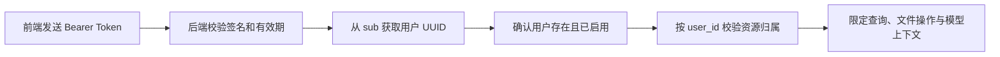

# 用户隔离实现说明

日期：2026-10-09。适用于当前工作区代码。相关验证见[用户数据完整隔离回归结果及分析](用户数据完整隔离回归结果及分析-20261009.md)。

## 隔离方式

项目使用共享 PostgreSQL 数据库，在应用层依据登录用户的 `user_id` 限定私有资源的读写范围。用户身份来自后端验证过的 JWT，资源 ID 只负责定位数据。没有按用户建立数据库或独立服务实例，也没有在本次修改中增加 PostgreSQL RLS 策略。

## 身份与接口入口

登录、注册和 OAuth Token 接口签发 JWT，将用户 ID 放在 `sub` 中。请求携带 `Authorization: Bearer <token>`，后端通过 `get_current_user_required` 校验 Token、将 `sub` 规范化为 UUID，并确认用户存在且启用。请求体或表单中的 `user_id` 不能替代该身份。

所有业务路由在应用注册时统一添加必须认证的依赖，各资源路由继续执行归属检查。登录、注册、Token 签发和 `/hello` 是公开业务入口；OpenAPI/文档页面不含私有业务数据。匿名私有请求返回 401，禁用用户返回 403；资源属于其他用户时，详情和变更通常返回 404，与资源不存在保持一致。研究事件列表则返回当前用户范围内的空列表。

相关代码：[应用统一认证](../backend/app/app_main.py)、[JWT校验](../backend/app/core/security.py)、[当前用户依赖](../backend/app/router/auth_router.py)、[归属查询](../backend/app/core/ownership.py)。

JWT 密钥必须是至少 32 字符的独立随机值；缺失、过短或已知公开示例值会阻止启动和签发 Token，解码失败时拒绝身份。本地 `.env` 原先使用公开示例值，现已替换为随机密钥，密钥未输出或写入报告。其他环境需在部署配置中提供自己的密钥，所有服务进程使用同一份配置。

## 各类数据的作用域

| 数据 | 访问作用域与实现 |
| --- | --- |
| 会话 | `ChatSession.id == session_id AND user_id == current_user.id`，并检查有效期；列表也按当前用户过滤 |
| 消息 | 先验证会话归属，再按会话 ID 读写消息，因此消息通过会话间接隔离 |
| 附件 | 同时匹配附件和所属会话的用户 ID，并检查会话有效期；聊天使用附件还要求它属于本次会话 |
| 知识库 | `KnowledgeBase.user_id == current_user.id`；创建资源时用户 ID 由后端填写 |
| 知识库文档 | 同时校验知识库归属和 `Document.user_id`；列表、切片详情、删除和批量操作都限定该范围 |
| 知识库向量/全文 | 通过已经授权的知识库 UUID 生成 `kb_<UUID>` 集合/索引名；用户 API 和后台写入设置 `allow_benchmark=False`，避免评测配置将私有数据重定向到共享语料 |
| 聊天知识检索 | 先筛选当前用户知识库，检索结果还必须对应当前用户拥有的本地文档；无归属残留切片不能进入模型上下文 |
| 长期记忆 | PostgreSQL 查询及 Milvus 检索包含用户 ID；共享记忆集合使用 `user_id` 表达式过滤 |
| 会话工作记忆 | Redis key 包含 `user_id:session_id`；构建或读取前校验会话归属，缓存内容也检查作用域 |
| 会话临时证据 | 存储层先验证用户与会话；向量层范围包含 `user_id + session_id`，继续限定主题和代次 |
| 研究任务与图检查点 | 外部请求先按 `ResearchRun.run_id + user_id` 授权，再读取、恢复对应图状态；检查点 thread ID 只用来定位执行位置 |
| 研究事件及历史成果 | 事件按运行 ID 和用户 ID 过滤；旧检查点及医学成果查询显式传入当前用户 ID |

内部检查点服务仍保留明确的可信 `user_id=None` 调用方式，供离线执行等内部场景使用；HTTP 私有入口始终传入已认证的真实用户 ID。数据库管理员及可信后台进程仍具有其数据库/文件权限，应用层隔离不改变这些权限。

## 文件与后台处理

附件和知识库上传先校验父资源归属，再保存文件。文件名去除客户端提供的目录信息；临时存储路径由服务端生成，包含用户 UUID、资源 UUID 和随机部分，文件权限为 `0600`。文件名相同也不会使用同一临时路径。

后台处理显式携带用户 ID，重新检查资源与父资源归属，并确认文件路径与数据库记录一致。知识库索引名从已授权文档所属的知识库生成。未授权的后台调用不能读取、解析或清理别人文件。聊天附件在保存本轮消息及调用模型之前整体授权，非法附件不会写入会话或进入模型上下文。

相关代码：[上传文件工具](../backend/app/core/uploads.py)、[附件接口与后台处理](../backend/app/router/attachment_router.py)、[知识库文档处理](../backend/app/router/knowledge_router.py)、[聊天上下文](../backend/app/router/chat_router.py)。

## 前端账号切换

登录或登出会清空会话列表、当前会话、知识库选择和聊天状态。登录时同步写入新的 Token，确保导航后的请求使用新的身份。会话请求记录发起时的版本，账号切换后旧版本的延迟响应不会写回当前账号缓存。

相关代码：[认证状态](../frontend/src/store/auth.ts)、[会话状态](../frontend/src/store/session.ts)。前端清理用于防止旧内容残留，后端仍负责实际访问权限。

## 旧文档 API 的变化

`/documents` 的四个接口保留为本地知识库适配层，不再调用共享 `DEFAULT_DATASET_ID` 的远端文档服务。每个接口都必须登录，并在查询参数提供当前用户的 `kb_id`：

| 接口 | 参数与行为 |
| --- | --- |
| `POST /documents/upload?kb_id=<UUID>` | multipart 文件上传，复用知识库上传/后台处理；指定 `index_name` 返回 400，索引由后端生成 |
| `GET /documents/list?kb_id=<UUID>` | 本人知识库的文档列表，支持分页、文件名关键词及本地文档 UUID 筛选 |
| `POST /documents/delete?kb_id=<UUID>` | body 为 `document_ids`；先校验整批文档，混入其他用户或其他库文档时拒绝整批授权，开始删除前无文件或索引变更 |
| `POST /documents/retrieve?kb_id=<UUID>` | body 为 `question` 和可选 `document_ids`；仅返回已授权本地文档切片，空 ID 列表返回空结果 |

缺少 `kb_id` 返回 422。文档 ID 使用本地 `documents.id` UUID，不使用旧远端数据集的文档 ID。上传格式与现有知识库接口一致，返回“已上传、后台处理中”，列表和检索沿用 `code/data` 外层结构。前端现有知识库页面已使用 `/knowledge-bases`，本次无需更改其 API 地址。

## 启用与历史数据

本次无需数据库迁移。重启后端使新密钥和路由生效，原 Token 会失效，用户需重新登录；前端修改需由开发服务重新加载或部署新构建。

历史匿名附件或附件/会话用户不一致的数据不再放行；文档/知识库用户不一致的数据也不通过新归属查询。旧共享数据集没有可靠的本地所有权，本次没有将它自动分配给任何用户。需要保留这类历史内容时，应先确定归属再迁入本人知识库；本次没有迁移、删除历史数据或启动生产服务。

## 验证边界

新增双用户测试包含真实 JWT、真实 HTTP 路由和 SQLite ORM，覆盖匿名、跨用户、跨会话、错误归属、过期资源、授权后的正常操作及文件副作用。外部 AI/DocMind/索引服务使用替身；真实 PostgreSQL、Milvus、ES、Redis 部署以及浏览器多标签行为没有完成端到端验证。具体测量与原始文件见回归报告。
