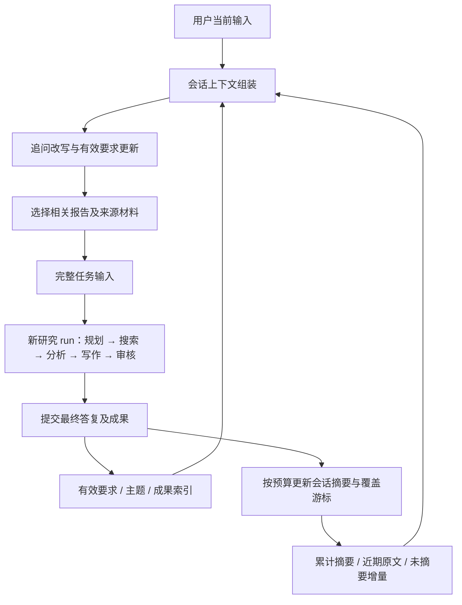

# 研究内历史隔离与追问路由删除实现及多轮会话链路方案

日期：2026-10-05，Asia/Singapore。对象：智能体工作历史、研究图追问路由、会话层多轮链路。本文记录源码实现、机制回归、现用数据库核查和后续方案；没有执行真实模型的开发集5题30轮实验。

## 一、交付状态与职责划分

本次已在源码中完成两项修改：智能体回放的内部工作历史以当前研究 `run_id` 为边界；删除执行图内的追问路由。会话层的完整摘要链路仍是待实施方案。

| 层次 | 应负责的上下文 | 本次状态 |
| --- | --- | --- |
| 会话层 | 用户与助手的历次对话、累计摘要、当前有效要求、相关报告与来源索引、追问改写 | 保留已有追问改写；完整链路改造见第五节 |
| 研究执行层 | 本次独立任务、显式传入的旧成果、各智能体在本次研究中的调用与工具历史 | 已完成按 run 隔离 |
| 存储审计层 | 全量原始对话、工作记录、摘要版本、检查点与来源正文 | 保留原始记录，模型输入按边界读取 |

同一研究中断后恢复继续使用同一个 run，可接续本研究历史。用户发起新的追问时创建新 run，不自动回放上一研究的规划、模型回复或工具消息。需要复用的报告与证据通过授权成果传递进入新任务。

“给智能体完整 query”适用于任务本身足以执行的情况。若用户要求“修改上一报告第二节”，还必须传入目标报告、章节标识和修改要求；一条改写后的问题不能替代修改对象。

## 二、已实现的源码修改

### 1. 工作历史、摘要与回读均限定当前研究

- `backend/app/service/agent_history.py` 新上下文标识包含用户、会话和 run；在该标识下再区分智能体与子任务。加载消息、加载工具来源和按原文 ID 回读均要求消息属于当前 run。
- 同 run 续跑保留调用序列与摘要。跨 run 即使知道旧消息 UUID，也不能通过 AgentMessage 回读接口取得旧工作消息。
- 兼容旧数据时，只导入当前 run 的原始消息，保留消息 UUID、内容和调用标识。可确认只属于该 run 且覆盖序号完整的旧摘要才继续沿用。混合多个 run 的旧共享摘要留在旧 context 供审计，不进入新模型输入。
- 摘要提示改为“本次研究该智能体的工作摘要”。现有按输入预算触发的研究内摘要、来源外置和回读保护仍可使用。本次没有强制开启 Architect 摘要，没有新增按固定内部调用次数强制摘要的策略。
- 新 run 的旧资料来自成果白名单与来源正文，不借用跨 run 的工作历史权限。模型仍可按本次任务需要看到旧报告材料，因此历史隔离不会阻止合理的多轮追问。

主要文件：`agent_history.py`、`agent_context.py`、`models/agent_history.py`。

### 2. 删除 agent 内部追问路由

- 删除 `deep_research_v2/followup_router.py`、对应路由测试以及 `FOLLOWUP_ROUTER_*` 示例配置。
- 图入口统一为 `START → plan`，移除 `followup_route`、`user_revision` 节点和按路由结果直接写作或补充搜索的分支。智能体工厂只创建 Architect、Scout、DataAnalyst、Writer、Critic 五个智能体。
- 删除 Writer 专用的 `revise_from_user` 路径；Critic 在本次研究中要求修订或重新研究的循环保留。
- 原正文长度检查从路由模块移到 `report_constraints.py`，保持原字符计数与超长拒绝交付语义。
- 普通 HTTP 入口始终允许 `ResearchContextService` 在会话层改写追问。已有同用户同会话成果继承保留，先进入 Architect 确认本轮需求与是否复用资料。
- 图版本更新为 `single-main-v3-run-history`。兼容已知旧普通主图；旧检查点若启用了被删除的路由，或待执行节点为上述删除节点，则明确拒绝恢复，要求新建研究。

主要文件：`graph.py`、`service.py`、`state.py`、`followup_context.py`、`agents/writer.py`、`research_router.py`、`.env.example`、`README.md`。开发集采集入口同步去掉路由与强制摘要配置，标明跨用户轮次不接续 agent 工作历史。

## 三、机制验证与原始结果

### 数据和配置口径

使用项目 `backend/.venv/bin/python`，Python 3.13；共运行12个 unittest 模块。设置 `TEST_AGENT_HISTORY_POSTGRES=1`：历史集成测试实际连接 PostgreSQL，创建隔离测试 schema，测试迁移、读写、续跑、隔离与并发后删除测试 schema。模型回复和外部工具均使用测试替身。未设置 `RUN_DB_INTEGRATION_TESTS=1`，四项研究事件数据库测试跳过。

原始文件位于 [研究内历史隔离与追问路由删除验证-20261005](../backend/eval/data/研究内历史隔离与追问路由删除验证-20261005/)：

- [修改前清单.json](../backend/eval/data/研究内历史隔离与追问路由删除验证-20261005/修改前清单.json) 及 `修改前代码快照/`：任务开始时相关源码与 SHA256。
- [第一轮回归结果.json](../backend/eval/data/研究内历史隔离与追问路由删除验证-20261005/第一轮回归结果.json)、`第一轮回归日志.txt`：首次回归失败及完整堆栈。
- [修复后回归结果.json](../backend/eval/data/研究内历史隔离与追问路由删除验证-20261005/修复后回归结果.json)、`修复后回归日志.txt`：最终测试结果。
- [交付清单与源码哈希.json](../backend/eval/data/研究内历史隔离与追问路由删除验证-20261005/交付清单与源码哈希.json)：22个已记录基线的修改、删除或新增文件及交付状态。
- [最终静态核对与补充文件清单.json](../backend/eval/data/研究内历史隔离与追问路由删除验证-20261005/最终静态核对与补充文件清单.json)：另两个适配文件的当前哈希，共24个源码、配置、测试文件；20个现存 Python 文件语法通过。两个补充文件没有修改前快照，未将 Git HEAD 冒充本次基线。
- [后端应用前只读检查.json](../backend/eval/data/研究内历史隔离与追问路由删除验证-20261005/后端应用前只读检查.json)、[现用数据库历史表结构.json](../backend/eval/data/研究内历史隔离与追问路由删除验证-20261005/现用数据库历史表结构.json)：现用数据库结构和待应用状态。

### 核心指标与逐类分析

| 指标 | 已测量结果 | 边界 |
| --- | --- | --- |
| 最终回归 | 158项：154通过，0失败，0错误，4跳过 | 机制测试，不是用户答案正确率 |
| 实际 PostgreSQL 历史集成测试 | 15项通过 | 隔离测试 schema，未迁移现用业务表 |
| 模型及搜索真实请求 | 0 | 没有模型成本、真实延迟或答案质量测量 |
| 静态核对 | 20个 Python 文件语法通过；路由模块与示例配置已移除；入口为 plan | 当前源码哈希与交付清单一致 |
| 开发集5题30轮 | 未执行 | 首次超限轮次、答案质量、真实压缩率尚未评估 |

逐类验证覆盖：

1. **工作历史边界**：同 run 续跑读回历史；同会话新 run 初始历史和摘要为空；跨 run 原文回读被拒绝；智能体和子任务隔离保留。
2. **旧数据接续**：旧独立 run 原始记录可导入；混合旧共享 context 只拆出当前 run 消息，另一 run 的消息和混合摘要留在旧 context，混合摘要不注入模型。
3. **持久化与并发**：两个 run 的消息序号各自递增；摘要写入与原文引用可重载；删除一个 run 后不会让其他 run 获得旧消息权限。
4. **研究图和恢复**：入口进入 plan；五个智能体创建；写作技术中断后续跑；普通旧图兼容；已删除路由的旧检查点拒绝恢复。
5. **需求与成果**：父成果保持待确认需求更新；主题切换、条件新增/替换/删除和版本更新；删除字数限制不会被旧报告或模型建议恢复；正文超出当前限制不能交付。
6. **原有预算机制**：摘要失败不覆盖原历史；硬预算超限在模型请求前阻止；运行冻结逐智能体配置。不能据此推断真实摘要的语义保真度。

### 首次失败样例及修复

第一次运行158项，有3项失败、1项错误、4项跳过，原始结果未覆盖：

| 样例 | 原因 | 修复 |
| --- | --- | --- |
| 旧迁移接续断言 | 原测试期望同会话的另一个新 run 读取旧历史，已与新边界冲突 | 改为按旧消息实际 run 恢复，并单独验证新 run 隔离 |
| v4摘要未产生 | 测试隐含 Scout 可回放，当前默认策略只回放 Writer | 在旧v4测试中显式冻结 Scout 策略，避免环境默认值影响 |
| 图入口集成没有预期待写节点 | 模拟用户ID进入真实父成果数据库查询，查询先失败 | 明确模拟父成果定位，图执行本身仍使用实际图 |
| 续跑错误地拒绝当前版本 | 本次恢复检查曾过度限制所有待执行节点名，误拒绝测试检查点 | 只拒绝已删除路由节点；保留图版本兼容规则 |

修复后同一组模块复评全部符合上述最终结果。四项跳过均为研究事件 PostgreSQL 测试开关未开启，不能计为通过；历史 PostgreSQL 测试已执行。

## 四、现用服务应用前的缺口

只读检查时没有活跃研究 run，但现用数据库 Alembic 版本为 `20260919_0008`；`agent_contexts` 109行，`agent_messages` 8596行，仍是旧表结构，缺少 `history_scope_id` 和消息级 `run_id`。这些是已有迁移尚未应用造成的部署缺口。

源码验证使用的历史 schema 来自已有0010、0011迁移，本次没有新增迁移。现用数据库尚未迁移，运行中的后端尚未重启，因此本报告不宣称运行服务已采用新行为。

必要应用顺序：

1. 保存现用数据库可恢复备份，确认历史表行数和旧字段口径，确认没有活跃研究任务。
2. 核查待应用迁移：0009为聊天时间统一UTC；0010为历史表创建兼容；0011增加 history_scope 和消息 run_id。直接 `alembic upgrade head` 会同时包含0009，须先核实旧聊天时间的来源和迁移假设。
3. 在数据库副本验证迁移顺序、回填 run_id、唯一约束和消息内容/行数保存，再应用到现用数据库。不要只 stamp 版本或跳过时间转换来假装已完成迁移。
4. 重启后端，进行新 run 隔离、同 run 恢复、追问成果传递的应用验收。0011没有可安全回退的降级实现，出现异常应使用事先备份恢复。

本次未连带执行聊天时间迁移，未改变现用业务历史记录。

## 五、建议的多轮会话完整链路（待实施）

### 1. 先形成一个统一的会话任务输入

在现有 `ResearchContext` 基础上定义稳定的数据契约，让生产入口和评测入口使用同一个 builder。至少包含：

| 字段 | 用途 |
| --- | --- |
| original_query / resolved_query | 原始用户要求及可独立执行的任务；保留两者供审计 |
| user_id / session_id / turn_id / topic_id | 所属权限、轮次与主题 |
| active_requirements / requirements_version | 当前有效范围、时间、来源、篇幅、格式等要求 |
| revision_instructions | 要改什么，区分改报告和新增研究问题 |
| selected_artifacts | 目标报告、相关章节及必要证据材料 |
| artifact_refs / source_refs | 可授权读取的材料标识、版本与内容哈希 |
| summary_version / covered_until / delta_message_ids | 摘要覆盖范围及尚未覆盖原文 |
| assumptions / unresolved_references / token_counts | 补全假设、待澄清指代、各部分输入成本 |

会话记录先保存原始输入，builder 排除本轮正在写入的消息，避免输入重复。当前 `ResearchContextService` 已有原问题、改写、假设和未消解指代，可扩展而不另造一套入口。

### 2. 在会话层理解追问并更新要求

改写只补足对象、范围、时间和指代；本轮显式要求优先，完整问题保持原意。不能把旧答案变成确定事实，也不能擅自新增目标。模糊的“第二个”无法可靠对应时，应进入澄清状态；已有 resolver 虽记录 `unresolved_references`，目前还缺少统一阻止歧义任务直接开跑的处理。

把需求的新增、替换、撤销、作用范围和主题切换作为结构化状态管理，记录本轮原文依据与版本。现有 `contract_updates.py` 可复用这些规则；后续将跨用户轮次的有效要求状态放在会话输出中，让 Architect 消费确认后的任务。实施期间须避免会话层和 Architect 对同一要求重复提交。

这一步不再判断跳到 Writer 还是 Scout。所有研究任务统一进入规划节点；Architect 仍负责本次执行计划、资料复用与研究任务拆分。

### 3. 旧成果按相关性选择，再显式交给本次研究

已有父成果继承目前定位最近一次已交付研究。对“回到最开始那个问题”或跨主题追问，最近一次报告可能不对。因此会话层需维护主题和成果索引，先按显式指代、主题与相关性选报告，再传必要章节、证据和来源引用。

成果权限仍限定当前用户与会话。旧报告是修改对象或历史结论，事实支持仍要回到来源正文。限制模型实际输入预算，完整大报告按章节提供并保留可回读引用。需要旧来源时通过成果材料读取，不重新打开旧 AgentMessage 权限。

### 4. 会话摘要采用“累计摘要＋近期原文＋未摘要增量”

现有 `semantic_context_service.py` 已有摘要版本、引用原文和覆盖消息游标，可作为基础；但默认开关关闭。现有 `session_memory_service.py` 与 `ResearchContextService` 又会对消息进行预算裁剪，不能仅开启开关就宣称完成可靠长会话支持。

建议 builder 明确分区和预算：摘要有固定预算，近期用户与最终助手答复保留完整对话，尚未被摘要游标覆盖的增量必须处理。摘要落后时读取全部未覆盖增量并做预算检查；增量已放不下时，先补做会话摘要再发起研究。不能静默截掉既不在摘要也不在近期窗口的消息。

摘要更新输入为“上一版累计摘要＋本次准备移出近期窗口的会话消息”，输出保留主题、实体、有效要求及撤销、关键结论、未解决问题、报告/来源引用。以预算或窗口变化触发，近期窗口大小可配置；这里计数的是用户会话消息，与智能体内部模型调用次数分别管理。

原始消息一直保留在数据库；失败时保留旧摘要与旧游标。并发提交需校验摘要基准版本和覆盖终点，防止较旧任务覆盖新摘要。最终研究答复提交后才作为完成成果进入会话摘要，工作过程和工具日志留在研究审计层。

### 5. 研究内部只按本次预算管理工作历史

每次研究接收上述完整任务输入和选定材料。只回放当前 run 的内部调用，技术恢复沿用该 run。窗口够时无需为了支持多轮用户对话而触发内部摘要；长研究仍可能独立超限，保留按实际输入预算的摘要、来源外置和硬预算检查即可。Architect 是否需要压缩由其本次输入大小决定，不能用 Architect 摘要替代会话记忆。

## 六、后续实施和30轮实验口径

建议顺序：统一会话 builder 和任务契约 → 有效要求与歧义处理 → 摘要覆盖及增量保护 → 成果索引与任务传递 → 应用部署与多轮验收 → 真实30轮实验。先用少量包含修改要求、撤销限制、主题切换、远距回指的对话验证链路，再进行开发集5题同会话30轮。

现有真实追问采集仍用评测辅助函数拼接历史，并非生产 `ResearchContextService` 的完整路径。本次只移除了路由与强制开关并修正元数据。正式实验必须统一入口，否则测到的是完整历史拼接或评测专用行为，不能用于评价会话摘要。

建议比较“当前 run 隔离＋现有会话上下文”与“当前 run 隔离＋新会话摘要”，冻结模型、输入/输出预算、搜索配置、问题次序、评判口径。先前跨 run 混合 agent 历史方案如需要作为旧基线，应使用保存的旧版本和单独运行目录。禁止临时强制 Architect/Writer 摘要后仍称为默认方案。

| 指标组 | 每轮记录 |
| --- | --- |
| 会话理解 | 原问题、改写、有效要求版本、主题、指代消解及误补全；要求保留/撤销正确率、主题污染样例 |
| 输入长度 | 摘要、近期原文、未摘要增量、成果、系统提示、每个智能体实际发送输入token；模型窗口和输出预留 |
| 摘要压缩 | 覆盖范围、前后token、耗时、调用/重试、摘要版本、失败原因、关键实体/要求/引用保留情况 |
| 成果传递 | 选中报告是否正确、章节/来源命中、引用版本、原文回读成功率 |
| 答案质量 | 逐题逐轮要求满足、事实及引用支持、无依据新增、修改是否生效；人工或标注依据可追溯 |
| 执行成本 | 改写、摘要、各智能体、核验分别计输入/输出token、调用数、耗时；有单价口径才计算费用 |
| 故障 | 首次超限用户轮次、内部调用序号、出错组件；区分模型输入窗口、研究累计token预算、网络/工具、交付门禁 |

会话摘要保留比 `r = 新摘要token / (旧摘要token + 本次被压缩原文token)`，压缩减少比例为 `1-r`。另记录整个模型输入的前后变化，避免只看摘要长度。重复摘要同一段原文不算新增覆盖。无可压缩内容时比例为不适用。完成30轮且没有超限时记录“观察范围内至少支持30轮”，不能外推无限轮。

## 七、结论与限制

**已测量**：当前源码的 run 内历史隔离、回读边界、旧混合摘要处理、路由删除和图恢复规则通过机制回归；结果为154通过、4跳过。现用数据库结构与迁移缺口通过只读查询确认。

**间接推断**：隔离可以消除跨研究自动累积内部历史这一输入增长来源；统一规划入口减少被删除路由造成的入口差异。这不等于已测量答案质量改善，也不证明本次长研究不会超限。

**尚未评估**：会话摘要完整实现、生产新行为、真实追问改写/摘要质量、开发集5题30轮正确率、首次超限轮次、真实压缩率与费用。

下一步应按第四节先处理已有部署缺口，并按第五节实现统一的会话任务输入与摘要覆盖机制，再使用相同入口进行30轮实验。本次交付完成源码历史隔离与路由删除，链路方案具备明确输入、状态、失败处理和测量口径。
