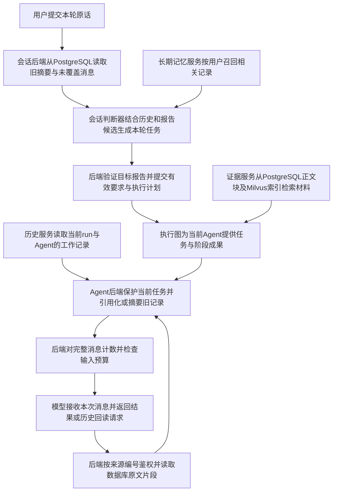

# 项目上下文机制实现、效果、不足、优化与面试要点

核查日期：2026-10-28，Asia/Singapore。评估对象：本仓库研究主链路的上下文准备、会话摘要、研究内历史、证据检索、报告继承和长期记忆，并检查普通聊天入口的差异。

源码 HEAD：`206cb4b868110567e3c1aaf1b5f73d46cbb2d6b1`。本次读取源码、在新 Python 进程加载本地 `.env`（继承环境变量优先），并复算历史 JSON；未调用模型、访问业务数据库、运行新研究或回归测试。未修改业务源码和配置，未核实已启动后端的环境及供应商当前可用模型。

本次原始结果：[配置与历史指标复核.json](../backend/eval/data/上下文机制全链路核查-20261028/配置与历史指标复核.json)。复现脚本：[核查与指标复算.py](../backend/eval/data/上下文机制全链路核查-20261028/核查与指标复算.py)。JSON 保存配置白名单、逐题复算、逐轮标注指标、证据路径和文件 SHA-256，不包含密钥。

补充核查：2026-10-28，针对用户追问细化Agent压缩触发条件。只读取执行分支并重新加载本地新进程配置，未新增模型实验或回归测试，历史效果指标口径不变。原始记录：[触发条件补充核查.json](../backend/eval/data/上下文机制全链路核查-20261028/触发条件补充核查.json)。

## 1. 判断与概念边界

项目已经形成分层上下文机制：**用会话历史理解追问，用结构化任务保存当前有效要求，用研究内历史保持工作连续性，用检索证据提供事实依据，用授权成果继承连接前后两次研究。** 用户级长期记忆是另一条可选召回路径。

“上下文”指后端本次实际发给模型的消息内容。数据库里的全部聊天、文献、报告和工作记录只是可用资料，不会自动全部成为模型上下文。token 是模型计量文本长度的单位，不能直接等同于一个汉字或一个单词。

效果判断：历史实验已经证明输入体积可以明显降低，也暴露了摘要遗漏、追问对象错位及当前证据过大的问题；**现有证据不足以证明当前版本长期对话始终正确，或端到端费用降低某个固定比例。** 历史实验多来自通用研究任务，不能直接当成医学场景的质量评估。

## 2. 一次追问如何变成模型输入

以假设任务为例：用户上一轮要求“仅纳入成年人、中文输出、正文不超过1200字”，本轮说“把当前报告缩到900字，并补充一个方面的证据”。这个例子只解释数据流，不代表运行结果。



这条流程有六个不同职责，不能笼统叫作“记忆”。

### 2.1 会话历史：记住用户和助手说过什么

`ResearchContextService.build` 调用 `RedisSessionMemoryService.get_context`。启用滚动摘要时，后者调用 `prepare_semantic_context`，从 PostgreSQL 获取旧摘要和摘要尚未覆盖的聊天消息。本轮 query 参与阈值判断，但不会又作为历史重复返回。

当前新进程配置：

- 历史和本轮 query 达到 `int(65536 × 0.85) = 55705` tokens 时尝试摘要。
- 摘要服务保留最近 **10条消息**，计数包含当前 query；这不是10轮，也不是会话总长度限制。
- 后端将较早前缀和旧摘要交给配置中的 `qwen3.5-plus` 生成完整新摘要，输出上限2000 tokens；摘要请求窗口配置为100万，与研究Agent的输入上限分开。
- 未触发时保留全部未覆盖消息，不再沿用旧的3000-token/12条二次裁剪。
- 后端在数据库事务中保存新摘要及“已覆盖到哪条消息”的位置，提交成功后采用新状态；失败回滚，不推进位置。
- Redis保存可重建结果；缓存命中也不能跳过本轮阈值判断。会话摘要在消费历史前执行，和后台长期记忆提取不同。

例如数据库已保存消息1—100，摘要覆盖到80，那么后端通常给消费者提供“消息1—80的摘要＋81—100的原文”。原始1—80仍可保留在数据库中，但不再自动全部进入这次模型请求。

源码：[会话读取](../backend/app/service/session_memory_service.py:288)、[摘要准备及事务](../backend/app/service/semantic_context_service.py:261)、[切分与生成](../backend/app/service/session_summarization.py:131)。

### 2.2 本轮任务：知道用户现在要做什么

会话判断器读取历史、长期记忆和同用户同会话的已交付报告候选，判断是否延续话题、是否依赖历史、目标报告是哪份，以及需要编辑、补证或重新规划。最新原话位于最后一条独立用户消息；历史与报告query明确作为参考材料。

后端再次校验候选归属、报告版本及操作协议。`prepare_task` 把本轮要求合并进有效任务约束，例如把字数上限从1200改为900，保留未被取消的成年人范围。这里的“任务契约”就是后端保存的结构化要求集合，不是自然语言摘要的别名。

执行图根据已验证计划选择路径：纯编辑走Writer与Critic；补证增加Scout和分析；改变实质范围或新研究进入Architect完整规划。新话题清空供执行使用的旧对话与旧记忆；指代不清时先产生澄清答复。

当前还检查一种确定错误：模型给出的改写若不同于本轮、却精确复制历史问题，后端要求模型重判整份任务，最多重判一次；持续错位则停止执行并澄清。它只能识别该类可确定错位，不能保证所有语义改写正确。

源码：[构建入口](../backend/app/service/research_context_service.py:115)、[当前任务置末及重判](../backend/app/service/research_context_service.py:322)、[要求提交](../backend/app/service/deep_research_v2/session_task_execution.py:10)。

### 2.3 研究内历史：让一个Agent接续自己已经做过的工作

一次用户问题可能包含多次搜索、正文读取、写作和返工；这些内部调用和用户聊天轮次是两个计数口径。研究状态中的大纲、证据、章节、审核意见通过执行图的状态字段交接；某Agent回放自己的历史则是另一条路径。

`PostgresAgentHistory` 是操作 PostgreSQL 工作历史的服务对象。后端按用户、会话、`run_id`、Agent、子任务和策略作用域保存及读取原始输入、工具结果和模型输出。新研究不会自动继承上一研究全部Agent轨迹；同run技术恢复继续自己的记录、摘要及覆盖序号。

当前本地新进程实际开关如下，不能只复述README中的旧默认值：

| Agent | 回放内部历史 | 资料引用化/外置 | 模型摘要 | 摘要语义核验 |
|---|---|---|---|---|
| DeepScout | 开启 | 关闭 | 关闭 | 关闭 |
| LeadWriter | 开启 | 开启 | 开启 | 关闭 |
| ChiefArchitect、DataAnalyst、CriticMaster | 关闭 | 不进入该历史路径 | 关闭 | 关闭 |

关闭内部历史回放不代表Agent没有任务、证据或上游阶段成果。它仍然读取业务状态组装的当前输入。已有run使用冻结策略，修改本地配置不会自动改变已有run。

Writer统一经`BaseAgent.call_llm → prepare_agent_messages`组装请求，处理顺序是：

1. 后端将最新有效要求放入系统消息，并单独保留当前任务输入，标明历史和工具文本只是参考材料。
2. 后端加载旧摘要和未覆盖历史，在Python内存中构造发送视图。
3. 整体输入达到17000 tokens后，后端先把旧输入中的已保存材料、旧输出和工具正文替换成来源引用。较早工具参数和正文使用不同条件；最近5条历史的工具参数受保护。引用包含来源编号，必要时包含字符位置；工具正文保留预览。
4. 若处理后的输入仍达17000 tokens，摘要器才总结连续、已结束的调用。当前调用和仍在执行的调用形成边界，避免只总结工具输入而丢下对应输出。配置中的`summary_ratio`并不是当前执行阈值，源码实际使用软阈值。
5. 摘要器读取的是完成引用替换后的视图；超过摘要请求预算时分块生成再合并。正文包含`SESSION INTENT`、`SUMMARY`、`ARTIFACTS`三栏目，分别记录目标、进展/限制/未完成事项和资源，输出上限3000 tokens。
6. 后端检查格式及是否缩短，再按期望版本更新摘要和覆盖序号。版本冲突时不采用过期结果。数据库事务成功提交后，后端才把新摘要加入当前发送视图。
7. 后端重新统计完整消息，超过硬预算则抛出`ContextBudgetExceeded`，不会靠静默删除当前任务强行发送。

本次加载配置中的Agent摘要模型是`qwen3-max`。Claimify，即把摘要拆成可逐项审查的小论断的后处理流程，目前关闭；Writer摘要语义核验也关闭。即使开启，当前生命周期也是正文先提交、审计后更新状态，不能声称所有摘要均在事实核验通过后才使用。

源码：[Agent入口](../backend/app/service/deep_research_v2/agents/base.py:120)、[组装与压缩](../backend/app/service/agent_context.py:418)、[原文鉴权及摘要提交](../backend/app/service/agent_history.py:292)、[正文先提交](../backend/app/service/summary_lifecycle.py:23)。

### 2.4 原文回读：引用代表去哪里取，不代表模型已经看过全部内容

**触发条件补充（2026-10-28）：** 后端在每次供应商模型请求前检查，包括模型请求回读原文后的下一次请求。软阈值为`min(soft_token_cap, int(soft_ratio × 可用输入预算))`；本地配置代入为`min(17000, int(0.85 × 65536)) = 17000`。计数对象是组装后的整次输入消息，包含系统规则、任务约束、旧摘要/未覆盖历史、回读循环消息及当前输入，不是只统计旧历史，也不是按用户轮数触发。

启用对应方法时，整体输入`>=17000`先进入资料引用化/外置；完成后重新计数，若仍`>=17000`、该Agent允许摘要，且有上次覆盖位置之后连续完整、可安全覆盖的历史调用，才尝试生成历史摘要。当前调用和仍在执行的调用不进入这批全局摘要候选。达到阈值没有候选时，不会凭空生成摘要。比如30000先外置到12000无需摘要，30000外置后仍20000且有候选才尝试摘要；这些数值是说明条件的假设例子，不是新增实验。

`thresholds()`虽计算`int(0.95 × 65536)=62259`，实际组装函数明确执行`summary_threshold = soft_threshold`，所以62259不是当前摘要触发点。若同一调用内有至少两次回读响应（包括错误响应），且存在未覆盖的较早记录，另一路局部摘要也在总输入达17000时尝试压缩较早回读过程，保留最新请求与响应；它不推进全局历史覆盖位置。独立证据提取批次跳过上述历史回放/压缩路径。最终输入`>65536`时抛出预算异常，等于预算不会因该检查被拒绝。上述数字只代表本地新进程配置，已有run仍使用其冻结策略。

模型若需要某段已外置材料，可返回`_history_read`，包含`source_id`及字符范围。后端验证当前run、Agent、子任务、来源哈希和范围，从PostgreSQL读取片段，加入下一次模型请求；模型本身不直接连接数据库。回读后的请求仍重新经过组装和预算检查。

原文保留意味着“具备可回查条件”，不等于“模型一定知道何时回查，也不等于所有历史细节都在当前窗口”。这条Agent回读权限仅覆盖本run对应上下文，不能用它任意读取上一研究内部轨迹。

### 2.5 证据检索：从大量文献中选择本次需要的材料

RAG在本项目中的具体含义是：后端先从已有资料中找相关片段，再把这些片段提供给生成模型。会话证据服务把正文和证据块保存到PostgreSQL，把用于相似性检索的向量存到Milvus；研究状态主要携带来源引用。

检索同时进行词语匹配和向量相似检索，再按两个排序中的名次融合候选，随后使用重排模型细排。当前配置模型为`text-embedding-v4`和`qwen3-rerank`。结果还会补相邻块、检查用户/会话/主题及版本，并按token预算装入请求。向量或重排失败时会记录降级状态。

| 检索用途 | 选择的数据 | 当前配置预算 |
|---|---|---|
| 写作/理解材料 | 段落、章节、表格、结构记录，默认前8个候选并可补邻居 | 8192 tokens，包含结果JSON |
| 逐项引用核验 | 句子、表格、结构记录，默认前5个候选并可补邻居 | 每条检索2000 tokens |

`fit_evidence_prompt`在Agent发送前为历史默认预留4096 tokens；请求太长时移除完整证据单元，不截断半句或半个表格。最终仍由Agent检查所有消息的总输入。这处理“当前材料太大”，与摘要处理“旧工作历史太长”相互补充。

源码：[临时证据检索](../backend/app/service/session_evidence_rag.py:215)、[发送前证据预算](../backend/app/service/session_evidence_rag.py:443)、[正文权威存储](../backend/app/service/session_evidence_store.py:26)。

### 2.6 成果继承与长期记忆：作用范围不同

同会话追问修改报告时，后端从明确选择且再次授权的已完成run加载报告、章节、来源、事实及要求，检查报告哈希，生成新run。白名单继承业务成果，不把旧运行的可变执行进度直接当成新运行状态。Architect获得有界成果索引；旧报告用来理解编辑对象，新增事实仍需回到证据。

跨会话长期记忆由后台任务从聊天提取摘要、偏好和原子事实等内容；PostgreSQL保存记忆及权限状态，Milvus提供检索索引。研究入口按用户召回最多5项，再适配默认2000-token记忆预算。此处不是按课题档案检索；话题判断为新时，执行链会清空这批历史记忆。因此它既可能缺少课题隔离，也不能自然保证新话题仍沿用所有通用偏好。

源码：[授权成果继承](../backend/app/service/deep_research_v2/service.py:435)、[成果字段白名单](../backend/app/service/deep_research_v2/followup_context.py:12)、[长期记忆召回](../backend/app/service/research_context_service.py:225)、[记忆权限复核](../backend/app/service/memory_service.py:1218)、[后台记忆任务入队](../backend/app/service/memory_service.py:1468)。

## 3. 预算和存储边界

研究Agent输入预算按下式计算：

`可用输入 = min(单次输入上限, 配置窗口 − 本次输出预留 − 安全余量)`

本地新进程五个研究Agent的输入预算均为65536 tokens。Writer配置窗口250000、输出上限60000、安全余量1024，故输入仍取65536。不能把摘要模型百万窗口说成所有研究请求都能接收百万token；这些值是项目配置，未在线核实供应商原生窗口。

普通聊天`ChatService.get_chat_completion`和会话任务判断器直接调用模型客户端，没有统一走研究Agent这套完整请求适配。判断器虽有累计调用预算预留，也不等于每个请求有同样的上下文窗口保护。源码：[预算](../backend/app/service/context_policy.py:64)、[普通聊天](../backend/app/service/chat_service.py:174)。

| 数据或对象 | 所在位置及作用 | 保存边界 |
|---|---|---|
| 聊天原始消息、Agent原始记录、摘要及覆盖位置 | PostgreSQL | 事务commit成功才是应用确认提交的边界；flush本身不等于提交 |
| `messages`、`views`、当前回读循环 | Python程序内存中的对象 | 仅组装对象不代表保存到数据库；最终消息通过客户端发给模型 |
| 会话派生结果 | Redis缓存 | 可从数据库重建，不是聊天原文的唯一副本 |
| 文献正文及证据块 | PostgreSQL临时证据表 | 证据入库事务成功后可按编号读取；受会话生命周期约束 |
| 向量索引 | Milvus | 可辅助召回，不替代PostgreSQL的权限、原文和有效版本复核 |
| 执行图检查点 | 研究状态的持久化快照 | 用于恢复执行位置，不会自动把全部快照变成模型消息 |

压缩不删除其原始历史，但业务会话和临时证据有24小时空闲过期机制，新消息可以续期，不能承诺原文永久可回读。本次未审计数据库WAL及存储耐久配置，未把数据库flush、内存更新或操作系统缓存写入等同于断电后必然可恢复。评估档案另存于仓库，不属于业务TTL清理对象。

## 4. 效果：分清输入容量、信息质量和真实交付

### 4.1 五题历史生命周期回放：输入显著缩小

实验日期2026-10-02，对旧DeepScout轨迹回放，输入预算25744，与当前Writer配置不同。原始结果：[汇总结果.json](../backend/eval/data/已有中文五题摘要与引用评估-20261002-151935/真实生命周期回放/汇总结果.json)。本次按`1−最终输入/处理前输入`重新计算。

| 题号 | 处理前tokens | 引用化后 | 工具外置后 | 最终tokens | 输入减少 | 提交摘要 |
|---|---:|---:|---:|---:|---:|---|
| 16 | 141960 | 130090 | 26899 | 8366 | 94.11% | 是 |
| 31 | 438986 | 375526 | 59398 | 16219 | 96.31% | 是 |
| 35 | 352802 | 316881 | 52157 | 13653 | 96.13% | 是 |
| 46 | 341888 | 296519 | 48406 | 10945 | 96.80% | 是 |
| 49 | 35234 | 35234 | 8560 | 8560 | 75.70% | 否 |

五题都进入当时预算、原始记录未改变；同一输入二次组装均无新增模型请求。第49题只靠外置即可满足阈值，是“先引用/外置，再按需摘要”的直接例子。这里的缩减来自多种方法共同作用，不是纯摘要压缩率；处理前计数也不代表供应商真正接受过超长请求。

### 4.2 七份自然摘要诊断：有明显信息损失

实验日期2026-10-04，来自五题轨迹中四题触发的七份摘要，与上一组回放不是同一批摘要。每份由模型选出16项重要检查点，人工标注数为0。原始结果：[分析复算指标.json](../backend/eval/data/最新五题自然摘要引用核验与人工审核-20261004-000500/结果深入分析-20261004-020050/分析复算指标.json)。

| 摘要样本 | 完整保留/16 | 部分保留 | 遗漏 |
|---|---:|---:|---:|
| 31-LeadWriter-1 | 6 | 4 | 6 |
| 46-DeepScout-1 | 16 | 0 | 0 |
| 46-LeadWriter-1 | 6 | 3 | 7 |
| 46-LeadWriter-2 | 12 | 2 | 2 |
| 16-LeadWriter-1 | 11 | 4 | 1 |
| 49-DeepScout-1 | 14 | 2 | 0 |
| 49-LeadWriter-1 | 14 | 2 | 0 |
| 合计 | **79/112，70.54%** | **17** | **16** |

Writer合计49/80完整保留，即61.25%；不同角色材料和检查点不同，不能直接用此排名模型能力。历史失败样例包括将“城镇新建建筑”概括成“新建建筑”、保留10—20BP但漏掉“3A级房企”条件。问题在于数字的适用对象和条件丢失，保留数字本身仍可能导致误用。

历史自动核验的177项论断中139项被标为支持，比例78.53%，另有23项证据不足和15项矛盾。该比例不是人工事实准确率；历史核验后端与当前配置不同，自动标签也有主体/时间未对齐的误判。

那套核验相关流程共有459次模型调用，输入2098143、输出55101 tokens，平均约65.6次调用/摘要。它说明审计可能有明显开销，但当前关闭该流程，不能将历史开销算作当前默认成本，也不能凭一次输入变短推导净省钱。

### 4.3 第24轮失败与后续RAG回放：历史压缩不足以解决当前证据过大

旧长对话经分段修复续跑累计交付23轮；第24轮完整输入从136387降到66975，仍超65536。当前受保护输入已达65457，其中证据文本61111。历史摘要已经采用，这次失败的主要容量来源是当前证据。

10月8日补充离线RAG回放将同口径受保护输入从65457降到11662，缩减82.18%。回放保留131份原文，选择3个证据单元；11份旧文档因表格格式或单元超预算不可索引。其检索用二维向量和词法精排替身，没有生成答案，也没有重新构造完整历史上下文，因此只证明输入预算改善，未证明相关证据都找到了或第24轮真实交付成功。

原始结果：[旧失败构成](../backend/eval/data/第20题32轮待合并结果恢复续跑-20261008-184009/第24轮超限输入构成与压缩分析.json)、[最终补充回放](../backend/eval/data/会话临时双层RAG实现验证-20261008/第24轮预算补充回放-20261008-205534/第24轮失败材料输入预算回放结果.json)。这里采用20:55最终回放的11662，未混用较早版本11942。

### 4.4 本轮任务理解：能交付不代表在做正确任务

10月17日对旧32轮计划的24轮实际执行记录进行离线标注，本次复算如下：

- 话题关系正确20/24，83.3%。
- 主操作正确16/24，66.7%。
- 话题、历史依赖、主操作联合正确14/24，58.3%。
- 再要求目标基稿与本轮问题正确，仅8/24，33.3%。

这是单个长会话、单标注者非盲评诊断，不是整个产品准确率。第14轮用户已要求Python改TypeScript，旧模型响应却继续处理第13轮的连接/会话术语，虽有报告交付，也没有完整执行本轮要求。

当前代码已将本轮独立置末并加入精确复用防护。10月17日历史坏响应回放识别10/10，另4个未复用响应未误报；这证明防护识别能力，不是修复后的真实生成准确率。当天配对生成因旧型号404和替代型号账户拒绝未完成，当前供应商状态本次未核实。

原始结果：[逐轮标注](../backend/eval/data/研究入口继承判断准确率标注-20261017/逐轮标注.jsonl)、[防护复评](../backend/eval/data/研究入口本轮问题错位修复与同轨迹复评-20261017-135458/历史原始响应防护复评.json)、[复评边界](../backend/eval/data/研究入口本轮问题错位修复与同轨迹复评-20261017-135458/本次复评指标与边界.json)。

## 5. 不足及优化顺序

以下是建议，均未在本任务实施，不应写成已完成优化。

| 优先级 | 当前问题与依据 | 建议 | 验收指标 |
|---|---|---|---|
| P0 | 会话摘要触发只计历史和query；证据装包固定预留4096；聊天、判断器和Agent预算入口不同 | 统一完整请求组装器，先计算系统提示、要求、输出格式、当前任务及输出预留，再动态分配报告、证据、历史和记忆预算；以整次请求计数收口 | 完整输入超限率、当前要求丢失率、长报告成功率 |
| P0 | 摘要会遗漏适用对象和条件；当前摘要审计关闭 | 继续使用现有结构化要求，补充有来源的关键事实字段：主体、时间、单位、比较基准、条件、状态、来源ID。摘要描述进度，关键约束由版本化字段承载；不把所有事实都复制进固定头部 | 早期约束正确使用率、变更/撤销正确率、条件遗漏率 |
| P0 | 旧路由有任务滞后一轮，当前防护只识别精确复用 | 固定历史输入重测修复后判断；覆盖语义相近但不逐字相等的错位、回到早期报告、组合修改和范围撤销；持续保存原话、候选、原始响应和实际执行计划 | 本轮动作、目标报告、要求变化的联合正确率；误澄清率 |
| P1 | 引用可回读不代表模型会正确回读；回读会增加请求 | 为关键来源建立简短可检索目录，按当前问题主动检索旧约束和必要片段；相同source/range去重，限制无效回读及总耗时，出现缺失时保留明确状态 | 正确来源命中率、回读后回答正确率、重复回读次数、P95延迟 |
| P1 | 当前DeepScout回放原文但关闭引用/摘要 | 按角色固定轨迹消融，先比较仅引用外置，再比较按需摘要；不能未经质量验证统一开启所有Agent压缩 | Scout输入峰值、重复检索次数、证据召回率、后续交付质量 |
| P1 | 证据检索预算改善未证明召回；历史文档有分块失败 | 为原始段落/句子标注相关性及反证，按章节构造检索问题；修复可确认的表格提取问题，保留不可索引原因；检查邻居补充是否保全条件 | Recall@k、必要条件覆盖、引用支持率、不可索引文档率 |
| P1 | 用户长期记忆混合偏好、课题事实与摘要；新话题又清空记忆 | 将稳定偏好作为独立配置，按课题保存范围与版本，事实保留时间与来源；当前明确要求覆盖默认值，跨课题内容需匹配后才引入 | 跨课题误用率、过期结论误用率、偏好遵循率 |
| P2 | 会话摘要持有数据库行锁时调用模型；递归摘要可能累积遗漏 | 考虑锁外生成、按版本条件提交并有界重试；设置关键条件检查和按需从原文重建。需要测试并发冲突，不能以降低锁等待牺牲覆盖位置一致性 | 锁等待、重复摘要率、版本冲突恢复率、累计保真率 |
| P2 | 历史全量摘要核验调用很多；当前关闭后又缺少质量保障 | 先验证轻量字段/来源检查，再对新增或高风险事实做选择性语义审计；对稳定来源缓存审计，错误审计不自动抹掉原文 | 每次摘要净token、耗时、人工复核的漏检与误判 |

首要工作应是完整预算和当前任务正确性；盲目提高压缩率，可能得到更短但更容易遗漏约束的输入。

## 6. 怎样补齐效果证明

先做固定历史轨迹回放，比较“无压缩、仅引用外置、引用外置加摘要”；每组保持输入资料、模型、提示词及预算一致。再单独比较是否使用证据检索，避免把RAG筛选和摘要效果混成一个数字。无压缩超限应如实记录为超限，而非偷偷提高某一组窗口。

随后做固定的真实多轮任务，覆盖早期约束追问、更新/撤销约束、跨话题返回、指定旧稿、长报告、同来源多次使用、反证和工具失败。先用30轮验收，再扩展；轮数本身不是质量指标。

同时记录：完整请求输入量及超限率、原始要求与当前有效要求的准确使用、事实条件保留、检索召回及引用支持、目标报告选择、正确交付率、总调用数、输入输出token、摘要/回读/核验单独开销、P50/P95延迟。计费模型和缓存口径固定后再计算货币净成本。由独立人工检查点和后续回答验证保真，不能只让同一个模型评价自己生成的摘要。

## 7. 面试可直接使用的回答

### 约90秒主回答

> 这个项目的研究流程会反复搜索、读取文献、写作和修改，所以一轮用户问题可能产生大量内部调用。我的上下文设计分几类信息处理：会话层用旧摘要加未覆盖原文理解追问，任务层单独保存当前有效要求和目标报告，Agent层保存本次研究的工作轨迹，证据层从文献库检索本次需要的原文片段。
>
> 在Agent调用前，后端先保护当前任务，把已经保存的重复材料替换成可回读引用；仍超阈值才生成摘要。原文留在PostgreSQL，模型需要细节时返回来源编号，由后端鉴权读取。摘要与覆盖位置按版本提交，最终对完整消息计数，避免静默截断当前要求。不同研究、Agent和子任务有独立作用域。
>
> 历史五题轨迹回放中，这套组合方法把输入减少了75.7%到96.8%，五题都进入当时预算。但另一批七份自然摘要只完整保留了模型检查清单中约70.5%的信息，所以我不会把压缩率当成准确率，也不会直接说节省同等费用。我们还遇到过历史已经压缩、当前证据仍把输入撑满的失败，因此又接入按问题检索证据和完整单元预算裁减。
>
> 后续我会优先统一完整请求预算，把关键条件和有效要求从自由摘要中分离，并在固定多轮任务上同时测正确交付、信息保留、召回、延迟和总token。优化目标是预算内继续正确完成任务。

“我的设计/我负责”仅在本人确实负责对应模块时使用；可以按实际工作替换成“我负责核查并优化……”。本次代码核查不能证明个人完成了全部实现。

### 追问速答

- **为什么不只保留最近几轮？** 早期用户范围和决策仍可能有效。现有方案用结构化要求保存当前约束，用摘要保存进展，同时保留近期原文；细节需要检索或回读。
- **为什么不只用向量数据库？** 相似片段适合回答“哪些材料相关”，不能单独表达“900字已经覆盖1200字”“本次应编辑第几版报告”这类确定状态和操作关系。
- **为什么不直接用大窗口模型？** 更大窗口仍有输入上限，重复证据和无关旧任务仍可能干扰；但本项目没有做固定质量的大窗口成本对照，不能声称当前方案必然更便宜。
- **上下文压缩是否无损？** 引用替换保留原文及回查入口；摘要和检索选择都有信息遗漏风险。数据库未删不代表模型本次看到的内容无损。
- **怎么防止多Agent串历史？** 按用户/会话/run/Agent/子任务隔离工作记录。跨Agent通过明确业务状态传递成果，跨run修改通过授权父报告和白名单继承。
- **摘要游标是什么？** 后端保存的覆盖序号，例如覆盖到100意味着下次可以用摘要代替1—100，再追加后面的记录；它不是删除指针。提交还校验旧版本，避免并发摘要覆盖新状态。
- **摘要都核验了吗？** 当前Writer摘要核验关闭，正文有未核验标记；报告引用核验是独立链路，不能混称。
- **最多支持几轮？** 没有当前版本固定轮数保证。旧运行经修复续跑累计交付23轮，第24轮失败；容量模拟的200步不是200轮真实对话，交付也不等于每轮正确。
- **最有价值的失败案例？** 第24轮历史已压缩，但当前证据占61111 tokens，完整输入仍超限。这促使上下文治理从“缩短历史”扩展到“当前证据也按需检索并参与统一预算”。

## 8. 结论与本次证据边界

已测量：本次有效配置、历史JSON逐题/逐轮指标复算及文件哈希；历史实验测得的输入缩减、自动质量标签、离线RAG装包和错位防护结果。

间接推断：统一预算、关键条件结构化、按角色配置及问题驱动回读有望改善现有问题；持锁调用模型可能造成同会话等待，尚未测并发性能。

尚未评估：当前版本端到端质量增益、净费用收益、真实多轮上限、跨主题召回质量、当前模型在线可用性，以及本报告优化建议的实际收益。本次没有新增模型测试，旧测试通过数不计为本次验证结果。

复现本次本地核查：

```sh
backend/.venv/bin/python backend/eval/data/上下文机制全链路核查-20261028/核查与指标复算.py
```

这条命令重算本报告对应的本地核查文件，不运行完整研究或付费模型。后续开展新评估应使用新目录并保留本次历史结果。
